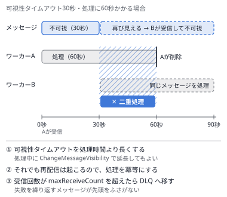
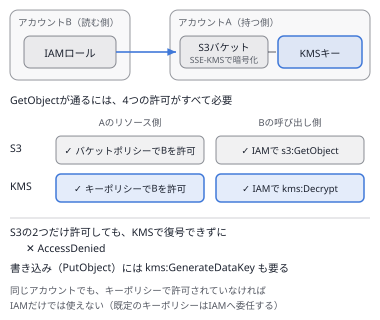
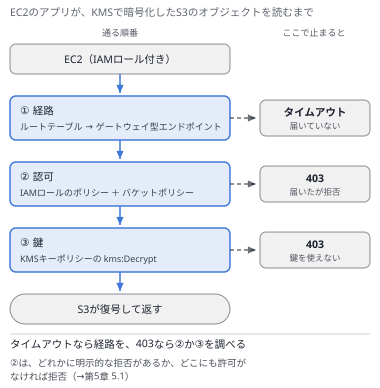
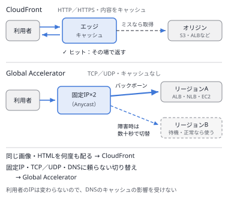
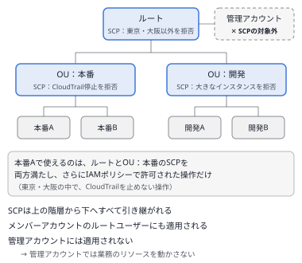
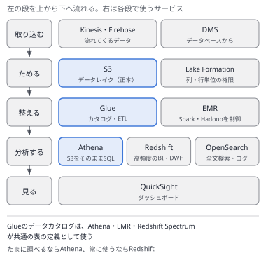
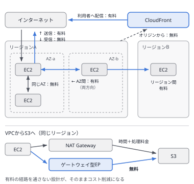

# 問題セット34 ｜ 実戦演習⑨（選択肢の差が一語の問題・15問）

> 全15問・目安30分。各問の「解答と解説」を開くと正解が表示されます。
> 本試験の問題は含みません。出題形式に沿ったオリジナル問題です。
>
> 第1分野5問／第2分野4問／第3分野3問／第4分野3問を分野を伏せて並べ、複数選択を2問含めています。
> どの問題も、選択肢は同じ文の形で書かれ、違うのは**設定値・条件キー・サービス名・適用先**の一語か二語だけです。
> キーワードの一致では選べないので、設問の要件を1つずつ選択肢に当てて、どこで外れるかを確かめてください。

---

### Q1 ｜ 二重に処理される注文 ｜ ★★

EC2上のワーカーが、SQSの標準キューから注文のメッセージを受け取って処理しています。1件の処理には最大で4分かかり、ワーカーは処理の最後にメッセージを削除します。キューの設定は作成時の既定値のままです。注文が多い時間帯に、**同じ注文が2回処理される**ことがあります。最も適切な設定の変更はどれですか。

- **A.** キューの配信遅延を6分にする
- **B.** キューのメッセージ保持期間を6分にする
- **C.** キューの可視性タイムアウトを6分にする
- **D.** キューの受信メッセージ待機時間を6分にする

解答と解説

**正解：C**

**分野**：2.1 スケーラブルで疎結合な設計

**決め手**：可視性タイムアウトの既定値は30秒です。4分かかる処理の途中でメッセージが再び見えるようになり、別のワーカーが同じメッセージを受け取ります。可視性タイムアウトを処理時間より長くすれば、処理中のメッセージは他のワーカーに渡りません。標準キューはまれに同じメッセージを2回配信するため、処理を冪等にする対策もあわせて必要です。

**キーワード**：可視性タイムアウト ＞ 1件の処理時間

**他の選択肢を外す理由**
- **A**：配信遅延は、送信してから最初に見えるようになるまでの時間です。受信した後に隠しておく時間は変わりません。
- **B**：保持期間を6分にすると、6分以内に処理されなかった注文が消えます。重複は減りません。
- **D**：受信メッセージ待機時間はロングポーリングの設定で、最大20秒です。空の応答を減らすためのもので、重複とは関係ありません。

**参照**：[第6章 6.1 Amazon SQS](../docs/06-integration.md)

---

### Q2 ｜ 別のアカウントからの暗号化オブジェクトの読み取り ｜ ★★★

アカウントAのS3バケットのオブジェクトは、アカウントAの**カスタマー管理キーを使ったSSE-KMS**で暗号化されています。アカウントBのEC2上のアプリケーションは、IAMロール `app-role` を使ってこのオブジェクトを**読み取る**必要があります。書き込みは行いません。**必要な設定を3つ選択してください。**

- **A.** アカウントAのバケットポリシーで、`app-role` に `s3:GetObject` を許可する
- **B.** アカウントAのキーポリシーで、`app-role` に `kms:GenerateDataKey` を許可する
- **C.** アカウントAのキーポリシーで、`app-role` に `kms:Decrypt` を許可する
- **D.** アカウントBの `app-role` のIAMポリシーで、`s3:GetObject` と `kms:Decrypt` を許可する
- **E.** アカウントAのバケットの既定の暗号化を、AWSマネージドキー（`aws/s3`）に変える
- **F.** アカウントBの `app-role` のIAMポリシーで、`s3:GetObject` と `kms:GenerateDataKey` を許可する

解答と解説

**正解：A・C・D**

**分野**：1.1 安全なアクセス／1.3 データセキュリティ管理

**決め手**：アカウントをまたぐアクセスは、**リソースの側（バケットポリシーとキーポリシー）**と、**呼び出す側（アカウントBのIAMポリシー）**の両方で許可が必要です。さらにSSE-KMSのオブジェクトを読むには、S3の権限とは別に、キーを使う権限が要ります。読み取りで使うのは `kms:Decrypt` です。

**キーワード**：クロスアカウント＝リソース側と呼び出す側の両方で許可／読み取り＝kms:Decrypt

**他の選択肢を外す理由**
- **B**：`kms:GenerateDataKey` は、新しいオブジェクトを暗号化して書き込むときに使う権限です。読み取りには使いません。
- **E**：AWSマネージドキーのキーポリシーは利用者が変更できないため、別のアカウントに使用を許可できません。かえって読み取れなくなります。
- **F**：`kms:GenerateDataKey` では復号できません。読み取りに必要な `kms:Decrypt` が抜けています。

**参照**：[第5章 5.8 AWS KMS](../docs/05-security.md) ／ [第11章 11.5 設計ケーススタディ](../docs/11-secure.md)

---

### Q3 ｜ 移行の予定がある環境の割引 ｜ ★★

ある会社は、東京リージョンでEC2（m5ファミリー）、ECS on Fargate、Lambdaを常に使っています。今後3年間の利用は確実です。半年以内に、EC2の多くをGravitonのm7gファミリーへ移し、一部のワークロードはFargateへ移す予定です。**移行の後も、EC2・Fargate・Lambdaのすべてに割引が適用され続ける**購入方法はどれですか。

- **A.** 3年のEC2 Instance Savings Plans（m5ファミリー・東京リージョン）を購入する
- **B.** 3年のCompute Savings Plansを購入する
- **C.** 3年のスタンダードリザーブドインスタンス（m5・東京リージョン）を購入する
- **D.** 3年のコンバーティブルリザーブドインスタンス（m5・東京リージョン）を購入する

解答と解説

**正解：B**

**分野**：4.2 コンピューティングのコスト

**決め手**：Compute Savings Plansは、1時間あたりの利用額をコミットする購入方法で、**インスタンスファミリー・サイズ・リージョンを問わず**EC2に適用され、**FargateとLambda**にも適用されます。ファミリーの変更やFargateへの移行があっても、割引が続きます。

**キーワード**：ファミリーの変更・Fargate・Lambda → Compute Savings Plans

**他の選択肢を外す理由**
- **A**：EC2 Instance Savings Plansは、選んだファミリーとリージョンに限って適用されます。m7gへ移ると割引が外れ、FargateとLambdaにも適用されません。
- **C**：スタンダードRIは、インスタンスファミリーを変えられません。FargateとLambdaにも適用されません。
- **D**：コンバーティブルRIは交換でm7gに変えられますが、交換の手間がかかり、FargateとLambdaには適用されません。

**参照**：[第14章 14.3 コンピューティングのコスト最適化](../docs/14-cost.md)

---

### Q4 ｜ 特定のエンドポイントだけに絞るバケットポリシー ｜ ★★★

VPCには、S3用のゲートウェイ型VPCエンドポイントが2つあります。`vpce-1111` は監査部門がエンドポイントポリシーで用途を絞ったもので、`vpce-2222` は一般用です。機密データのバケットには、**`vpce-1111` を通るリクエストだけ**を受け付けたいと考えています。同じアカウントで `s3:*` を許可されているIAMユーザーが、別の経路（マネジメントコンソールなど）から操作することも防ぐ必要があります。バケットポリシーとして最も適切なものはどれですか。

- **A.** `aws:SourceIp` がVPCのCIDRと一致しない要求をDenyする
- **B.** `aws:SourceVpc` がこのVPCのIDと一致しない要求をDenyする
- **C.** `aws:SourceVpce` が `vpce-1111` と一致するときだけ `s3:*` をAllowする
- **D.** `aws:SourceVpce` が `vpce-1111` と一致しない要求をDenyする

解答と解説

**正解：D**

**分野**：1.2 安全なワークロードとアプリケーション

**決め手**：`aws:SourceVpce` は、リクエストが通ったVPCエンドポイントのIDです。**一致しない要求を明示的にDenyする**と、IAMポリシーで許可されているユーザーでも、ほかの経路からは操作できなくなります。明示的な拒否はどの許可よりも優先されるためです。

**キーワード**：経路を1つに絞る＝`aws:SourceVpce` の不一致をDeny

**他の選択肢を外す理由**
- **A**：VPCエンドポイントを通るリクエストでは、`aws:SourceIp` にプライベートIPアドレスが入らないため、この条件は使えません。エンドポイント経由のリクエストも拒否されます。
- **B**：`aws:SourceVpc` はVPC単位の条件です。同じVPCの `vpce-2222` を通るリクエストも受け付けてしまいます。
- **C**：Allowを足すだけでは、ほかの経路を拒否しません。IAMポリシーで `s3:*` を許可された同じアカウントのユーザーは、コンソールからも操作できます。

**参照**：[第11章 11.5 設計ケーススタディ](../docs/11-secure.md) ／ [第3章 3.3 VPCの外部接続](../docs/03-network.md)

---

### Q5 ｜ 置き換えられないインスタンスと、終了を繰り返すインスタンス ｜ ★★★

ALBの背後に、Auto Scalingグループで管理するEC2を置いています。アプリケーションは起動してから**初期化に約5分**かかります。最初は、HTTP 500を返すようになったインスタンスがいつまでも置き換えられませんでした。そこでヘルスチェックの種類を変えたところ、今度は**起動したばかりのインスタンスが初期化の途中で終了され**、起動と終了を繰り返すようになりました。最も適切な設定はどれですか。

- **A.** ヘルスチェックの種類をELBにし、ヘルスチェックの猶予期間を420秒にする
- **B.** ヘルスチェックの種類をELBにし、ヘルスチェックの猶予期間を0秒にする
- **C.** ヘルスチェックの種類をEC2にし、ヘルスチェックの猶予期間を420秒にする
- **D.** ヘルスチェックの種類をEC2にし、ALBのヘルスチェックの間隔を5秒にする

解答と解説

**正解：A**

**分野**：2.2 高可用性・耐障害性

**決め手**：ヘルスチェックの種類がEC2のままでは、OSが動いていれば正常と判定され、HTTP 500を返すインスタンスは置き換わりません。ELBにすると、ALBのヘルスチェックの結果で判定されます。ただし、初期化の途中は応答できないため、**猶予期間を初期化の時間より長く**しておかないと、準備中のインスタンスが異常と判定されて終了されます。

**キーワード**：アプリの異常で置き換え＝ELBヘルスチェック／初期化中の誤判定＝猶予期間

**他の選択肢を外す理由**
- **B**：猶予期間が0秒だと、初期化中のインスタンスがすぐに異常と判定されます。今起きている終了の繰り返しが続きます。
- **C**：EC2のヘルスチェックはインスタンスの状態だけを見るため、HTTP 500を返すインスタンスは置き換わりません。
- **D**：ALBのヘルスチェックの間隔を短くしても、Auto ScalingがEC2のヘルスチェックしか見ていなければ置き換えは起きません。

**参照**：[第1章 1.2 Amazon EC2 Auto Scaling](../docs/01-compute.md)

---

### Q6 ｜ UDPのゲームを世界から低遅延で ｜ ★★

オンラインゲームのサーバーは、東京と米国東部のEC2で動いており、**UDP**で通信します。世界中のプレイヤーを最寄りのリージョンに低遅延で接続し、クライアントには**変わらない2つのIPアドレス**を設定しておきたいと考えています。リージョンで障害が起きたときは、数十秒以内にもう一方のリージョンへ切り替える必要があります。最も適切な構成はどれですか。

- **A.** 各リージョンのALBの前に、AWS Global Acceleratorを置く
- **B.** 各リージョンのNLBの前に、Amazon CloudFrontを置く
- **C.** 各リージョンのNLBの前に、AWS Global Acceleratorを置く
- **D.** 各リージョンのNLBを、Route 53のレイテンシーベースルーティングで返す

解答と解説

**正解：C**

**分野**：3.4 高性能なネットワーク

**決め手**：Global Acceleratorは**2つの静的なエニーキャストIPアドレス**を提供し、最寄りのエッジからAWSのネットワークを通って正常なエンドポイントへ届けます。TCPとUDPに対応し、エンドポイントの異常を検知すると、DNSのキャッシュを待たずに切り替わります。UDPを受けるのはNLBです。

**キーワード**：UDP・固定IP・速い切り替え → Global Accelerator ＋ NLB

**他の選択肢を外す理由**
- **A**：ALBはHTTPとHTTPSのロードバランサーで、UDPを受けられません。
- **B**：CloudFrontはHTTPとHTTPSの配信のサービスで、UDPのゲームの通信は通せません。
- **D**：DNSが返すIPアドレスは固定の2つになりません。切り替えもTTLとクライアントのキャッシュに左右されます。

**参照**：[第3章 3.6 CloudFront と Global Accelerator](../docs/03-network.md)

---

### Q7 ｜ リージョンを制限するSCP ｜ ★★★

AWS Organizationsで、すべてのメンバーアカウントについて、**東京リージョン（ap-northeast-1）以外でのリソースの作成と操作を禁止**したいと考えています。メンバーアカウントの管理者でも外せないようにし、IAMやRoute 53などの**グローバルサービスは引き続き使える**ようにする必要があります。最も適切なものはどれですか。

- **A.** ルートにSCPを付け、`Deny`・`StringEquals` で `aws:RequestedRegion` が `ap-northeast-1` の要求を対象にし、`NotAction` でグローバルサービスを除く
- **B.** ルートにSCPを付け、`Deny`・`StringNotEquals` で `aws:RequestedRegion` が `ap-northeast-1` 以外の要求を対象にし、`NotAction` でグローバルサービスを除く
- **C.** ルートにSCPを付け、`Deny`・`StringNotEquals` で `aws:RequestedRegion` が `ap-northeast-1` 以外の要求を対象にし、除外は設けない
- **D.** 各アカウントのすべてのIAMロールに、`Deny`・`StringNotEquals` で `aws:RequestedRegion` が `ap-northeast-1` 以外の要求を拒否するポリシーを付ける

解答と解説

**正解：B**

**分野**：1.1 安全なアクセス

**決め手**：「東京以外を拒否」は、`StringNotEquals` で東京と一致しない要求を `Deny` します。IAMやRoute 53などのグローバルサービスは米国東部（バージニア北部）のエンドポイントで処理されるため、`NotAction` で除外しないと使えなくなります。SCPはメンバーアカウントの管理者（ルートユーザーを含む）にも効き、アカウントの中からは外せません。

**キーワード**：`StringNotEquals` ＋ `NotAction`（グローバルサービスの除外）＋ SCP

**他の選択肢を外す理由**
- **A**：`StringEquals` だと、東京への要求を拒否します。条件が逆です。
- **C**：グローバルサービスの要求も東京以外として拒否され、IAMなどが使えなくなります。
- **D**：IAMポリシーはアカウントの管理者が外せます。新しく作るロールにも付け直す必要があります。

**参照**：[第8章 8.5 AWS Organizations](../docs/08-management.md) ／ [第11章 11.1 アクセス管理](../docs/11-secure.md)

---

### Q8 ｜ 四半期に1回だけ見る画像の保存先 ｜ ★★

医療用の画像を1年間保存し、その後は削除します。画像は作成後、**四半期に1回程度**しか参照されませんが、参照するときは医師が**すぐに（ミリ秒単位で）**表示できる必要があります。AZの障害でデータが失われてはなりません。保管の費用を最も下げられるのはどれですか。

- **A.** S3 Standard-IAに保存する
- **B.** S3 One Zone-IAに保存する
- **C.** S3 Glacier Flexible Retrievalに保存し、迅速取り出しを使う
- **D.** S3 Glacier Instant Retrievalに保存する

解答と解説

**正解：D**

**分野**：4.1 ストレージのコスト

**決め手**：Glacier Instant Retrievalは、**ミリ秒で取り出せ、複数のAZに保存**され、四半期に1回程度のアクセスを想定したクラスです。保管料金はStandard-IAより安く、最低保存期間（90日）も1年の保存期間に収まります。

**キーワード**：めったに見ない・ミリ秒で取り出す・複数AZ → Glacier Instant Retrieval

**他の選択肢を外す理由**
- **A**：要件は満たしますが、四半期に1回のアクセスであれば、保管料金はGlacier Instant Retrievalの方が安くなります。
- **B**：1つのAZにしか保存しないため、AZの障害でデータを失うおそれがあります。
- **C**：迅速取り出しでも数分かかり、ミリ秒で表示する要件を満たしません。

**参照**：[第2章 2.1 Amazon S3](../docs/02-storage.md) ／ [第14章 14.2 ストレージのコスト最適化](../docs/14-cost.md)

---

### Q9 ｜ 速いフェイルオーバーと読めるスタンバイ ｜ ★★★

RDS for PostgreSQLのデータベースについて、次の要件があります。(1) AZの障害時に、**通常35秒程度で**自動でフェイルオーバーする。(2) 待機しているインスタンスでも**読み取りのクエリを処理**し、レポートの負荷を書き込み用のインスタンスから外す。(3) 構成するインスタンスの種類を増やさない。最も適切な構成はどれですか。

- **A.** マルチAZ DBクラスター配置にする
- **B.** マルチAZ DBインスタンス配置にする
- **C.** マルチAZ DBインスタンス配置にし、別のAZにリードレプリカを作る
- **D.** シングルAZ配置にし、別のAZにリードレプリカを作る

解答と解説

**正解：A**

**分野**：2.2 高可用性・耐障害性／3.3 高性能なデータベース

**決め手**：マルチAZ DBクラスターは、書き込み用のインスタンス1台と、**読み取りに使える2台のスタンバイ**を別々のAZに置く構成です。フェイルオーバーは通常35秒未満で終わり、スタンバイは読み取り用のエンドポイントからクエリを受けられます。

**キーワード**：読めるスタンバイ・35秒未満のフェイルオーバー → マルチAZ DBクラスター

**他の選択肢を外す理由**
- **B**：マルチAZ DBインスタンスのスタンバイは、読み取りのクエリを受けられません。フェイルオーバーにもより長い時間がかかります。
- **C**：読み取りはリードレプリカで分けられますが、フェイルオーバーの時間は (1) を満たさず、インスタンスの種類も増えます。
- **D**：自動のフェイルオーバーがありません。リードレプリカの昇格は手動で、その間は書き込みが止まります。

**参照**：[第4章 4.1 Amazon RDS](../docs/04-database.md)

---

### Q10 ｜ 毎年の鍵のローテーション ｜ ★★

S3とEBSのデータをAWS KMSで暗号化しています。社内規程で次のことが求められています。(1) 暗号鍵を**年に1回**ローテーションする。(2) キーポリシーで、鍵を使えるIAMロールを限定する。(3) ローテーションの前に暗号化したデータも復号できる。(4) 運用の手間をできるだけ減らす。最も適切な方法はどれですか。

- **A.** AWSマネージドキーを使い、毎年の自動ローテーションに任せる
- **B.** カスタマー管理キーを作り、毎年新しいキーを作ってエイリアスを付け替える
- **C.** カスタマー管理キーを作り、自動ローテーションを有効にする
- **D.** カスタマー管理キーを作り、自動ローテーションを有効にして、毎回データを再暗号化する

解答と解説

**正解：C**

**分野**：1.3 データセキュリティ管理

**決め手**：カスタマー管理キーの自動ローテーションを有効にすると、既定では365日ごとに新しい鍵マテリアルが作られます。**キーのIDとエイリアスは変わらず、古い鍵マテリアルも保持される**ため、以前のデータはそのまま復号できます。キーポリシーも自分で編集できます。

**キーワード**：カスタマー管理キー＋自動ローテーション（古い鍵マテリアルは残る）

**他の選択肢を外す理由**
- **A**：AWSマネージドキーのキーポリシーは利用者が変更できず、(2) を満たしません。
- **B**：手作業の運用が毎年発生します。古いデータを復号するには古いキーも残しておく必要があります。
- **D**：KMSは古い鍵マテリアルを保持しているため、再暗号化は不要です。手間が増えるだけです。

**参照**：[第5章 5.8 AWS KMS](../docs/05-security.md)

---

### Q11 ｜ 古い値を返さず、メモリも無駄にしないキャッシュ ｜ ★★★

商品情報をRDSから読み出すアプリケーションの前段に、ElastiCache（Valkey）を置きます。要件は次の2つです。(1) 商品の情報を更新した直後に読まれても、**古い情報を返さない**。(2) **一度も読まれない商品**のデータで、キャッシュのメモリを使い続けない。最も適切なキャッシュの方法はどれですか。

- **A.** 遅延読み込みでキャッシュし、TTLを設定する
- **B.** 書き込みスルーでキャッシュし、TTLを設定する
- **C.** 書き込みスルーでキャッシュし、TTLは設定しない
- **D.** 遅延読み込みでキャッシュし、TTLは設定しない

解答と解説

**正解：B**

**分野**：3.3 高性能なデータベース

**決め手**：書き込みスルーは、データベースへの書き込みと同時にキャッシュも更新するため、更新の直後でも新しい値を返せます（要件1）。ただし、読まれないデータもキャッシュに入るため、**TTLで期限を付けて**読まれないデータが消えるようにします（要件2）。期限切れの後に読まれた場合は、データベースから読み直してキャッシュに入れます。

**キーワード**：更新直後の整合＝書き込みスルー／読まれないデータの整理＝TTL

**他の選択肢を外す理由**
- **A**：遅延読み込みでは、更新してもTTLが切れるまで古い値を返します。(1) を満たしません。
- **C**：更新のたびに、一度も読まれない商品のデータもキャッシュに入り、残り続けます。(2) を満たしません。
- **D**：古い値がいつまでも残り、(1) も (2) も満たしません。

**参照**：[第4章 4.4 Amazon ElastiCache](../docs/04-database.md) ／ [第13章 13.3 データベースとパフォーマンス](../docs/13-performance.md)

---

### Q12 ｜ 承認を待つワークフロー ｜ ★★

経費の申請を、申請 → 上長の承認 → 支払いの順に処理するワークフローを作ります。上長はメールのリンクから承認し、承認までに**最大3日**かかることがあります。承認されたら**すぐに**支払いへ進め、待っている間に計算の料金はかけたくありません。最も適切な設計はどれですか。

- **A.** Expressワークフローにし、承認のステップでタスクトークンのコールバックを待つ
- **B.** 標準ワークフローにし、承認のステップでLambda関数が承認されるまでループで待つ
- **C.** 標準ワークフローにし、承認のステップをWaitステートで3日待ってから結果を確かめる
- **D.** 標準ワークフローにし、承認のステップでタスクトークンのコールバックを待つ

解答と解説

**正解：D**

**分野**：2.1 スケーラブルで疎結合な設計

**決め手**：標準ワークフローは最大1年まで実行でき、**タスクトークン（`.waitForTaskToken`）**を使うと、外部からトークン付きで結果が返されるまでステップを止めておけます。承認のリンクから `SendTaskSuccess` を呼べば、その時点ですぐに次へ進みます。待っている間に計算の料金はかかりません。

**キーワード**：人の承認を待つ＝標準ワークフロー＋タスクトークン

**他の選択肢を外す理由**
- **A**：Expressワークフローは最大5分で、コールバック（`.waitForTaskToken`）の連携方式にも対応していません。
- **B**：Lambda関数の実行は最大15分で、3日は待てません。待っている間も実行時間の料金がかかります。
- **C**：早く承認されても、3日たつまで次に進めません。

**参照**：[第6章 6.4 AWS Step Functions](../docs/06-integration.md)

---

### Q13 ｜ データベースのパスワードの自動変更 ｜ ★★

Lambda関数がRDS for MySQLに接続しています。データベースのパスワードを**30日ごとに自動で変更**し、変更の後も**コードを変えずに**接続できるようにしたいと考えています。運用の手間が最も少ない方法はどれですか。

- **A.** Secrets Managerにパスワードを保存して自動ローテーションを有効にし、関数は実行時に値を取得する
- **B.** Parameter StoreのSecureStringに保存して自動ローテーションを有効にし、関数は実行時に値を取得する
- **C.** Secrets Managerにパスワードを保存して自動ローテーションを有効にし、関数の環境変数にデプロイ時に設定する
- **D.** Parameter StoreのSecureStringに保存し、30日ごとに値を書き換えるジョブを作り、関数は実行時に値を取得する

解答と解説

**正解：A**

**分野**：1.2 安全なワークロードとアプリケーション

**決め手**：Secrets Managerの自動ローテーションは、スケジュールに合わせて**データベースのパスワードとシークレットの値を両方とも**更新します。関数が実行のたびにシークレットを取得すれば、変更された後もコードを変えずに接続できます。

**キーワード**：パスワードの自動変更 → Secrets Managerの自動ローテーション

**他の選択肢を外す理由**
- **B**：Parameter Storeには、パスワードを自動で変更する機能がありません。
- **C**：環境変数はデプロイ時の値のままなので、パスワードが変わると接続できなくなります。
- **D**：パラメータの値を書き換えても、データベースのパスワードは変わりません。両方を変える仕組みを自分で作る必要があり、手間がかかります。

**参照**：[第5章 5.10 Secrets Manager vs Parameter Store](../docs/05-security.md)

---

### Q14 ｜ ログをParquetで保存する ｜ ★★

アプリケーションのログ（JSON形式）を、**数分以内**にS3へ**Parquet形式**で保存し、Athenaで調べたいと考えています。**変換のコードは書かず**、サーバーの管理もしたくありません。最も適切な構成はどれですか。

- **A.** Data Firehoseで受け、データ変換のLambda関数でParquetに変えてS3へ配信する
- **B.** Kinesis Data Streamsで受け、Glueのクローラーでスキーマを推定してParquetで保存する
- **C.** Data Firehoseで受け、レコード形式の変換でGlueデータカタログを使いParquetに変える
- **D.** Data Firehoseで受け、JSONのままS3へ配信し、S3のライフサイクルルールでParquetに変える

解答と解説

**正解：C**

**分野**：3.5 データの取り込みと変換

**決め手**：Data Firehoseの**レコード形式の変換**は、Glueデータカタログのテーブル定義をスキーマとして使い、JSONをParquetやORCに変えてからS3へ書き込みます。設定だけで動き、コードもサーバーも要りません。

**キーワード**：コードなしでParquetへ → Firehoseのレコード形式の変換＋Glueデータカタログ

**他の選択肢を外す理由**
- **A**：変換は動きますが、Lambda関数のコードを書いて保守する必要があります。
- **B**：Kinesis Data StreamsにはS3へ配信する機能がなく、読み出す処理が別に要ります。クローラーはスキーマを推定するだけで、形式は変えません。
- **D**：ライフサイクルルールはストレージクラスの移行と削除の機能で、ファイルの形式は変えません。

**参照**：[第7章 7.1 Amazon Kinesis](../docs/07-analytics.md) ／ [第7章 7.2 AWS Glue](../docs/07-analytics.md)

---

### Q15 ｜ NAT Gatewayの処理料金を減らす ｜ ★★★

3つのAZのプライベートサブネットにあるEC2が、NAT Gatewayを経由して、同じリージョンの**S3とDynamoDB**に大量のデータを読み書きしています。NAT Gatewayの処理料金が月額の大部分を占めています。アプリケーションのコードは変えずに、費用を最も下げたいと考えています。**適切な対策を2つ選択してください。**

- **A.** S3用のインターフェース型VPCエンドポイントを作成し、プライベートDNSを有効にする
- **B.** S3用のゲートウェイ型VPCエンドポイントを作成し、プライベートサブネットのルートテーブルに関連付ける
- **C.** S3用のゲートウェイ型VPCエンドポイントを作成し、NAT Gatewayのあるパブリックサブネットのルートテーブルに関連付ける
- **D.** DynamoDB用のゲートウェイ型VPCエンドポイントを作成し、NAT Gatewayのあるパブリックサブネットのルートテーブルに関連付ける
- **E.** DynamoDB用のゲートウェイ型VPCエンドポイントを作成し、プライベートサブネットのルートテーブルに関連付ける

解答と解説

**正解：B・E**

**分野**：4.4 ネットワークのコスト

**決め手**：ゲートウェイ型エンドポイントは**追加料金がかからず**、関連付けたルートテーブルに、S3やDynamoDBへの経路が追加されます。経路を決めるのは**送信元のサブネットのルートテーブル**なので、EC2のあるプライベートサブネットのルートテーブルに関連付けます。これでNAT Gatewayを通らなくなり、処理料金がかからなくなります。

**キーワード**：S3・DynamoDB → ゲートウェイ型エンドポイント（プライベートサブネットのルートテーブルに関連付ける）

**他の選択肢を外す理由**
- **A**：インターフェース型エンドポイントは、時間料金とデータ処理料金がかかります。S3には無料のゲートウェイ型が使えるため、費用を最も下げる方法になりません。
- **C**：パブリックサブネットのルートテーブルに関連付けても、プライベートサブネットからの通信は、そのサブネットのルートテーブルに従ってNAT Gatewayへ向かいます。
- **D**：Cと同じ理由で、プライベートサブネットからのDynamoDBへの通信はNAT Gatewayを通り続けます。

**参照**：[第3章 3.3 VPCの外部接続](../docs/03-network.md) ／ [第14章 14.2 ストレージのコスト最適化](../docs/14-cost.md)

