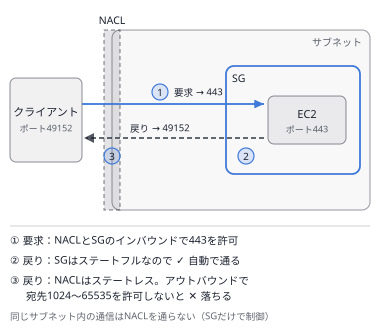
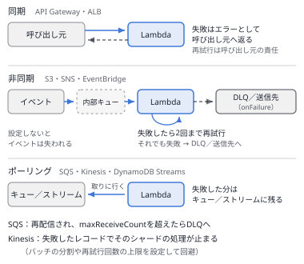
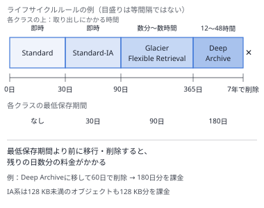
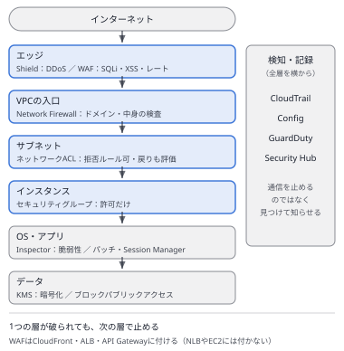
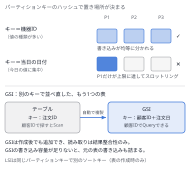

# 問題セット35 ｜ 実戦演習⑩（選択肢の差が一語の問題・15問）

> 全15問・目安30分。各問の「解答と解説」を開くと正解が表示されます。
> 本試験の問題は含みません。出題形式に沿ったオリジナル問題です。
>
> 第1分野5問／第2分野4問／第3分野3問／第4分野3問を分野を伏せて並べ、複数選択を2問含めています。
> セット34と同じく、選択肢は同じ文の形で書かれ、違うのは**設定値・ポリシーの種類・サービス名・適用先**の一語か二語だけです。
> 設問の要件を1つずつ選択肢に当てて、どこで外れるかを確かめてください。

---

### Q1 ｜ アプリ層からだけ受け付けるデータベース ｜ ★★

3層のWebアプリケーションで、アプリ層のEC2はAuto Scalingで増減し、起動のたびにIPアドレスが変わります。RDSのデータベースには**アプリ層のEC2からだけ**接続させたいと考えています。同じプライベートサブネットには、データベースに接続させたくないバッチ用のEC2も動いています。最も適切な設定はどれですか。

- **A.** DBのセキュリティグループのインバウンドで、送信元にアプリ層のサブネットのCIDRを指定する
- **B.** DBのセキュリティグループのインバウンドで、送信元にアプリ層のセキュリティグループを指定する
- **C.** アプリ層のセキュリティグループのアウトバウンドで、送信先にDBのセキュリティグループを指定する
- **D.** DBのサブネットのネットワークACLのインバウンドで、送信元にアプリ層のサブネットのCIDRを指定する

解答と解説

**正解：B**

**分野**：1.2 安全なワークロードとアプリケーション

**決め手**：セキュリティグループのルールでは、送信元に**別のセキュリティグループ**を指定できます。アプリ層のセキュリティグループが付いたインスタンスからの通信だけが許可されるため、IPアドレスが変わっても設定を変える必要がなく、同じサブネットのバッチ用のEC2は接続できません。

**キーワード**：セキュリティグループの参照（送信元にセキュリティグループを指定）

**他の選択肢を外す理由**
- **A**：サブネットのCIDRで許可すると、同じサブネットのバッチ用のEC2も接続できます。
- **C**：送る側を絞っても、データベースの側はほかのインスタンスからの接続を受け付けたままです。
- **D**：CIDR単位なのでバッチ用のEC2も通ります。ネットワークACLはステートレスで、戻りの通信の許可も別に必要です。

**参照**：[第3章 3.2 通信制御](../docs/03-network.md) ／ [第11章 11.3 多層防御](../docs/11-secure.md)

---

### Q2 ｜ 成功と失敗の両方を記録する ｜ ★★

S3にファイルが置かれると、イベント通知でLambda関数が起動してファイルを変換します。運用チームは、**成功した処理と失敗した処理の両方**について、どのファイルでどのような結果になったかを、関数のコードを変えずにSQSのキューへ記録したいと考えています。最も適切な設定はどれですか。

- **A.** 関数にデッドレターキューを設定し、記録用のSQSキューを指定する
- **B.** 関数の非同期呼び出しの送信先で、失敗時にだけ記録用のSQSキューを指定する
- **C.** 関数のイベントソースマッピングを作り、成功時と失敗時の送信先に記録用のSQSキューを指定する
- **D.** 関数の非同期呼び出しの送信先で、成功時と失敗時の両方に記録用のSQSキューを指定する

解答と解説

**正解：D**

**分野**：2.1 スケーラブルで疎結合な設計

**決め手**：S3のイベント通知は、Lambda関数を**非同期**で呼び出します。非同期呼び出しの**送信先（Destinations）**は、成功時と失敗時を別々に指定でき、送られる記録には関数の応答の内容も含まれます。コードを変えずに、両方の結果をSQSに残せます。

**キーワード**：成功と失敗の両方 → 非同期呼び出しの送信先（成功時・失敗時）

**他の選択肢を外す理由**
- **A**：デッドレターキューに送られるのは、失敗したイベントの中身だけです。成功した処理は記録されません。
- **B**：失敗時だけでは、成功した処理が記録されません。
- **C**：イベントソースマッピングは、SQSやKinesisなどを関数がポーリングするときの仕組みです。S3からの非同期の呼び出しには使いません。

**参照**：[第1章 1.6 AWS Lambda](../docs/01-compute.md) ／ [第12章 12.4 イベント駆動型アーキテクチャ](../docs/12-resilient.md)

---

### Q3 ｜ 計測用のパラメータで下がるヒット率 ｜ ★★★

ニュースサイトをCloudFrontで配信しています。ページの内容は、クエリ文字列の `lang` と `page` によって変わります。広告から来たアクセスには `utm_source` などの計測用のパラメータが付き、その値は利用者ごとに異なります。計測用のパラメータはオリジンでは使っていません。**キャッシュのヒット率が低く**、オリジンの負荷が高くなっています。最も適切な対策はどれですか。

- **A.** キャッシュポリシーで、キャッシュキーに含めるクエリ文字列を `lang` と `page` だけにする
- **B.** キャッシュポリシーで、キャッシュキーにすべてのクエリ文字列を含める
- **C.** キャッシュポリシーで、キャッシュキーにクエリ文字列を含めない
- **D.** オリジンリクエストポリシーで、オリジンへ送るクエリ文字列を `lang` と `page` だけにする

解答と解説

**正解：A**

**分野**：3.4 高性能なネットワーク

**決め手**：キャッシュキーに含めた値が違えば、別のキャッシュとして扱われます。値が人ごとに違う計測用のパラメータを含めると、同じページでもキャッシュが細かく分かれ、ほとんどヒットしません。内容を変える `lang` と `page` だけをキャッシュキーに含めれば、同じページは1つのキャッシュにまとまります。

**キーワード**：キャッシュキーには、内容を変える値だけを含める

**他の選択肢を外す理由**
- **B**：今の状態と同じで、計測用の値ごとにキャッシュが分かれ、ヒット率は上がりません。
- **C**：言語やページ番号の違うページが、同じキャッシュから返されてしまいます。
- **D**：オリジンへ送る値を絞っても、キャッシュキーは変わらないため、ヒット率は上がりません。

**参照**：[第3章 3.6 CloudFront と Global Accelerator](../docs/03-network.md)

---

### Q4 ｜ ログの保存とアップロードの残骸 ｜ ★★

アプリケーションのログをS3 Standardに保存しています。ログは作成から30日間はよく参照され、その後はまれにしか参照されませんが、参照するときは**すぐに**読める必要があります。1年たったログは削除します。AZの障害でログが失われてはなりません。また、アップロードの失敗で**未完了のマルチパートアップロード**が多数たまっています。費用を下げるライフサイクルルールとして、**適切なものを2つ選択してください。**

- **A.** 作成から30日後にOne Zone-IAへ移行し、365日後に失効させる
- **B.** 作成から30日後にStandard-IAへ移行し、365日後に失効させる
- **C.** 作成から30日後にGlacier Deep Archiveへ移行し、365日後に失効させる
- **D.** 開始から7日たった未完了のマルチパートアップロードを、Standard-IAへ移行する
- **E.** 開始から7日たった未完了のマルチパートアップロードを、中止して削除する

解答と解説

**正解：B・E**

**分野**：4.1 ストレージのコスト

**決め手**：まれにしか読まないが、読むときはすぐに読む必要があり、複数のAZに保存したいデータはStandard-IAに移します。未完了のマルチパートアップロードは、アップロード済みのパーツが見えないまま保管料金の対象になるため、ライフサイクルルールで**一定の日数がたったら中止して削除**します。

**キーワード**：Standard-IAへの移行＋失効／未完了のマルチパートアップロードの中止

**他の選択肢を外す理由**
- **A**：One Zone-IAは1つのAZにしか保存しないため、AZの障害でログを失うおそれがあります。
- **C**：Glacier Deep Archiveは、標準の取り出しで最大12時間かかり、すぐに読む要件を満たしません。
- **D**：ライフサイクルで移行できるのは完了したオブジェクトです。未完了のパーツは中止しない限り、料金がかかり続けます。

**参照**：[第2章 2.1 Amazon S3](../docs/02-storage.md) ／ [第14章 14.2 ストレージのコスト最適化](../docs/14-cost.md)

---

### Q5 ｜ 別のアカウントのロールを引き受ける ｜ ★★

アカウントA（開発）のエンジニアが、アカウントB（本番）で読み取りだけの作業を行うため、アカウントBの `ReadOnlyRole` を引き受けたいと考えています。アカウントBには長期のアクセスキーを作りません。必要な設定の組み合わせはどれですか。

- **A.** アカウントBのロールのアクセス許可ポリシーでアカウントAを許可し、アカウントAのユーザーに `sts:AssumeRole` を許可する
- **B.** アカウントBのロールの信頼ポリシーでアカウントAを許可し、アカウントBのユーザーに `sts:AssumeRole` を許可する
- **C.** アカウントBのロールの信頼ポリシーでアカウントAを許可し、アカウントAのユーザーに `sts:AssumeRole` を許可する
- **D.** アカウントAのロールの信頼ポリシーでアカウントBを許可し、アカウントAのユーザーに `sts:AssumeRole` を許可する

解答と解説

**正解：C**

**分野**：1.1 安全なアクセス

**決め手**：ロールを**誰が引き受けられるか**は、ロールの**信頼ポリシー**で決めます。アカウントBのロールの信頼ポリシーでアカウントAを信頼し、さらにアカウントA側で、エンジニアに `sts:AssumeRole` を許可します。両方がそろって初めて引き受けられます。

**キーワード**：引き受ける側の許可＝信頼ポリシー／呼び出す側の許可＝`sts:AssumeRole`

**他の選択肢を外す理由**
- **A**：アクセス許可ポリシーは、ロールを引き受けた後に**何ができるか**を決めるものです。誰が引き受けられるかは決まりません。
- **B**：引き受けるのはアカウントAのエンジニアです。アカウントBのユーザーに許可しても意味がありません。
- **D**：方向が逆です。アカウントAのロールを作っても、アカウントBでの作業はできません。

**参照**：[第5章 5.1 AWS IAM](../docs/05-security.md) ／ [第11章 11.1 アクセス管理](../docs/11-secure.md)

---

### Q6 ｜ 一部のインスタンスだけが高負荷になる ｜ ★★★

Network Load Balancer（NLB）の背後に、AZ-aに2台、AZ-bに6台のEC2があります（AZ-aで希望のインスタンスタイプの容量が足りず、偏りが出ました）。**AZ-aの2台だけ**がCPU使用率90%を超え、AZ-bの6台には余裕があります。クライアントはNLBのDNS名で接続しています。最も適切な対策はどれですか。

- **A.** NLBのクロスゾーン負荷分散を有効にする
- **B.** NLBのターゲットの登録解除の遅延を延ばす
- **C.** NLBのターゲットグループでスティッキーセッションを有効にする
- **D.** NLBのターゲットグループでヘルスチェックの間隔を短くする

解答と解説

**正解：A**

**分野**：2.1 スケーラブルで疎結合な設計

**決め手**：NLBのクロスゾーン負荷分散は**既定で無効**です。無効のときは、各AZのNLBのノードが同じAZのターゲットにだけ送ります。DNSで2つのAZのノードにほぼ半分ずつ届くため、AZ-aの2台に全体の半分が集まります。有効にすると、8台に均等に配られます。AZをまたぐ通信にはデータ転送料金がかかる点も確認します。

**キーワード**：NLBのクロスゾーン負荷分散（既定で無効。ALBは既定で有効）

**他の選択肢を外す理由**
- **B**：登録解除の遅延は、ターゲットを外すときに処理中の接続を待つ時間で、振り分けの割合は変わりません。
- **C**：同じクライアントを同じターゲットに固定する機能で、偏りはむしろ大きくなることがあります。
- **D**：異常の検出が早くなるだけで、正常な2台への偏りは変わりません。

**参照**：[第3章 3.5 負荷分散](../docs/03-network.md)

---

### Q7 ｜ 誰も消せない取引記録 ｜ ★★

金融の取引記録をS3に7年間保存します。規制により、保存期間中は**ルートユーザーを含めて誰も**、記録の削除・上書き・保持期間の短縮ができないようにする必要があります。最も適切な方法はどれですか。

- **A.** オブジェクトロックのガバナンスモードで、保持期間を7年にする
- **B.** オブジェクトロックのリーガルホールドを、すべてのオブジェクトに設定する
- **C.** バージョニングとMFA削除を有効にし、ライフサイクルで7年後に失効させる
- **D.** オブジェクトロックのコンプライアンスモードで、保持期間を7年にする

解答と解説

**正解：D**

**分野**：1.3 データセキュリティ管理

**決め手**：コンプライアンスモードの保持期間中は、**ルートユーザーを含めて誰も**オブジェクトのバージョンを削除・上書きできず、保持期間を短くすることもできません。規制で求められる「誰も消せない」状態になります。

**キーワード**：ルートユーザーも消せない → オブジェクトロックのコンプライアンスモード

**他の選択肢を外す理由**
- **A**：ガバナンスモードは、`s3:BypassGovernanceRetention` の権限を持つユーザーなら削除や期間の短縮ができます。
- **B**：リーガルホールドには期限がなく、`s3:PutObjectLegalHold` の権限を持つユーザーが外せます。
- **C**：MFA削除は、MFAを使ったルートユーザーなら削除できます。誰も消せない状態にはなりません。

**参照**：[第2章 2.1 Amazon S3](../docs/02-storage.md) ／ [第11章 11.2 データ保護](../docs/11-secure.md)

---

### Q8 ｜ 中断の多いスポット ｜ ★★

画像のバッチ処理を、Auto Scalingグループのスポットインスタンスで実行しています。複数のインスタンスタイプと3つのAZを指定していますが、**中断が多く**処理が遅れています。費用はできるだけ低く保ちたいと考えています。最も適切な変更はどれですか。

- **A.** 配分戦略を lowest-price にし、使うプールの数を2にする
- **B.** 配分戦略を price-capacity-optimized にする
- **C.** 配分戦略を lowest-price にし、使うプールの数を10にする
- **D.** 配分戦略を lowest-price にし、最大価格を低く設定する

解答と解説

**正解：B**

**分野**：4.2 コンピューティングのコスト

**決め手**：price-capacity-optimized は、**空き容量の多いプール**の中から、さらに価格の低いものを選びます。中断されにくさと価格の両方を考えるため、AWSが多くのワークロードに推奨している配分戦略です。

**キーワード**：中断を減らしつつ安く → price-capacity-optimized

**他の選択肢を外す理由**
- **A**：lowest-price は価格だけで選ぶため、空き容量の少ないプールにも置かれて中断が増えやすく、AWSも推奨していません。プールを減らすと、さらに偏ります。
- **C**：プールの数を増やしても、価格だけで選ぶ点は同じで、中断されやすいプールが選ばれます。
- **D**：最大価格を下げると、起動できない、または中断されることがかえって増えます。

**参照**：[第14章 14.3 コンピューティングのコスト最適化](../docs/14-cost.md)

---

### Q9 ｜ リージョン障害への備え ｜ ★★

Aurora MySQLのデータベースについて、別のリージョンに災害対策の環境を用意します。要件は、**RPOが数秒以内**、**RTOが1分程度**で、リージョン障害のときに別のリージョンで書き込みを再開できることです。最も適切な構成はどれですか。

- **A.** Auroraのスナップショットを、別のリージョンへ1時間ごとにコピーする
- **B.** Auroraのクロスリージョンリードレプリカ（binlogのレプリケーション）を作る
- **C.** Auroraグローバルデータベースにし、別のリージョンにセカンダリクラスターを置く
- **D.** Auroraのレプリカを、同じリージョンの別のAZに追加する

解答と解説

**正解：C**

**分野**：2.2 高可用性・耐障害性

**決め手**：Auroraグローバルデータベースは、ストレージの層で別のリージョンへ**通常1秒未満**で複製し、障害時はセカンダリのリージョンを**1分程度で**書き込み可能に切り替えられます。RPOとRTOの両方を満たします。

**キーワード**：リージョンをまたぐ・RPO数秒・RTO1分 → Auroraグローバルデータベース

**他の選択肢を外す理由**
- **A**：最大1時間分のデータを失い、スナップショットからの復元にも時間がかかります。
- **B**：binlogによる論理的な複製は遅延が大きくなりやすく、昇格にも時間がかかるため、要件に届きません。
- **D**：同じリージョンの中の冗長化で、リージョン障害には備えられません。

**参照**：[第4章 4.2 Amazon Aurora](../docs/04-database.md) ／ [第12章 12.5 高可用性と耐障害性](../docs/12-resilient.md)

---

### Q10 ｜ 大量のリクエストと特定の国からのアクセス ｜ ★★

ALBの背後でWebアプリケーションを公開しています。次の2つの要件があります。(1) 同じIPアドレスから**5分間に2,000回を超える**リクエストが来たら、自動で遮断する。(2) サービスの対象外の**特定の国**からのアクセスを遮断する。**適切な対策を2つ選択してください。**

- **A.** AWS WAFのWeb ACLをALBに関連付け、レートベースルールを追加する
- **B.** AWS WAFのWeb ACLをALBに関連付け、IPセットのルールに過去の攻撃元を登録する
- **C.** ALBのサブネットのネットワークACLで、対象の国のIPアドレスの範囲を拒否する
- **D.** AWS WAFのWeb ACLをALBに関連付け、地理的一致ルールを追加する
- **E.** ALBのセキュリティグループで、対象の国のIPアドレスの範囲を拒否する

解答と解説

**正解：A・D**

**分野**：1.2 安全なワークロードとアプリケーション

**決め手**：レートベースルールは、同じIPアドレスからのリクエスト数がしきい値を超えると、そのIPアドレスを自動で遮断します（要件1）。地理的一致ルールは、リクエストの送信元の国でブロックできます（要件2）。どちらもALBに関連付けたWeb ACLで使えます。

**キーワード**：回数で自動遮断＝レートベースルール／国で遮断＝地理的一致ルール

**他の選択肢を外す理由**
- **B**：登録したIPアドレスしか止まらず、新しい送信元を回数で自動的に遮断することはできません。
- **C**：ネットワークACLはルールの数に上限があり、国のIPアドレスの範囲を登録して保守するのは現実的ではありません。
- **E**：セキュリティグループには拒否のルールがありません。

**参照**：[第5章 5.5 AWS WAF](../docs/05-security.md) ／ [第11章 11.3 多層防御](../docs/11-secure.md)

---

### Q11 ｜ 顧客ごとの注文の一覧 ｜ ★★★

DynamoDBの `Orders` テーブルは、`order_id` をパーティションキーにしています。新しく、**顧客ごとに注文を日付順で表示する**画面を追加します。テーブルは本番で稼働中で、作り直したくありません。読み取りの負荷と料金も抑えたいと考えています。最も適切な方法はどれですか。

- **A.** 既存のテーブルに、`customer_id` と注文日をキーとするLSIを追加する
- **B.** 既存のテーブルを、`customer_id` で絞り込むScanで読み出す
- **C.** 既存のテーブルの前にDAXを置き、`customer_id` で絞り込んで読み出す
- **D.** 既存のテーブルに、`customer_id` と注文日をキーとするGSIを追加する

解答と解説

**正解：D**

**分野**：3.3 高性能なデータベース

**決め手**：GSI（グローバルセカンダリインデックス）は、テーブルと**別のパーティションキー**を持て、稼働中のテーブルに**後から追加**できます。`customer_id` をパーティションキー、注文日をソートキーにすれば、顧客ごとの注文をQueryで日付順に取り出せます。

**キーワード**：別のキーで引く・後から追加 → GSI

**他の選択肢を外す理由**
- **A**：LSIはテーブルを作るときにしか作れず、パーティションキーもテーブルと同じ（`order_id`）でなければなりません。
- **B**：Scanはテーブル全体を読むため、読み取りの容量と料金が大きくなります。
- **C**：DAXは読み取りのキャッシュで、検索の方法は変わりません。Scanで読むことに変わりはありません。

**参照**：[第4章 4.3 Amazon DynamoDB](../docs/04-database.md)

---

### Q12 ｜ AZが止まっても読める共有ディレクトリ ｜ ★★

3つのAZにまたがるAuto ScalingグループのEC2で、アップロードされた画像を**共有のディレクトリ**（POSIXのファイルシステム）に置いて読み書きしています。1つのAZが止まっても、残りのAZのインスタンスがすべてのファイルを読み書きできる必要があります。最も適切な構成はどれですか。

- **A.** EFS One Zoneのファイルシステムを作り、すべてのインスタンスからマウントする
- **B.** EFS（リージョン）のファイルシステムを作り、すべてのインスタンスからマウントする
- **C.** io2のEBSボリュームを作り、マルチアタッチですべてのインスタンスに接続する
- **D.** 各インスタンスのインスタンスストアに置き、定期的にほかのインスタンスへコピーする

解答と解説

**正解：B**

**分野**：2.2 高可用性・耐障害性

**決め手**：リージョンのEFSは、データを**複数のAZに冗長化**して保存し、各AZのマウントターゲットから同じファイルシステムを読み書きできます。1つのAZが止まっても、ほかのAZのインスタンスはすべてのファイルを使えます。

**キーワード**：複数AZから共有・AZ障害に耐える → EFS（リージョン）

**他の選択肢を外す理由**
- **A**：One Zoneは1つのAZにしか保存しないため、そのAZが止まるとファイルを読めなくなります。
- **C**：マルチアタッチは同じAZのインスタンスにしか接続できず、共有するにはクラスターに対応したファイルシステムも必要です。
- **D**：インスタンスが終了するとデータが消え、コピーの間にファイルの内容がずれます。

**参照**：[第2章 2.3 Amazon EFS](../docs/02-storage.md) ／ [第2章 2.2 Amazon EBS](../docs/02-storage.md)

---

### Q13 ｜ 会員だけが見られる動画 ｜ ★★

有料会員向けの動画を、CloudFrontとS3で配信しています。動画はHLS形式で、1本の動画が**数百の小さなファイル**に分かれています。**会員だけ**が視聴でき、プレーヤーが読み込むURLは変えたくありません。S3への直接のアクセスは、OACで防いでいます。最も適切な方法はどれですか。

- **A.** S3の署名付きURLを、ファイルごとに発行する
- **B.** CloudFrontの署名付きURLを、ファイルごとに発行する
- **C.** CloudFrontの署名付きCookieを、ログインのときに発行する
- **D.** CloudFrontのOACを、会員のIAMユーザーごとに設定する

解答と解説

**正解：C**

**分野**：1.1 安全なアクセス

**決め手**：署名付きCookieは、1回発行すれば、**複数のファイル**へのアクセスをまとめて許可できます。URLは変わらないため、数百のファイルに分かれた動画でも、プレーヤーはそのまま読み込めます。

**キーワード**：複数のファイル・URLを変えない → CloudFrontの署名付きCookie

**他の選択肢を外す理由**
- **A**：CloudFrontを通らずにS3へアクセスすることになり、OACで拒否されます。ファイルごとの発行も必要です。
- **B**：数百のファイルのそれぞれにURLを発行する必要があり、プレーヤーが読み込むURLも変わります。
- **D**：OACはCloudFrontからS3へのアクセスを認証する仕組みで、視聴者を区別しません。

**参照**：[第3章 3.6 CloudFront と Global Accelerator](../docs/03-network.md)

---

### Q14 ｜ 一日中読み続けるログのボリューム ｜ ★★★

EC2でログの集計を行っています。6 TiBのデータを**一日中、先頭から順番に**読み続け、常に約200 MiB/sのスループットが必要です。ランダムなアクセスはほとんどなく、ブートボリュームには使いません。費用を最も下げられるボリュームはどれですか。

- **A.** スループット最適化HDD（st1）の6 TiBのボリュームを使う
- **B.** コールドHDD（sc1）の6 TiBのボリュームを使う
- **C.** 汎用SSD（gp3）の6 TiBのボリュームを使う
- **D.** プロビジョンドIOPS SSD（io2）の6 TiBのボリュームを使う

解答と解説

**正解：A**

**分野**：3.1 高性能なストレージ

**決め手**：st1のベースラインは1 TiBあたり40 MiB/sなので、6 TiBでは約240 MiB/sです。一日中読み続けても、必要な200 MiB/sをベースラインの範囲で保てます。大きなデータを順番に読む処理に向いたHDDで、SSDより容量あたりの料金が安くなります。

**キーワード**：大量の順次読み取り・低コスト → st1（ベースライン40 MiB/s × TiB）

**他の選択肢を外す理由**
- **B**：sc1のベースラインは1 TiBあたり12 MiB/sで、6 TiBでも約72 MiB/sです。バーストのクレジットを使い切ると200 MiB/sを保てません。
- **C**：スループットは満たせますが、容量あたりの料金がst1より高くなります。
- **D**：ランダムなI/Oが多いデータベース向けで、最も料金が高く、この用途には合いません。

**参照**：[第2章 2.2 Amazon EBS](../docs/02-storage.md)

---

### Q15 ｜ 読み書きが一定のテーブルの割引 ｜ ★★

DynamoDBのテーブルは**オンデマンドモード**で、1日を通して読み書きの量がほぼ一定です。今後も少なくとも1年は同じ量が続く見込みです。保存しているデータの量は小さく、費用の大部分は読み書きの料金です。費用を最も下げられる方法はどれですか。

- **A.** オンデマンドモードのまま、リザーブドキャパシティを購入する
- **B.** プロビジョンドモードに変え、リザーブドキャパシティを購入する
- **C.** オンデマンドモードのまま、テーブルクラスをStandard-IAに変える
- **D.** プロビジョンドモードに変え、テーブルクラスをStandard-IAに変える

解答と解説

**正解：B**

**分野**：4.3 データベースのコスト

**決め手**：量が一定ならプロビジョンドモードの方が安く、1年以上続くと見込めるなら、さらに**リザーブドキャパシティ**で割引を受けられます。リザーブドキャパシティは、プロビジョンドモードでStandardテーブルクラスのテーブルが対象です。

**キーワード**：一定の読み書きが続く → プロビジョンドモード＋リザーブドキャパシティ

**他の選択肢を外す理由**
- **A**：リザーブドキャパシティは、オンデマンドモードのテーブルには使えません。
- **C**：Standard-IAは保存の料金が安い代わりに、読み書きの料金が高くなります。データが小さく、読み書きが中心のテーブルではかえって高くなります。
- **D**：Cと同じ理由に加え、Standard-IAのテーブルはリザーブドキャパシティの対象外です。

**参照**：[第14章 14.4 データベースのコスト最適化](../docs/14-cost.md) ／ [第4章 4.3 Amazon DynamoDB](../docs/04-database.md)

