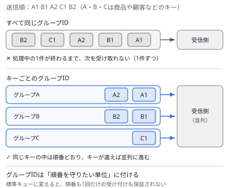

# 問題セット36 ｜ 実戦演習⑪（選択肢の差が一語の問題・15問）

> 全15問・目安30分。各問の「解答と解説」を開くと正解が表示されます。
> 本試験の問題は含みません。出題形式に沿ったオリジナル問題です。
>
> 第1分野5問／第2分野4問／第3分野3問／第4分野3問を分野を伏せて並べ、複数選択を2問含めています。
> 選択肢は同じ文の形で書かれ、違うのは**ID・キー・階層の数字・リージョン・置く場所**などの一語か二語だけです。
> 設問の要件を1つずつ選択肢に当てて、どこで外れるかを確かめてください。

---

### Q1 ｜ 再送による二重の決済 ｜ ★★★

決済の依頼を、SQSのFIFOキューで受け付けています。送信側のアプリケーションは、送信がタイムアウトすると同じ依頼を送り直します。依頼には一意の依頼IDがあります。また、同じ顧客が**同じ金額の依頼を短い間に2回**出すことがあり、それは別々の依頼として処理しなければなりません。送り直しによる二重の決済を防ぐ設定として、最も適切なものはどれですか。

- **A.** FIFOキューで、コンテンツベースの重複排除を有効にする
- **B.** 送信するときに、依頼IDをメッセージグループIDに設定する
- **C.** 送信するときに、依頼IDをメッセージ重複排除IDに設定する
- **D.** 送信するときに、顧客IDをメッセージ重複排除IDに設定する

解答と解説

**正解：C**

**分野**：2.1 スケーラブルで疎結合な設計

**決め手**：FIFOキューは、同じ**メッセージ重複排除ID**のメッセージを5分間受け付けません。送り直しでは同じ依頼IDが付くため重複として捨てられ、別の依頼は依頼IDが違うので受け付けられます。

**キーワード**：送り直しの重複＝依頼ごとのIDを重複排除IDに

**他の選択肢を外す理由**
- **A**：コンテンツベースの重複排除は本文から重複を判定します。同じ金額で本文が同じ正当な2回目の依頼まで捨てられます。
- **B**：メッセージグループIDは順序を守る単位で、重複の判定には使われません。
- **D**：同じ顧客の別の依頼まで、5分間すべて重複として捨てられます。

**参照**：[第6章 6.1 Amazon SQS](../docs/06-integration.md)

---

### Q2 ｜ IAMポリシーで許可しても使えない鍵 ｜ ★★★

管理者がKMSのカスタマー管理キーを作るときに、キーポリシーを書き換え、**キーの管理者のロールだけ**を許可する内容にしました（既定の文は削除しました）。その後、アプリケーションのロールのIAMポリシーで `kms:Decrypt` を許可しましたが、`AccessDeniedException` になります。今後は、キーポリシーを編集せずに**IAMポリシーだけで**利用者を管理したいと考えています。最も適切な対応はどれですか。

- **A.** キーポリシーに、アカウント（ルート）にキーの操作を許可する既定の文を戻す
- **B.** アプリケーションのロールのIAMポリシーで、`kms:Decrypt` を `kms:*` に広げる
- **C.** アプリケーションのロールにアクセス許可の境界を付け、`kms:Decrypt` を許可する
- **D.** 組織のSCPに、アプリケーションのロールへ `kms:Decrypt` を許可する文を加える

解答と解説

**正解：A**

**分野**：1.1 安全なアクセス

**決め手**：KMSでは、キーポリシーがキーの権限の起点です。既定のキーポリシーにある「アカウント（ルート）にキーの操作を許可する文」があるときだけ、**IAMポリシーでキーの使用を許可できる**ようになります。この文を戻せば、以後はIAMポリシーだけで利用者を管理できます。

**キーワード**：キーポリシーのアカウント（ルート）の文 → IAMポリシーが有効になる

**他の選択肢を外す理由**
- **B**：キーポリシーがIAMポリシーを有効にしていない限り、IAMポリシーの許可をどれだけ広げても効きません。
- **C**：アクセス許可の境界は上限を決めるもので、許可を与えません。IAMポリシーが効かない状態も変わりません。
- **D**：SCPも上限を決めるもので、許可を与えません。

**参照**：[第5章 5.8 AWS KMS](../docs/05-security.md)

---

### Q3 ｜ 書き込みに必要なシャード数 ｜ ★★★

工場のセンサーから、Kinesis Data Streams（プロビジョンドモード）に、**毎秒合計4,500件**、1件あたり平均1 KB（合計で毎秒約4.4 MB）のレコードを書き込みます。読み取りは拡張ファンアウトで別に確保しています。書き込みが上限で拒否されない、最も少ないシャード数はどれですか。

- **A.** シャード数を3にする
- **B.** シャード数を5にする
- **C.** シャード数を9にする
- **D.** シャード数を45にする

解答と解説

**正解：B**

**分野**：3.5 データの取り込みと変換

**決め手**：1シャードの書き込みの上限は、**毎秒1 MBまたは1,000件**です。件数では4,500 ÷ 1,000 ＝ 4.5、データ量では4.4 ÷ 1 ＝ 4.4なので、どちらの上限も超えないためには5シャードが必要です。

**キーワード**：書き込みは1シャードあたり毎秒1 MB・1,000件（読み取りは毎秒2 MB）

**他の選択肢を外す理由**
- **A**：読み取りの上限（毎秒2 MB）で割った数です。書き込みには足りず、拒否されます。
- **C**：足りますが、必要な数を大きく超え、シャードの時間料金が増えます。
- **D**：1シャードを毎秒100件として計算した数で、費用が大幅に増えます。

**参照**：[第7章 7.1 Amazon Kinesis](../docs/07-analytics.md)

---

### Q4 ｜ 2か所のHTTPSの証明書 ｜ ★★

`www.example.com` をCloudFrontで配信し、オリジンは東京リージョン（ap-northeast-1）のALBです。利用者からCloudFrontまで、CloudFrontからALBまでの**両方をHTTPS**にし、どちらにもACMの証明書を使います。**必要な対応を2つ選択してください。**

- **A.** ap-northeast-1 でACMの証明書を発行し、CloudFrontに関連付ける
- **B.** us-east-1 でACMの証明書を発行し、CloudFrontに関連付ける
- **C.** us-east-1 でACMの証明書を発行し、ALBに関連付ける
- **D.** ap-northeast-1 でACMの証明書を発行し、ALBに関連付ける
- **E.** us-east-1 でACMの証明書を発行し、CloudFrontとALBの両方に関連付ける

解答と解説

**正解：B・D**

**分野**：1.3 データセキュリティ管理

**決め手**：CloudFrontに関連付けるACMの証明書は、**バージニア北部（us-east-1）**で発行したものに限られます。ALBで使う証明書は、**ALBと同じリージョン**で発行します。そのため、証明書を2つのリージョンで1つずつ発行します。

**キーワード**：CloudFront＝us-east-1／ALB＝ALBと同じリージョン

**他の選択肢を外す理由**
- **A**：CloudFrontは、us-east-1以外のリージョンの証明書を使えません。
- **C**：ALBは、別のリージョンの証明書を使えません。
- **E**：us-east-1の証明書は、東京のALBには関連付けられません。

**参照**：[第5章 5.7 AWS Certificate Manager](../docs/05-security.md) ／ [第3章 3.6 CloudFront と Global Accelerator](../docs/03-network.md)

---

### Q5 ｜ 翌朝までに取り出せばよいアーカイブ ｜ ★★

監査の依頼で、S3 Glacier Flexible Retrievalに保存した2 TBの過去のログを取り出します。期限は翌日の朝で、**12時間以内**に取り出せれば十分です。取り出しの費用を最も下げられる方法はどれですか。

- **A.** 迅速取り出し（Expedited）で復元する
- **B.** プロビジョニングされた容量を購入し、迅速取り出しで復元する
- **C.** 標準取り出し（Standard）で復元する
- **D.** 大容量取り出し（Bulk）で復元する

解答と解説

**正解：D**

**分野**：4.1 ストレージのコスト

**決め手**：Glacier Flexible Retrievalの大容量取り出しは、通常**5〜12時間**で終わり、**取り出しの料金がかかりません**。期限に間に合い、費用も最も低くなります。

**キーワード**：時間に余裕がある・最安 → 大容量取り出し（Bulk）

**他の選択肢を外す理由**
- **A**：数分で取り出せますが、取り出しの料金が最も高くなります。
- **B**：迅速取り出しの料金に加え、容量の購入費もかかります。
- **C**：3〜5時間で終わりますが、取り出しの料金がかかります。

**参照**：[第2章 2.1 Amazon S3](../docs/02-storage.md)

---

### Q6 ｜ 昇格させたくないレポート用のレプリカ ｜ ★★★

Aurora PostgreSQLのクラスターに、書き込み用のインスタンスが1台、同じサイズのリーダー2台（R1・R2、db.r6g.large）、レポート用の大きなリーダー1台（R3、db.r6g.4xlarge）があります。障害のときにR3が昇格すると、レポートの重いクエリが書き込みの処理に影響します。**R1かR2を昇格させ、R3は最後の手段**にしたいと考えています。最も適切な設定はどれですか。

- **A.** R1・R2を階層15、R3を階層0にする
- **B.** R1・R2を階層0、R3を階層15にする
- **C.** R1・R2・R3をすべて階層0にする
- **D.** R1・R2・R3をすべて階層15にする

解答と解説

**正解：B**

**分野**：2.2 高可用性・耐障害性

**決め手**：Auroraのフェイルオーバーでは、**階層の数字が小さいレプリカ**から昇格します。R1・R2を階層0、R3を階層15にすれば、R1かR2が先に選ばれます。

**キーワード**：昇格の階層は0が最優先・15が最後

**他の選択肢を外す理由**
- **A**：優先の順が逆で、R3が最初に昇格します。
- **C**：同じ階層が複数あるときは、**サイズの大きいレプリカ**が選ばれるため、R3が昇格します。
- **D**：Cと同じ理由で、R3が昇格します。

**参照**：[第4章 4.2 Amazon Aurora](../docs/04-database.md)

---

### Q7 ｜ 組織内のすべてのアカウントに読ませる ｜ ★★

共有のS3バケットを、AWS Organizationsの組織内の**すべてのアカウント**から読み取れるようにしたいと考えています。アカウントは毎月追加され、追加されたアカウントにも自動で読ませたいと考えています。組織の外からのアクセスは拒否します。バケットポリシーの条件として最も適切なものはどれですか。

- **A.** `aws:PrincipalAccount` に、現在のすべてのアカウントIDを並べる
- **B.** `aws:ResourceOrgID` に、組織のIDを指定する
- **C.** `aws:PrincipalOrgID` に、組織のIDを指定する
- **D.** `aws:SourceOrgID` に、組織のIDを指定する

解答と解説

**正解：C**

**分野**：1.1 安全なアクセス

**決め手**：`aws:PrincipalOrgID` は、**リクエストした主体が属する組織**のIDです。組織のIDを1つ指定すれば、今あるアカウントも、今後追加されるアカウントも、ポリシーを変えずに許可できます。

**キーワード**：組織内のすべての主体 → `aws:PrincipalOrgID`

**他の選択肢を外す理由**
- **A**：アカウントが追加されるたびにポリシーを書き換える必要があります。
- **B**：`aws:ResourceOrgID` は、**アクセスされるリソース**の組織を表すキーで、リクエストした主体を絞れません。
- **D**：`aws:SourceOrgID` は、AWSのサービスが別のリソースの代わりにリクエストするときに使うキーで、人やアプリのロールからのアクセスには入りません。

**参照**：[第5章 5.1 AWS IAM](../docs/05-security.md)

---

### Q8 ｜ 昼過ぎから遅くなるボリューム ｜ ★★

200 GiBのgp2のボリュームにデータベースを置いています。日中はずっと3,000 IOPS程度が必要です。朝は速いのですが、昼過ぎから急に遅くなります。調べると、バーストのクレジットを使い切っていました。費用をできるだけ抑えて、性能を安定させたいと考えています。最も適切な方法はどれですか。

- **A.** ボリュームの種類をgp3に変える（IOPSは既定のまま）
- **B.** gp2のまま、ボリュームを1,000 GiBに広げる
- **C.** ボリュームの種類をio2に変え、3,000 IOPSを指定する
- **D.** gp2のまま、スナップショットからボリュームを作り直す

解答と解説

**正解：A**

**分野**：3.1 高性能なストレージ

**決め手**：gp2のベースラインは1 GiBあたり3 IOPSで、200 GiBでは600 IOPSです。3,000 IOPSはバーストで出ているだけなので、クレジットが尽きると下がります。gp3は**容量にかかわらずベースライン3,000 IOPS**で、ボリュームを使いながら種類を変えられます。

**キーワード**：容量と関係なく3,000 IOPS → gp3

**他の選択肢を外す理由**
- **B**：1,000 GiBでベースラインが3,000 IOPSになりますが、使わない容量の料金がかかります。
- **C**：IOPSの料金も加わり、gp3より高くなります。
- **D**：作り直してもベースラインは600 IOPSのままです。

**参照**：[第2章 2.2 Amazon EBS](../docs/02-storage.md)

---

### Q9 ｜ 複製されない既存のオブジェクトと削除 ｜ ★★★

バージョニングを有効にしている既存のバケット（オブジェクトは数千万個）に、別のリージョンへのレプリケーションルールを設定しました。数日たっても、**ルールを設定する前からあるオブジェクト**が複製先にありません。また、複製元で（バージョンIDを指定せずに）**削除したオブジェクト**が、複製先には残っています。両方を解決するために、**適切な対応を2つ選択してください。**

- **A.** S3バッチレプリケーションで、既存のオブジェクトを複製する
- **B.** レプリケーションルールで、S3 Replication Time Controlを有効にする
- **C.** レプリケーションルールで、レプリカの変更の同期を有効にする
- **D.** 複製先のバケットで、バージョニングを停止する
- **E.** レプリケーションルールで、削除マーカーのレプリケーションを有効にする

解答と解説

**正解：A・E**

**分野**：2.2 高可用性・耐障害性

**決め手**：レプリケーションのルールは、設定した**後に書き込まれたオブジェクト**だけを複製します。前からあるオブジェクトは**S3バッチレプリケーション**で複製します。また、バージョンIDを指定しない削除で作られる**削除マーカー**は、既定では複製されないため、ルールで有効にします。

**キーワード**：既存のオブジェクト＝バッチレプリケーション／削除＝削除マーカーのレプリケーション

**他の選択肢を外す理由**
- **B**：RTCは新しいオブジェクトを15分以内に複製する保証で、既存のオブジェクトは対象外です。
- **C**：複製先でのレプリカのメタデータの変更を、複製元へ戻す機能です。削除の複製とは関係ありません。
- **D**：レプリケーションには、複製先でもバージョニングが必要です。

**参照**：[第2章 2.1 Amazon S3](../docs/02-storage.md)

---

### Q10 ｜ 自社のバケット以外への持ち出しを防ぐ ｜ ★★★

プライベートサブネットのEC2は、S3用のゲートウェイ型エンドポイントだけを通ってS3にアクセスしています（NAT Gatewayはありません）。情報の持ち出しへの対策として、EC2から**自社のバケット以外**へアップロードできないようにしたいと考えています。他社のバケットのポリシーは変えられません。最も適切な方法はどれですか。

- **A.** 自社のバケットのバケットポリシーで、このエンドポイントからのアクセスだけを許可する
- **B.** EC2のセキュリティグループのアウトバウンドで、S3のプレフィックスリストだけを許可する
- **C.** エンドポイントポリシーで、自社のアカウントのIAMロールだけを許可する
- **D.** エンドポイントポリシーで、自社のバケットだけをリソースとして許可する

解答と解説

**正解：D**

**分野**：1.2 安全なワークロードとアプリケーション

**決め手**：エンドポイントポリシーは、**そのエンドポイントを通るリクエスト**に上限をかけます。リソースに自社のバケットだけを指定すれば、エンドポイントを通って他社のバケットへ書き込むことはできません。EC2からS3への経路はこのエンドポイントしかないため、持ち出しを防げます。

**キーワード**：アクセス先のバケットを絞る → エンドポイントポリシーのリソース

**他の選択肢を外す理由**
- **A**：自社のバケットの側の制限で、他社のバケットへのアップロードは止まりません。
- **B**：プレフィックスリストはS3全体のIPアドレスの範囲で、他社のバケットにも届きます。
- **C**：主体を自社のロールに絞っても、そのロールが他社のバケットへ書き込むことは止まりません。

**参照**：[第3章 3.3 VPCの外部接続](../docs/03-network.md)

---

### Q11 ｜ 開発環境のNAT ｜ ★★

開発環境のVPCは、2つのAZを使っています。プライベートサブネットのEC2は、OSの更新のときだけインターネットに出ます。開発環境なので、AZの障害のときにインターネットに出られなくなっても問題ありません。NATの費用を最も下げられる構成はどれですか。

- **A.** 各AZのパブリックサブネットにNAT Gatewayを1つずつ置く
- **B.** 各AZのプライベートサブネットにNAT Gatewayを1つずつ置く
- **C.** 1つのAZのパブリックサブネットにNAT Gatewayを1つ置き、両方のAZから使う
- **D.** 1つのAZのプライベートサブネットにNAT Gatewayを1つ置き、両方のAZから使う

解答と解説

**正解：C**

**分野**：4.4 ネットワークのコスト

**決め手**：NAT Gatewayは1つごとに時間料金がかかります。可用性が求められない開発環境なら、**パブリックサブネットに1つ**だけ置き、両方のAZのプライベートサブネットのルートテーブルから向ければ、時間料金は1つ分で済みます。

**キーワード**：可用性が不要な環境 → NAT Gatewayは1つ（パブリックサブネット）

**他の選択肢を外す理由**
- **A**：AZの障害に強い本番向けの構成で、時間料金が2倍になります。
- **B**：インターネットに出るNAT Gatewayは、インターネットゲートウェイへの経路があるパブリックサブネットに置きます。
- **D**：Bと同じ理由で、インターネットに出られません。

**参照**：[第3章 3.1 VPCの基礎](../docs/03-network.md) ／ [第12章 12.5 高可用性と耐障害性](../docs/12-resilient.md)

---

### Q12 ｜ 属性を付けられない発行側 ｜ ★★★

注文のイベントをSNSトピックに発行し、配送用と請求用のSQSキューがサブスクライブしています。配送用のキューは、本文のJSONに `"type": "physical"` とある注文だけを受け取りたいと考えています。発行側のアプリケーションは外部の製品で、**メッセージ属性を付けることができません**。最も適切な方法はどれですか。

- **A.** 配送用のサブスクリプションで、フィルターの対象をメッセージ本文にして条件を書く
- **B.** 配送用のサブスクリプションで、フィルターの対象をメッセージ属性にして条件を書く
- **C.** 配送用のキューで、受信するときのフィルターに `type` の条件を書く
- **D.** トピックのデータ保護ポリシーで、`type` が `physical` 以外のメッセージを拒否する

解答と解説

**正解：A**

**分野**：2.1 スケーラブルで疎結合な設計

**決め手**：SNSのフィルターポリシーは、既定では**メッセージ属性**を対象にします。サブスクリプションの `FilterPolicyScope` を **MessageBody** にすると、本文のJSONの値で絞り込めるため、発行側を変えずに済みます。

**キーワード**：本文の値で絞る → FilterPolicyScope＝MessageBody

**他の選択肢を外す理由**
- **B**：発行側が属性を付けないため、条件に一致するメッセージがなく、何も届きません。
- **C**：SQSには、受信するときに本文の条件で絞り込む機能がありません。
- **D**：データ保護ポリシーは、個人情報などの機密データを検出・保護するためのもので、配信先の振り分けには使いません。

**参照**：[第6章 6.2 Amazon SNS](../docs/06-integration.md)

---

### Q13 ｜ 暗号化されていないデータベース ｜ ★★

暗号化されていないRDS for MySQLのDBインスタンスを、KMSのカスタマー管理キーで暗号化したいと考えています。停止の時間は短い方がよいものの、ある程度は許容できます。最も適切な手順はどれですか。

- **A.** 既存のDBインスタンスを変更し、ストレージの暗号化を有効にする
- **B.** スナップショットを作り、暗号化を有効にしてコピーし、コピーから復元する
- **C.** 暗号化を有効にしたリードレプリカを作り、そのレプリカを昇格させる
- **D.** スナップショットを作り、そのスナップショットの暗号化を有効にして復元する

解答と解説

**正解：B**

**分野**：1.3 データセキュリティ管理

**決め手**：作成した後のDBインスタンスは、暗号化の有無を変えられません。スナップショットを**コピーするときに暗号化を指定**し、暗号化されたスナップショットから新しいDBインスタンスを復元します。最後に、アプリケーションの接続先を新しいインスタンスに切り替えます。

**キーワード**：既存のDBの暗号化＝スナップショットを暗号化してコピー → 復元

**他の選択肢を外す理由**
- **A**：作成した後のDBインスタンスで、ストレージの暗号化を有効にすることはできません。
- **C**：暗号化されていないDBインスタンスから、暗号化したリードレプリカは作れません。
- **D**：作成済みのスナップショットそのものは暗号化できません。暗号化はコピーするときに指定します。

**参照**：[第11章 11.2 データ保護](../docs/11-secure.md)

---

### Q14 ｜ 2つのリージョンで書き込む ｜ ★★

東京と米国東部の利用者が、どちらも同じDynamoDBのデータを**1桁ミリ秒で読み書き**します。どちらのリージョンでも書き込めることが必要で、運用の手間は抑えたいと考えています。最も適切な構成はどれですか。

- **A.** 東京のテーブルにグローバルセカンダリインデックスを作り、米国東部の利用者はそこに書き込む
- **B.** 東京のテーブルの前に、各リージョンでDAXのクラスターを置く
- **C.** 東京のテーブルのDynamoDB Streamsで、Lambda関数が米国東部のテーブルへ書き込む
- **D.** 東京と米国東部のテーブルを、グローバルテーブルにする

解答と解説

**正解：D**

**分野**：3.3 高性能なデータベース

**決め手**：グローバルテーブルは、複数のリージョンにテーブルのレプリカを置き、**どのリージョンでも読み書きでき**、変更を自動で互いに複製します。利用者は近いリージョンのテーブルに読み書きするため、1桁ミリ秒の応答を保てます。

**キーワード**：複数のリージョンで書き込む → グローバルテーブル

**他の選択肢を外す理由**
- **A**：グローバルセカンダリインデックスは同じリージョンの中の検索用のインデックスで、直接書き込めません。名前の「グローバル」は別のリージョンという意味ではありません。
- **B**：DAXは読み取りのキャッシュです。書き込みは東京のテーブルへ行くため、米国東部からは遅くなります。
- **C**：一方向の複製を自分で作ることになり、米国東部での書き込みを東京へ戻せず、運用の手間もかかります。

**参照**：[第4章 4.3 Amazon DynamoDB](../docs/04-database.md)

---

### Q15 ｜ Savings Plansの割引を最大にする ｜ ★

Compute Savings Plansを購入します。利用は今後3年間確実で、手元の資金で前払いしてもかまいません。**割引を最大に**したいと考えています。最も適切な購入方法はどれですか。

- **A.** 3年・全額前払いで購入する
- **B.** 3年・一部前払いで購入する
- **C.** 3年・前払いなしで購入する
- **D.** 1年・全額前払いで購入し、毎年買い直す

解答と解説

**正解：A**

**分野**：4.2 コンピューティングのコスト

**決め手**：Savings Plansの割引は、**期間が長いほど**、また**前払いの割合が大きいほど**大きくなります。3年・全額前払いが最も割引の大きい組み合わせです。

**キーワード**：割引の最大 → 3年・全額前払い

**他の選択肢を外す理由**
- **B**：一部前払いは、全額前払いより割引が小さくなります。
- **C**：前払いなしは、3つの支払い方法の中で最も割引が小さくなります。
- **D**：1年の期間は、3年より割引が小さくなります。

**参照**：[第14章 14.3 コンピューティングのコスト最適化](../docs/14-cost.md)

