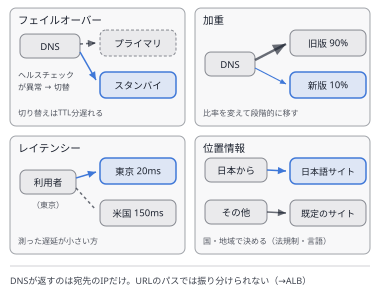
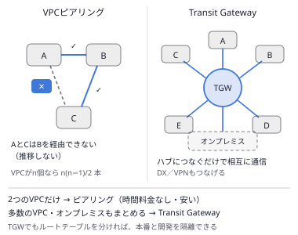

# 問題セット37 ｜ 実戦演習⑫（選択肢の差が一語の問題・15問）

> 全15問・目安30分。各問の「解答と解説」を開くと正解が表示されます。
> 本試験の問題は含みません。出題形式に沿ったオリジナル問題です。
>
> 第1分野5問／第2分野4問／第3分野3問／第4分野3問を分野を伏せて並べ、複数選択を2問含めています。
> 選択肢は同じ文の形で書かれ、違うのは**起動時と終了時・プライマリとセカンダリ・クエリごとと全体**などの一語か二語だけです。
> 設問の要件を1つずつ選択肢に当てて、どこで外れるかを確かめてください。

---

### Q1 ｜ 終了する前にログを送る ｜ ★★

Auto Scalingのスケールインでインスタンスが終了すると、ローカルに残っていた直近のアプリケーションのログが失われます。インスタンスを終了する前に、**ログをS3へ送り終えてから**終了させたいと考えています。最も適切な方法はどれですか。

- **A.** 起動時のライフサイクルフックを追加し、起動の後にログを送るスクリプトを動かす
- **B.** 終了時のライフサイクルフックを追加し、待機中にログを送ってから終了を続ける
- **C.** ターゲットグループの登録解除の遅延を延ばし、その間にログを送る
- **D.** 終了ポリシーを `OldestInstance` にし、古いインスタンスから順に終了させる

解答と解説

**正解：B**

**分野**：2.1 スケーラブルで疎結合な設計

**決め手**：終了時のライフサイクルフックを付けると、インスタンスは終了の前に**待機の状態**で止まります。その間にログを送り、送り終えたらライフサイクルアクションの完了を通知して、終了を続けます。

**キーワード**：終了する前の処理 → 終了時のライフサイクルフック

**他の選択肢を外す理由**
- **A**：起動時のフックは、起動の後の準備のためのものです。終了の前の処理には使えません。
- **C**：登録解除の遅延は、処理中のリクエストを待つ時間です。時間が来れば終了が進み、ログを送り終えたかは確かめられません。
- **D**：終了させる順番が変わるだけで、ログは失われます。

**参照**：[第1章 1.2 Amazon EC2 Auto Scaling](../docs/01-compute.md)

---

### Q2 ｜ 社員のシングルサインオン ｜ ★★

AWS Organizationsで30のAWSアカウントを管理しています。社員はふだんMicrosoft Entra IDでサインインしています。社員が**Entra IDの認証情報で各アカウントにシングルサインオン**し、部署ごとの権限を一か所で管理したいと考えています。最も適切な方法はどれですか。

- **A.** CognitoユーザープールにEntra IDをSAMLで連携し、各アカウントへサインインさせる
- **B.** 各アカウントのIAMにEntra IDをSAMLのIDプロバイダーとして登録し、ロールを作る
- **C.** Cognito IDプールにEntra IDを連携し、各アカウントの一時認証情報を渡す
- **D.** IAM Identity CenterのIDソースをEntra IDにし、許可セットをアカウントに割り当てる

解答と解説

**正解：D**

**分野**：1.1 安全なアクセス

**決め手**：IAM Identity Centerは、**社員が複数のAWSアカウントへシングルサインオン**するためのサービスです。IDソースに外部のIDプロバイダー（Entra ID）を指定し、**許可セット**をアカウントとグループに割り当てれば、権限を一か所で管理できます。

**キーワード**：社員・複数アカウント・SSO → IAM Identity Center＋許可セット

**他の選択肢を外す理由**
- **A**：Cognitoは、アプリケーションの利用者（顧客）の認証のためのサービスです。
- **B**：動きますが、30のアカウントそれぞれでIDプロバイダーとロールを作って保守する必要があります。
- **C**：IDプールは、アプリケーションにAWSの一時認証情報を渡す仕組みで、社員のコンソールへのサインインには使いません。

**参照**：[第5章 5.2 AWS IAM Identity Center](../docs/05-security.md)

---

### Q3 ｜ 大きすぎるスキャンを止める ｜ ★★

分析者がAthenaで大きなテーブルに `WHERE` 句のないクエリを実行し、**1回で数十TB**をスキャンしてしまうことがあります。1回のクエリで1 TBを超えるスキャンは、**自動で止めたい**と考えています。最も適切な方法はどれですか。

- **A.** ワークグループで、クエリごとのデータ使用量の制限を1 TBにする
- **B.** ワークグループで、ワークグループ全体のデータ使用量の制限を1日1 TBにする
- **C.** AWS Budgetsで、Athenaの費用に予算を設定し、超えたら通知する
- **D.** Cost Anomaly Detectionで、Athenaの費用の急増を検知して通知する

解答と解説

**正解：A**

**分野**：4.3 データベースのコスト

**決め手**：ワークグループの**クエリごと**のデータ使用量の制限は、1回のクエリのスキャン量が上限を超えると、そのクエリを**取り消します**。大きすぎるスキャンをその場で止められます。

**キーワード**：1回のクエリを止める → クエリごとのデータ使用量の制限

**他の選択肢を外す理由**
- **B**：ワークグループ全体の制限は、合計が上限を超えるとSNSで通知するだけで、実行中のクエリは止まりません。
- **C**：費用が予算を超えたことを知らせる仕組みで、クエリを止めません。
- **D**：費用の急増を知らせるだけで、クエリを止めません。

**参照**：[第7章 7.3 Amazon Athena](../docs/07-analytics.md)

---

### Q4 ｜ 止められず、改ざんも確かめられる監査ログ ｜ ★★★

組織内のすべてのアカウントのAPIの操作を、1つのS3バケットに記録します。要件は次の2つです。(1) メンバーアカウントの管理者が、記録を止めたり設定を変えたりできない。(2) ログファイルが後から**改ざんや削除をされていないことを検証**できる。**適切な対応を2つ選択してください。**

- **A.** 各メンバーアカウントで証跡を作り、ログを集約用のバケットへ送る
- **B.** 管理アカウントで組織の証跡を作り、ログを集約用のバケットへ送る
- **C.** 証跡のログをSSE-KMSで暗号化し、改ざんを検出する
- **D.** 証跡のログをCloudWatch Logsへ送り、改ざんを検出する
- **E.** 証跡でログファイルの検証を有効にし、ダイジェストファイルで確かめる

解答と解説

**正解：B・E**

**分野**：1.2 安全なワークロードとアプリケーション

**決め手**：管理アカウントで作る**組織の証跡**は、すべてのメンバーアカウントに適用され、メンバーアカウントからは変更も削除もできません（要件1）。**ログファイルの検証**を有効にすると、ハッシュと署名を含むダイジェストファイルが作られ、ログファイルの改ざんや削除を後から確かめられます（要件2）。

**キーワード**：止められない＝組織の証跡／改ざんの検証＝ログファイルの検証

**他の選択肢を外す理由**
- **A**：メンバーアカウントの管理者が、自分のアカウントの証跡を止めたり消したりできます。
- **C**：暗号化は内容を読めなくするもので、改ざんや削除を検出する仕組みではありません。
- **D**：CloudWatch Logsへの配信は監視のためのもので、S3のログファイルの改ざんは検証できません。

**参照**：[第8章 8.2 AWS CloudTrail](../docs/08-management.md)

---

### Q5 ｜ 切り替わらないフェイルオーバー ｜ ★★★

東京とシンガポールのALBに、Route 53のフェイルオーバーのエイリアスレコード（プライマリは東京）を設定しています。東京のALBの背後のEC2がすべて異常になっても、トラフィックがシンガポールへ切り替わりません。Route 53のヘルスチェックは作っていません。最小の変更で切り替わるようにする方法はどれですか。

- **A.** プライマリのエイリアスレコードで、TTLを60秒にする
- **B.** セカンダリのエイリアスレコードで、ターゲットのヘルスを評価を「はい」にする
- **C.** プライマリのエイリアスレコードで、ターゲットのヘルスを評価を「はい」にする
- **D.** プライマリのレコードを加重のエイリアスレコードに変え、東京の重みを0にする

解答と解説

**正解：C**

**分野**：2.2 高可用性・耐障害性

**決め手**：エイリアスレコードで「ターゲットのヘルスを評価」を「はい」にすると、Route 53はALBのターゲットグループのヘルスチェックの結果を使います。プライマリのALBに正常なターゲットがなくなるとレコードが異常と判定され、セカンダリへ切り替わります。別にヘルスチェックを作る必要はありません。

**キーワード**：エイリアスのフェイルオーバー → プライマリで「ターゲットのヘルスを評価」

**他の選択肢を外す理由**
- **A**：エイリアスレコードにはTTLを設定できず、そもそも異常を判定する設定ではありません。
- **B**：プライマリが常に正常と判定されたままなので、切り替わりません。
- **D**：手作業で重みを変える方法で、障害を自動で検知して切り替えることはできません。

**参照**：[第3章 3.4 名前解決：Route 53 と Resolver](../docs/03-network.md)

---

### Q6 ｜ 容量が足りないLambda関数 ｜ ★★

Lambda関数で、S3から最大6 GBの動画を `/tmp` にダウンロードして変換しています。大きな動画のときに `No space left on device` で失敗します。処理の時間は5分ほどで、タイムアウトには余裕があります。最も適切な対策はどれですか。

- **A.** 関数のメモリを10,240 MBにする
- **B.** 関数のタイムアウトを15分にする
- **C.** 関数の予約済み同時実行数を増やす
- **D.** 関数のエフェメラルストレージを10,240 MBにする

解答と解説

**正解：D**

**分野**：3.2 高性能なコンピューティング

**決め手**：`/tmp` の大きさは**エフェメラルストレージ**の設定で決まり、512 MBから最大10,240 MBまで増やせます。6 GBの動画を置くには、この設定を広げます。

**キーワード**：`/tmp` の容量不足 → エフェメラルストレージ

**他の選択肢を外す理由**
- **A**：メモリと `/tmp` の容量は別の設定です。メモリを増やしても `/tmp` は広がりません。
- **B**：不足しているのは時間ではなく容量です。
- **C**：同時に動く数が増えるだけで、1回の実行で使える容量は変わりません。

**参照**：[第1章 1.6 AWS Lambda](../docs/01-compute.md)

---

### Q7 ｜ 新しいボリュームを必ず暗号化する ｜ ★★

東京と大阪のリージョンで、今後作るEBSボリュームが**必ず暗号化される**ようにしたいと考えています。チームが使っているツールやテンプレートは変えたくありません。既存のボリュームは別の計画で対応します。最も適切な方法はどれですか。

- **A.** 東京と大阪のそれぞれで、EBSのデフォルトの暗号化を有効にする
- **B.** 東京だけで、EBSのデフォルトの暗号化を有効にする（全リージョンに適用される）
- **C.** AWS Configのルールで、暗号化されていないボリュームを検出して通知する
- **D.** SCPで、暗号化されていないボリュームの作成を拒否する

解答と解説

**正解：A**

**分野**：1.3 データセキュリティ管理

**決め手**：EBSのデフォルトの暗号化を有効にすると、ツールやテンプレートで暗号化を指定しなくても、新しいボリュームは自動で暗号化されます。この設定は**リージョンごと**なので、使うリージョンのそれぞれで有効にします。

**キーワード**：既定で暗号化・リージョンごと → EBSのデフォルトの暗号化

**他の選択肢を外す理由**
- **B**：設定はリージョンごとで、東京で有効にしても大阪には適用されません。
- **C**：作られた後に見つけるだけで、暗号化されていないボリュームの作成は防げません。
- **D**：暗号化を指定していない作成が拒否され、ツールやテンプレートを変える必要があります。

**参照**：[第2章 2.2 Amazon EBS](../docs/02-storage.md)

---

### Q8 ｜ 2つのVPCの間の大量の転送 ｜ ★★

同じリージョンの2つのVPCの間で、毎月数百TBのデータを転送しています。今後もVPCは2つのままで、CIDRは重なっていません。接続の費用を最も下げられる方法はどれですか。

- **A.** 2つのVPCをTransit Gatewayに接続する
- **B.** 2つのVPCをVPCピアリングで接続する
- **C.** 一方のVPCのサービスをPrivateLinkで公開する
- **D.** 2つのVPCをSite-to-Site VPNで接続する

解答と解説

**正解：B**

**分野**：4.4 ネットワークのコスト

**決め手**：VPCピアリングには、接続の時間料金も、GBあたりのデータ処理料金もありません（AZをまたぐ通信には通常のデータ転送料金がかかります）。VPCが2つだけなら、最も安い接続方法です。

**キーワード**：2つのVPC・大量の転送 → VPCピアリング

**他の選択肢を外す理由**
- **A**：Transit Gatewayは、アタッチメントの時間料金と、GBあたりのデータ処理料金がかかります。
- **C**：エンドポイントの時間料金とデータ処理料金がかかり、接続も一方向です。
- **D**：VPN接続の時間料金がかかり、帯域にも上限があります。

**参照**：[第3章 3.3 VPCの外部接続](../docs/03-network.md) ／ [第14章 14.2 ストレージのコスト最適化](../docs/14-cost.md)

---

### Q9 ｜ 切り替わらない注文の送信 ｜ ★★★

決済のAPIをCloudFront経由で公開し、オリジンは東京とシンガポールのALBです。オリジングループで東京をプライマリにしています。東京の障害の訓練で、画面の表示（GET）はシンガポールに切り替わりましたが、**注文の送信（POST）は失敗し続けました**。最も適切な対策はどれですか。

- **A.** オリジングループのフェイルオーバーの条件に、500番台のステータスコードをすべて加える
- **B.** オリジングループのフェイルオーバーの条件で、接続のタイムアウトを短くする
- **C.** キャッシュビヘイビアで、キャッシュするHTTPメソッドにPOSTを加える
- **D.** オリジングループをやめ、Route 53のフェイルオーバーレコードでALBを切り替える

解答と解説

**正解：D**

**分野**：2.2 高可用性・耐障害性

**決め手**：CloudFrontのオリジンフェイルオーバーが送り直すのは、**GET・HEAD・OPTIONSのリクエストだけ**です。POSTも切り替えるには、オリジンの名前をRoute 53のフェイルオーバーレコードにし、DNSの段階でALBを切り替えます。

**キーワード**：オリジンフェイルオーバーはGET・HEAD・OPTIONSだけ

**他の選択肢を外す理由**
- **A**：条件を増やしても、POSTは切り替えの対象になりません。
- **B**：Aと同じで、POSTは対象外のままです。
- **C**：キャッシュするメソッドにPOSTは指定できず、切り替えの対象にもなりません。

**参照**：[第3章 3.6 CloudFront と Global Accelerator](../docs/03-network.md)

---

### Q10 ｜ 使われていないロールと権限 ｜ ★★

組織の100のアカウントについて、**90日以上使われていないIAMロール**や、付与されているのに**使われていない権限**を、継続的に洗い出したいと考えています。最も適切な方法はどれですか。

- **A.** IAM Access Analyzerで、外部アクセスのアナライザーを組織に作る
- **B.** IAMの認証情報レポートを、各アカウントで定期的にダウンロードする
- **C.** IAM Access Analyzerで、未使用のアクセスのアナライザーを組織に作る
- **D.** IAM Access Analyzerのポリシーの生成で、CloudTrailから最小権限のポリシーを作る

解答と解説

**正解：C**

**分野**：1.1 安全なアクセス

**決め手**：Access Analyzerの**未使用のアクセス**のアナライザーは、使われていないロール、アクセスキー、パスワード、権限を見つけて検出結果にします。組織を対象に作れば、すべてのアカウントを継続的に調べられます。

**キーワード**：使われていないロール・権限 → 未使用のアクセスのアナライザー

**他の選択肢を外す理由**
- **A**：外部アクセスのアナライザーは、組織やアカウントの外に共有されているリソースを見つけるものです。
- **B**：IAMユーザーの認証情報の状態の一覧で、ロールや権限の未使用は分かりません。アカウントごとの作業も必要です。
- **D**：1つのロールの実際の操作から最小権限のポリシーを作る機能で、組織全体を継続的に洗い出すものではありません。

**参照**：[第5章 5.1 AWS IAM](../docs/05-security.md) ／ [第11章 11.1 アクセス管理](../docs/11-secure.md)

---

### Q11 ｜ 一部に偏るgRPCの通信 ｜ ★★★

マイクロサービスは、gRPC（HTTP/2）で通信しています。クライアントは長い接続を保ったまま多くの呼び出しを送るため、今のNetwork Load Balancer（TCP）では、一部のターゲットに負荷が偏ります。**呼び出しごとに**ターゲットへ分散したいと考えています。最も適切な構成はどれですか。

- **A.** ALBを使い、ターゲットグループのプロトコルのバージョンをgRPCにする
- **B.** ALBを使い、ターゲットグループのプロトコルのバージョンをHTTP1にする
- **C.** NLBのまま、クロスゾーン負荷分散を有効にする
- **D.** NLBのまま、ターゲットグループでスティッキーセッションを無効にする

解答と解説

**正解：A**

**分野**：3.4 高性能なネットワーク

**決め手**：NLBは**接続単位**で振り分けるため、1本の長い接続の中の呼び出しは同じターゲットに届きます。ALBのターゲットグループでプロトコルのバージョンを**gRPC**にすると、ALBがgRPCの呼び出しを理解して、呼び出しごとにターゲットへ分散します。

**キーワード**：gRPCの呼び出しごとの分散 → ALB＋プロトコルのバージョンgRPC

**他の選択肢を外す理由**
- **B**：ターゲットへHTTP/1.1で送るため、gRPCの通信ができません。
- **C**：AZをまたいで配るだけで、接続単位で振り分ける点は変わりません。
- **D**：接続単位で振り分ける点は同じで、偏りは解消しません。

**参照**：[第3章 3.5 負荷分散](../docs/03-network.md)

---

### Q12 ｜ 取引先ごとの利用の上限 ｜ ★★

API GatewayのREST APIを、外部の取引先に提供しています。取引先ごとにAPIキーを発行済みです。**取引先ごとに**、毎秒100リクエストまで、月に100万リクエストまでに制限したいと考えています。最も適切な方法はどれですか。

- **A.** ステージの既定のスロットリングを、毎秒100リクエストにする
- **B.** メソッドごとのスロットリングを、毎秒100リクエストにする
- **C.** 使用量プランでスロットリングとクォータを設定し、各APIキーを関連付ける
- **D.** AWS WAFのレートベースルールで、IPアドレスごとにリクエストを制限する

解答と解説

**正解：C**

**分野**：2.1 スケーラブルで疎結合な設計

**決め手**：使用量プランは、**APIキーごと**に、1秒あたりのリクエスト数（スロットリング）と、日・週・月の合計（クォータ）を設定できます。取引先のAPIキーを関連付ければ、取引先ごとの上限になります。

**キーワード**：APIキーごとの上限 → 使用量プラン

**他の選択肢を外す理由**
- **A**：すべての取引先の合計にかかる上限で、取引先ごとにはなりません。月の上限も設定できません。
- **B**：メソッド単位の合計の上限で、取引先ごとにはなりません。
- **D**：IPアドレスごとの制限で、取引先（APIキー）ごとではなく、月の上限も設定できません。

**参照**：[第10章 10.1 Amazon API Gateway](../docs/10-others.md)

---

### Q13 ｜ 暗号化したキューに届かない通知 ｜ ★★★

SNSトピックから、SSE-KMSで暗号化したSQSキューへ配信する構成を作りました。キューを**AWSマネージドキー（`aws/sqs`）**で暗号化したところ、メッセージが届きません。キューの暗号化は必須です。**必要な対応を2つ選択してください。**

- **A.** キューの暗号化に使うキーを、カスタマー管理キーに変える
- **B.** `aws/sqs` のキーポリシーで、SNSに `kms:GenerateDataKey` と `kms:Decrypt` を許可する
- **C.** キューのアクセスポリシーで、SNSに `kms:Decrypt` を許可する
- **D.** カスタマー管理キーのキーポリシーで、SNSに `kms:GenerateDataKey` と `kms:Decrypt` を許可する
- **E.** カスタマー管理キーのキーポリシーで、SNSに `kms:Encrypt` だけを許可する

解答と解説

**正解：A・D**

**分野**：1.3 データセキュリティ管理

**決め手**：SNSが暗号化されたキューへメッセージを送るには、キーを使う権限が必要です。AWSマネージドキーはキーポリシーを変えられないため、**カスタマー管理キー**に変え、そのキーポリシーでSNS（`sns.amazonaws.com`）に `kms:GenerateDataKey` と `kms:Decrypt` を許可します。

**キーワード**：SNS → 暗号化したSQS＝カスタマー管理キー＋キーポリシーでSNSを許可

**他の選択肢を外す理由**
- **B**：AWSマネージドキーのキーポリシーは、利用者が変更できません。
- **C**：キューのアクセスポリシーはSQSの操作の許可で、KMSのキーを使う権限は与えられません。
- **E**：SNSが使うのは `kms:GenerateDataKey` と `kms:Decrypt` で、`kms:Encrypt` だけでは送れません。

**参照**：[第6章 6.2 Amazon SNS](../docs/06-integration.md) ／ [第5章 5.8 AWS KMS](../docs/05-security.md)

---

### Q14 ｜ 変更の記録を多くの処理で読む ｜ ★★★

DynamoDBの注文テーブルの変更を、検索・分析・通知など**5つの処理**がそれぞれ読みます。障害のときに読み直せるよう、変更の記録を**7日間**残したいと考えています。最も適切な方法はどれですか。

- **A.** DynamoDB Streamsを有効にし、5つの処理で同じストリームを読む
- **B.** Kinesis Data Streams for DynamoDBを有効にし、保持期間を7日にする
- **C.** DynamoDB Streamsを有効にし、ストリームの保持期間を7日にする
- **D.** Kinesis Data Streams for DynamoDBを有効にし、保持期間を既定の24時間のままにする

解答と解説

**正解：B**

**分野**：3.5 データの取り込みと変換

**決め手**：Kinesis Data Streams for DynamoDBは、変更の記録をKinesis Data Streamsへ送ります。保持期間を最大1年まで延ばせ、1つのシャードを同時に読む処理もDynamoDB Streamsより多くできます（拡張ファンアウトを使えばさらに増やせます）。

**キーワード**：長い保持・多くの読み手 → Kinesis Data Streams for DynamoDB

**他の選択肢を外す理由**
- **A**：DynamoDB Streamsで1つのシャードを同時に読むのは2つまでで、記録は24時間で消えます。
- **C**：DynamoDB Streamsの保持期間は24時間で、延ばせません。
- **D**：7日間残す要件を満たしません。

**参照**：[第4章 4.3 Amazon DynamoDB](../docs/04-database.md)

---

### Q15 ｜ 保存の料金が大部分のテーブル ｜ ★★

DynamoDBの注文履歴のテーブルは80 TBあります。過去の注文はめったに読まれませんが、DynamoDBのAPIで引ける状態にしておく必要があります。読み書きは少なく、**費用の大部分は保存の料金**です。費用を最も下げられる方法はどれですか。

- **A.** キャパシティモードをプロビジョンドにし、リザーブドキャパシティを購入する
- **B.** キャパシティモードをオンデマンドに変える
- **C.** TTLを設定し、1年より古い注文を自動で削除する
- **D.** テーブルクラスをStandard-IAに変える

解答と解説

**正解：D**

**分野**：4.3 データベースのコスト

**決め手**：Standard-IAのテーブルクラスは、**保存の料金が安い**代わりに読み書きの料金が高くなります。めったに読まれない大量のデータを置き、費用の大部分が保存の料金であるテーブルで最も効果があります。APIはそのまま使えます。

**キーワード**：保存の料金が大部分 → テーブルクラスをStandard-IAに

**他の選択肢を外す理由**
- **A**：読み書きの料金の割引で、費用の大部分を占める保存の料金は下がりません。
- **B**：Aと同じく読み書きの課金方式を変えるだけで、保存の料金は下がりません。
- **C**：古い注文を引ける状態にしておく要件に反します。

**参照**：[第4章 4.3 Amazon DynamoDB](../docs/04-database.md) ／ [第14章 14.4 データベースのコスト最適化](../docs/14-cost.md)

