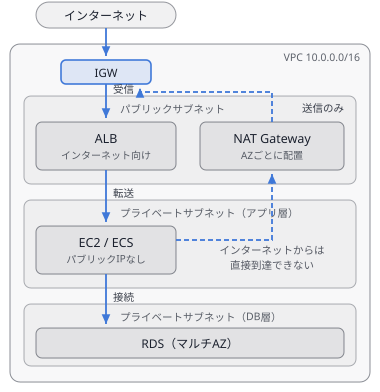
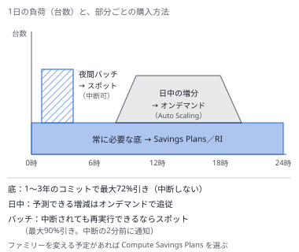
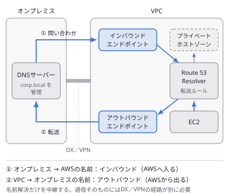
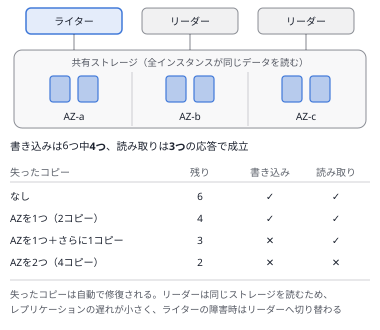
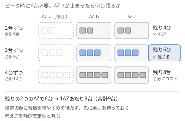

# 問題セット38 ｜ 実戦演習⑬（本番に近い設問と、ひっかけの選択肢・15問）

> 全15問・目安30分。各問の「解答と解説」を開くと正解が表示されます。
> 本試験の問題は含みません。出題形式に沿ったオリジナル問題です。
>
> 第1分野5問／第2分野4問／第3分野3問／第4分野3問を分野を伏せて並べ、複数選択を2問含めています。
> 設問は「状況 → 今の構成 → 問題や要件（数値つき）→ 評価の軸 → 問い」の順にそろえ、2問はポリシーのJSONを読む問題です。
> 誤りの選択肢には、**偽の機能・一語違い・過剰な構成・条件の取り違え・守る範囲の違い**のひっかけを入れています。解説の【　】は、その選択肢がどのひっかけかを示します。

---

### Q1 ｜ AZ障害で止まる外部への通信 ｜ ★★

ある企業は、AWS上で注文システムを運用しています。3つのAZのプライベートサブネットにEC2を置き、外部の決済APIへはNAT Gateway経由で接続しています。NAT GatewayはAZ-aのパブリックサブネットに1つだけあり、すべてのプライベートサブネットのルートテーブルがそこへ向いています。AZ-aで障害が起きても、AZ-bとAZ-cの注文が止まらないようにする必要があります。運用上のオーバーヘッドを最小限に抑えつつ対応したいと考えています。これらの要件を満たすソリューションはどれでしょうか。

- **A.** AZ-bとAZ-cのプライベートサブネットにもNAT Gatewayを置く。各AZのプライベートサブネットのルートテーブルを、同じAZのNAT Gatewayへ向ける。
- **B.** AZ-bとAZ-cのパブリックサブネットにもNAT Gatewayを置く。すべてのプライベートサブネットのルートテーブルは、AZ-aのNAT Gatewayへ向けたままにする。
- **C.** AZ-bとAZ-cのパブリックサブネットにもNAT Gatewayを置く。各AZのプライベートサブネットのルートテーブルを、同じAZのNAT Gatewayへ向ける。
- **D.** 別のリージョンに同じVPCとNAT Gatewayの構成を作る。Route 53のフェイルオーバーのレコードで、障害時はリージョンごと切り替える。

<details>
<summary>解答と解説</summary>

**正解：C**

**分野**：2.2 高可用性・耐障害性

**決め手**：NAT Gatewayは1つのAZの中で冗長化されたサービスで、AZが止まるとそのNAT Gatewayも使えません。**AZごとにパブリックサブネットへ1つずつ**置き、各AZのプライベートサブネットのルートテーブルを**同じAZのNAT Gateway**へ向ければ、1つのAZの障害がほかのAZに広がりません。

**キーワード**：NAT GatewayはAZごとにパブリックサブネットへ置き、同じAZのNAT Gatewayへ向ける



**他の選択肢を外す理由**
- **A**：【一語違い】インターネットへ出るNAT Gatewayは、インターネットゲートウェイへの経路があるパブリックサブネットに置きます。プライベートサブネットに置いても外へ出られません。
- **B**：【一語違い】NAT Gatewayを増やしても、経路がAZ-aを向いたままなので、AZ-aの障害ですべてのAZの通信が止まります。
- **D**：【守る範囲の違い】AZの障害への対策にリージョンの切り替えを使うのは過剰で、構成と運用が2倍になります。

**参照**：[第3章 3.1 VPCの基礎](../docs/03-network.md) ／ [第12章 12.5 高可用性と耐障害性](../docs/12-resilient.md)

</details>

---

### Q2 ｜ 削除を社内に限るIAMポリシー ｜ ★★★

あなたはソリューションアーキテクトとして、レポートを保存するS3バケット reports の権限を担当しています。社員は社内からも社外からもインターネット経由でレポートを読みますが、削除は社内のネットワーク（203.0.113.0/24）からだけに限る必要があります。最小限の労力で実現するため、社員のIAMグループに次のポリシーを付けました。ほかのポリシーはありません。

```json
{
  "Version": "2012-10-17",
  "Statement": [
    {
      "Effect": "Allow",
      "Action": "s3:*",
      "Resource": ["arn:aws:s3:::reports", "arn:aws:s3:::reports/*"]
    },
    {
      "Effect": "Deny",
      "Action": "s3:DeleteObject",
      "Resource": "arn:aws:s3:::reports/*",
      "Condition": {
        "NotIpAddress": { "aws:SourceIp": "203.0.113.0/24" }
      }
    }
  ]
}
```

この設定内容として正しいものを選択してください。

- **A.** 203.0.113.25 から、reports バケットのオブジェクトを削除できる。
- **B.** 203.0.113.25 から、reports バケットのオブジェクトを削除できない。
- **C.** 198.51.100.7 から、reports バケットのオブジェクトを読み取れない。
- **D.** 198.51.100.7 から、reports バケットのオブジェクトを削除できる。

<details>
<summary>解答と解説</summary>

**正解：A**

**分野**：1.1 安全なアクセス

**決め手**：2つ目の文は「送信元IPが203.0.113.0/24に**含まれない**とき、削除を拒否する」という意味です（`NotIpAddress`）。社内のIPアドレスからはこの条件に当たらないため、1つ目の文の `s3:*` の許可で削除できます。社外からの削除は、明示的なDenyが許可より優先されて拒否されます。

**キーワード**：NotIpAddress＋Deny＝その範囲の外からの操作を拒否／明示的なDenyは許可より優先


**他の選択肢を外す理由**
- **B**：【一語違い】送信元が203.0.113.0/24の中にあるため、NotIpAddressの条件に当たらず、Denyは働きません。1つ目の文の許可で削除できます。
- **C**：【条件の取り違え】Denyの対象は `s3:DeleteObject` だけです。読み取りは1つ目の文で許可され、どこからでもできます。
- **D**：【一語違い】送信元が203.0.113.0/24の外なので、NotIpAddressの条件に当たり、明示的なDenyで削除が拒否されます。

**参照**：[第5章 5.1 AWS IAM](../docs/05-security.md)

</details>

---

### Q3 ｜ ストリームを数秒以内に集計する ｜ ★★

ある企業は、AWS上で決済の不正検知を運用しています。決済のイベントは、Kinesis Data Streamsに毎秒5,000件届きます。カードごとに直近5分間の利用回数を集計し、しきい値を超えたら数秒以内に担当者へ通知する必要があります。運用上のオーバーヘッドを最小限に抑えつつ、サーバーの管理はしたくないと考えています。これらの要件を満たすソリューションはどれでしょうか。

- **A.** Amazon Data FirehoseのSQL処理でストリームを読み、カードごとに5分間のウィンドウで集計して通知する。
- **B.** Amazon EMRのクラスターを常に起動し、Spark Streamingでカードごとに5分間のウィンドウを集計して通知する。
- **C.** AWS Glueのクローラーでストリームのスキーマを推定し、カードごとに5分間の回数を集計して通知する。
- **D.** Amazon Managed Service for Apache Flinkでストリームを読み、カードごとに5分間のウィンドウで集計して通知する。

<details>
<summary>解答と解説</summary>

**正解：D**

**分野**：3.5 データの取り込みと変換

**決め手**：Managed Service for Apache Flinkは、ストリームを読み続けながら、**時間のウィンドウでの集計や異常の検出**をサーバーの管理なしで行えます。結果を数秒以内に出せるため、不正検知のようなリアルタイムの処理に向いています。

**キーワード**：ストリームのリアルタイム集計 → Managed Service for Apache Flink／Firehoseは届けるだけ


**他の選択肢を外す理由**
- **A**：【偽機能】Firehoseは、受け取ったデータをS3などへ届けるサービスで、SQLでウィンドウを集計する機能はありません。
- **B**：【過剰構成】集計はできますが、クラスターを常に動かして管理する必要があり、運用の負担が大きくなります。
- **C**：【偽機能】クローラーはスキーマを推定してデータカタログに登録するだけで、ストリームの集計はしません。

**参照**：[第7章 7.1 Amazon Kinesis](../docs/07-analytics.md)

</details>

---

### Q4 ｜ パスワードを30日ごとに変える ｜ ★★

ある企業は、AWS上で受注システムを運用しています。ECSのタスクがRDS for PostgreSQLに接続しており、データベースのパスワードはSystems Manager Parameter StoreのSecureStringに保存しています。監査での指摘を受け、このパスワードを30日ごとに変更する必要があります。運用上のオーバーヘッドを最小限に抑えつつ、自動で変更したいと考えています。これらの要件を満たすソリューションはどれでしょうか。

- **A.** Parameter StoreのSecureStringで、30日ごとの自動ローテーションを設定する。タスクは実行時に値を取得する。
- **B.** パスワードをSecrets Managerに移し、30日ごとの自動ローテーションを設定する。タスクは実行時にシークレットを取得する。
- **C.** Parameter StoreのSecureStringのまま、EventBridgeで30日ごとにLambda関数を起動し、DBと値を書き換える。
- **D.** パスワードをSecrets Managerに移し、30日ごとの自動ローテーションを設定する。値はタスク定義に直接書き込む。

<details>
<summary>解答と解説</summary>

**正解：B**

**分野**：1.2 安全なワークロードとアプリケーション

**決め手**：Secrets Managerの自動ローテーションは、**データベースのパスワードとシークレットの値を両方とも**スケジュールに合わせて変更します。タスクが実行時にシークレットを取得すれば、変更の後もそのまま接続できます。

**キーワード**：パスワードの自動ローテーション → Secrets Manager（Parameter Storeにはない）

**他の選択肢を外す理由**
- **A**：【偽機能】Parameter Storeには、パスワードを自動で変更する機能がありません。
- **C**：【過剰構成】動きますが、ローテーションの仕組みを自分で作って保守することになり、運用の負担が増えます。
- **D**：【一語違い】タスク定義に書いた値は変わらないため、ローテーションの後は接続できなくなります。

**参照**：[第5章 5.10 Secrets Manager vs Parameter Store](../docs/05-security.md)

</details>

---

### Q5 ｜ 常時稼働とバッチの購入方法 ｜ ★★

ある企業は、AWS上でECサイトを運用しています。Webサーバーは24時間365日、常に10台のEC2が動いており、今後3年間も台数は変わらない見込みです。別に、毎晩2時間だけ20台のEC2で集計のバッチを実行しており、途中で止まっても再実行できます。最もコスト効率の良い購入方法の組み合わせにする必要があります。これらの要件を満たすソリューションはどれでしょうか。（2つ選択）

- **A.** Webサーバーの10台を、スポットインスタンスで実行する。
- **B.** Webサーバーの10台に、3年のリザーブドインスタンスを購入する。
- **C.** 集計バッチの20台に、3年のリザーブドインスタンスを購入する。
- **D.** 集計バッチの20台を、Dedicated Hostで実行する。
- **E.** 集計バッチの20台を、スポットインスタンスで実行する。

<details>
<summary>解答と解説</summary>

**正解：B・E**

**分野**：4.2 コンピューティングのコスト

**決め手**：常に動き続ける**ベースラインはリザーブドインスタンス（またはSavings Plans）**で割り引き、**中断されても再実行できる処理はスポット**で動かします。短時間だけ使う処理にコミットの割引を使うと、使わない時間の分まで払うことになります。

**キーワード**：ベースライン＝リザーブド／中断してよい処理＝スポット



**他の選択肢を外す理由**
- **A**：【条件の取り違え】中断されると常時のサービスが止まります。中断できないベースラインにスポットは使いません。
- **C**：【条件の取り違え】1日2時間しか使わないため、残りの22時間分も払うことになります。
- **D**：【過剰構成】ハードウェアの専有が必要な要件はなく、費用が大きく増えます。

**参照**：[第14章 14.3 コンピューティングのコスト最適化](../docs/14-cost.md)

</details>

---

### Q6 ｜ キューがたまっても増えない台数 ｜ ★★★

ある企業は、AWS上で画像の変換サービスを運用しています。依頼はSQSのキューに入り、Auto ScalingグループのEC2が取り出して処理します。1件の処理には約2秒かかり、依頼は届いてから30秒以内に処理を始める必要があります。今はCPU使用率でスケーリングしていますが、しかし、キューに依頼がたまっても台数が増えないという問題が発生しています。運用上のオーバーヘッドを最小限に抑えつつ解決したいと考えています。これらの要件を満たすソリューションはどれでしょうか。

- **A.** キューの滞留数を台数で割ったメトリクスを作り、目標値を15にしたターゲット追跡スケーリングを設定する。
- **B.** キューの滞留数をそのまま使い、目標値を15にしたターゲット追跡スケーリングを設定する。
- **C.** キューの滞留数を台数で割ったメトリクスを作り、目標値を60にしたターゲット追跡スケーリングを設定する。
- **D.** CPU使用率の目標値を40%に下げたターゲット追跡スケーリングを設定する。

<details>
<summary>解答と解説</summary>

**正解：A**

**分野**：2.1 スケーラブルで疎結合な設計

**決め手**：AWSが推奨するのは、**キューの滞留数（ApproximateNumberOfMessagesVisible）を稼働中の台数で割った「1台あたりのバックログ」**を目標にする方法です。許容できる待ち時間30秒 ÷ 1件の処理時間2秒 ＝ **15件**を目標値にすれば、待ち時間が要件を超えないように台数が増減します。

**キーワード**：1台あたりのバックログ＝滞留数 ÷ 台数／目標値＝許容する待ち時間 ÷ 1件の処理時間

**他の選択肢を外す理由**
- **B**：【一語違い】キュー全体の滞留数は、台数が何台あっても同じ基準で比べられるため、必要な台数を正しく求められません。
- **C**：【一語違い】1台あたり60件たまると、最後の依頼は処理を始めるまで約120秒待ちます。30秒の要件を満たしません。
- **D**：【条件の取り違え】処理の待ちはCPU使用率に表れないことがあり、キューがたまっても台数が増えない問題は残ります。

**参照**：[第1章 1.2 Amazon EC2 Auto Scaling](../docs/01-compute.md)

</details>

---

### Q7 ｜ オンプレミスからプライベートな名前を引く ｜ ★★

ある企業は、AWS上で社内向けの業務システムを運用しています。システムの名前は、VPCに関連付けたRoute 53のプライベートホストゾーン（corp.internal）に登録しています。オンプレミスとはDirect Connectで接続しており、オンプレミスにある約500台のPCから、この名前を解決できるようにする必要があります。最小限の労力で実現したいと考えています。これらの要件を満たすソリューションはどれでしょうか。

- **A.** Route 53 Resolverのアウトバウンドエンドポイントを作成する。オンプレミスのDNSサーバーで、corp.internal の問い合わせをそのIPアドレスへ転送する。
- **B.** Route 53でVPCのDNS hostnamesの設定を有効にし、オンプレミスのPCがプライベートホストゾーンを直接参照できるようにする。
- **C.** Route 53 Resolverのインバウンドエンドポイントを作成する。オンプレミスのDNSサーバーで、corp.internal の問い合わせをそのIPアドレスへ転送する。
- **D.** プライベートホストゾーンを、パブリックホストゾーンとして作り直す。オンプレミスのPCが、インターネット経由で名前を解決できるようにする。

<details>
<summary>解答と解説</summary>

**正解：C**

**分野**：3.4 高性能なネットワーク

**決め手**：オンプレミスからVPCの中の名前（プライベートホストゾーン）を引くには、VPCにDNSの問い合わせを受け付ける口が必要です。それが**インバウンドエンドポイント**で、オンプレミスのDNSサーバーから条件付きで転送します。

**キーワード**：オンプレミス → VPCの名前＝インバウンド／VPC → オンプレミスの名前＝アウトバウンド



**他の選択肢を外す理由**
- **A**：【一語違い】アウトバウンドエンドポイントは、VPCからオンプレミスのDNSへ問い合わせるときに使います。向きが逆です。
- **B**：【偽機能】DNS hostnamesはVPCの属性で、オンプレミスからプライベートホストゾーンを引けるようにする機能ではありません。
- **D**：【条件の取り違え】社内の名前をインターネットに公開することになり、社内向けのシステムの要件に合いません。

**参照**：[第3章 3.4 名前解決：Route 53 と Resolver](../docs/03-network.md)

</details>

---

### Q8 ｜ 組織全体に同じWAFのルール ｜ ★★

ある企業は、AWS上で50のアカウントをAWS Organizationsで運用しています。各アカウントのALBに、共通のAWS WAFのルールを適用する必要があります。アカウントは毎月増え、新しいアカウントで作られたALBにも自動でルールを適用したいと考えています。運用上のオーバーヘッドを最小限に抑えつつ実現したいと考えています。これらの要件を満たすソリューションはどれでしょうか。

- **A.** 各アカウントでAWS WAFのWeb ACLを作成し、CloudFormationのテンプレートでALBに関連付ける。
- **B.** AWS Shield Advancedの保護グループで、組織のすべてのALBにAWS WAFのルールを適用する。
- **C.** 管理アカウントでAWS WAFのWeb ACLを作成し、各アカウントのALBにアカウントをまたいで関連付ける。
- **D.** AWS Firewall Managerで、組織を対象にAWS WAFのセキュリティポリシーを作成する。新しいアカウントのALBにも自動で適用する。

<details>
<summary>解答と解説</summary>

**正解：D**

**分野**：1.2 安全なワークロードとアプリケーション

**決め手**：Firewall Managerは、Organizationsの組織全体に、**WAFのルールやセキュリティグループのポリシーを一元的に適用**するサービスです。対象のリソースを自動で見つけて適用するため、新しいアカウントやALBにも手作業なしでルールが付きます。

**キーワード**：組織全体にWAFのルールを自動で配る → Firewall Manager


**他の選択肢を外す理由**
- **A**：【過剰構成】アカウントやALBが増えるたびに、作成と関連付けの作業が必要です。
- **B**：【偽機能】保護グループは、DDoSの検知と緩和のためにリソースをまとめる機能で、WAFのルールを配る機能ではありません。
- **C**：【偽機能】Web ACLは、同じアカウントのリソースにしか関連付けられません。

**参照**：[第5章 5.13 その他のセキュリティ・ガバナンスサービス](../docs/05-security.md)

</details>

---

### Q9 ｜ 増え続ける古い版 ｜ ★★

ある企業は、AWS上で設計図面の管理システムを運用しています。図面はバージョニングを有効にしたS3バケットに保存し、同じファイルを1日に何度も上書きしています。しかし、ストレージの容量が毎月20 TBずつ増え続けるという問題が発生しています。最新の図面は残し、上書きされた古い版は30日たったら不要です。最小限の労力で容量を減らしたいと考えています。これらの要件を満たすソリューションはどれでしょうか。

- **A.** ライフサイクルルールで、現行バージョンを、作成されてから30日後に失効させる。
- **B.** ライフサイクルルールで、非現行バージョンを、非現行になってから30日後に失効させる。
- **C.** S3のスナップショットを毎日取得し、30日より古いスナップショットを削除する。
- **D.** バケットのバージョニングを停止し、既存の古い版はそのまま残す。

<details>
<summary>解答と解説</summary>

**正解：B**

**分野**：4.1 ストレージのコスト

**決め手**：バージョニングを有効にしたバケットでは、上書きのたびに古い版が**非現行バージョン**として残り、料金の対象になります。ライフサイクルルールの「非現行バージョンの失効」で、非現行になってから30日たった版を自動で削除できます。

**キーワード**：上書きで残る古い版 → 非現行バージョンの失効

**他の選択肢を外す理由**
- **A**：【一語違い】最新の図面が30日で削除マーカーに置き換わり、残すべき版が見えなくなります。古い版も残り続けます。
- **C**：【偽機能】S3にスナップショットの機能はありません。古い版はバージョンとして残っています。
- **D**：【条件の取り違え】停止しても既存の古い版は消えず、容量は減りません。上書きからの保護もなくなります。

**参照**：[第2章 2.1 Amazon S3](../docs/02-storage.md) ／ [第14章 14.2 ストレージのコスト最適化](../docs/14-cost.md)

</details>

---

### Q10 ｜ 書き込み用インスタンスのAZ障害 ｜ ★★

ある企業は、AWS上で宿泊の予約サイトを運用しています。データ層はAurora MySQLで、書き込み用のインスタンスが1台だけあり、データは2 TBです。AZの障害でこのインスタンスが止まった場合でも、数分以内に復旧する必要があります。費用は必要以上にかけたくありません。これらの要件を満たすソリューションはどれでしょうか。

- **A.** 同じAZにAuroraレプリカを追加する。障害時は、そのレプリカが書き込み用に昇格する。
- **B.** Aurora Global Databaseにし、別のリージョンにセカンダリクラスターを追加する。
- **C.** 別のAZにAuroraレプリカを追加する。障害時は、そのレプリカが書き込み用に昇格する。
- **D.** 自動バックアップを有効にし、障害時はスナップショットから新しいクラスターを作る。

<details>
<summary>解答と解説</summary>

**正解：C**

**分野**：2.2 高可用性・耐障害性

**決め手**：Auroraのストレージは3つのAZにまたがっていますが、インスタンスは1台だけだとそのAZと一緒に止まります。**別のAZにAuroraレプリカ**を置けば、障害時はレプリカが書き込み用に昇格し、短時間で再開できます。

**キーワード**：AZの障害 → 別のAZのAuroraレプリカ／リージョンの障害 → Global Database



**他の選択肢を外す理由**
- **A**：【一語違い】同じAZにあるレプリカも、そのAZの障害で一緒に止まります。
- **B**：【過剰構成／守る範囲の違い】リージョンの障害への対策で、AZの障害には別のAZのレプリカで足ります。費用も大きく増えます。
- **D**：【条件の取り違え】2 TBの復元には時間がかかり、数分以内の復旧に間に合いません。

**参照**：[第4章 4.2 Amazon Aurora](../docs/04-database.md)

</details>

---

### Q11 ｜ ネットワークACLを作り直したら応答しない ｜ ★★★

ある企業は、AWS上でWebサイトを運用しています。パブリックサブネットのEC2がHTTPS（443番ポート）で応答し、セキュリティグループでは443番の受信を許可しています。監査の指摘で、サブネットのネットワークACLのルールをすべて削除し、必要なものだけを追加し直すことになりました。最もセキュリティが高い設定で、利用者が今までどおりサイトを使えるようにする必要があります。これらの要件を満たすソリューションはどれでしょうか。（2つ選択）

- **A.** ネットワークACLのインバウンドで、0.0.0.0/0 からのTCP 443を許可する。
- **B.** ネットワークACLのアウトバウンドで、0.0.0.0/0 へのTCP 443を許可する。
- **C.** ネットワークACLのインバウンドで、0.0.0.0/0 からのTCP 1024〜65535を許可する。
- **D.** ネットワークACLのアウトバウンドで、0.0.0.0/0 へのTCP 1024〜65535を許可する。
- **E.** セキュリティグループのアウトバウンドで、0.0.0.0/0 へのTCP 1024〜65535を許可する。

<details>
<summary>解答と解説</summary>

**正解：A・D**

**分野**：1.2 安全なワークロードとアプリケーション

**決め手**：ネットワークACLは**ステートレス**で、応答の通信も別に評価されます。受信の443番を許可するだけでなく、応答が利用者の**エフェメラルポート（1024〜65535）**へ出ていけるよう、アウトバウンドも許可する必要があります。

**キーワード**：ネットワークACLはステートレス＝戻りのエフェメラルポートも許可


**他の選択肢を外す理由**
- **B**：【一語違い】応答は、利用者側の一時的なポート（エフェメラルポート）へ返ります。443番だけを許可しても応答は届きません。
- **C**：【過剰構成】この通信には不要で、必要のないポートへの受信を広く開けることになります。
- **E**：【条件の取り違え】セキュリティグループはステートフルで、受信を許可した通信の応答は自動で通ります。問題はネットワークACLの側です。

**参照**：[第3章 3.2 通信制御](../docs/03-network.md)

</details>

---

### Q12 ｜ 取引先が登録したIPアドレスを変えない ｜ ★★★

ある企業は、AWS上で取引先向けのAPIを東京とフランクフルトで運用しています。取引先は、自社のファイアウォールに、この企業が所有するアドレス範囲（203.0.113.0/24と198.51.100.0/24）の2つのIPアドレスを登録しており、変更できません。世界中の取引先を、最寄りのリージョンへ低遅延で接続する必要があります。運用上のオーバーヘッドを最小限に抑えつつ実現したいと考えています。これらの要件を満たすソリューションはどれでしょうか。

- **A.** 所有するアドレス範囲をBYOIPでAWSに持ち込み、Global Acceleratorの静的IPアドレスとして割り当てる。
- **B.** 所有するアドレス範囲をBYOIPでAWSに持ち込み、各リージョンのALBに静的IPアドレスとして割り当てる。
- **C.** Global Acceleratorを作成し、割り当てられたAmazonのIPアドレスを取引先に登録し直してもらう。
- **D.** 所有するアドレス範囲をBYOIPでAWSに持ち込み、Route 53のエイリアスレコードに静的IPアドレスとして割り当てる。

<details>
<summary>解答と解説</summary>

**正解：A**

**分野**：3.4 高性能なネットワーク

**決め手**：Global Acceleratorは**BYOIP**に対応しており、自社が所有するIPv4のアドレス範囲を、アクセラレーターの静的IPアドレスとして使えます。取引先の登録を変えずに、最寄りのエッジからAWSのネットワークを通って、近いリージョンのエンドポイントへ届けられます。

**キーワード**：所有するIPアドレスのまま・複数リージョン → Global Accelerator＋BYOIP


**他の選択肢を外す理由**
- **B**：【偽機能】ALBには、固定のIPアドレスを割り当てられません。
- **C**：【条件の取り違え】取引先は登録済みのIPアドレスを変更できないという条件に反します。
- **D**：【偽機能】エイリアスレコードはAWSのリソースを指すDNSのレコードで、IPアドレスを持ち込んで割り当てる機能はありません。

**参照**：[第3章 3.6 CloudFront と Global Accelerator](../docs/03-network.md)

</details>

---

### Q13 ｜ 起動できるインスタンスを絞るポリシー ｜ ★★★

あなたはソリューションアーキテクトとして、開発チームが使うAWSアカウントの権限を担当しています。費用を抑えるため、開発者が起動できるEC2を小さいインスタンスタイプの2種類に限り、使えるリージョンも東京（ap-northeast-1）だけにする必要があります。最小限の労力で実現するため、開発者のIAMグループに次のポリシーを付けました。ほかのポリシーはありません。

```json
{
  "Version": "2012-10-17",
  "Statement": [
    {
      "Effect": "Allow",
      "Action": "ec2:*",
      "Resource": "*"
    },
    {
      "Effect": "Deny",
      "Action": "ec2:RunInstances",
      "Resource": "arn:aws:ec2:*:*:instance/*",
      "Condition": {
        "StringNotEquals": { "ec2:InstanceType": ["t3.micro", "t3.small"] }
      }
    },
    {
      "Effect": "Deny",
      "Action": "ec2:*",
      "Resource": "*",
      "Condition": {
        "StringNotEquals": { "aws:RequestedRegion": "ap-northeast-1" }
      }
    }
  ]
}
```

この設定内容として正しいものを選択してください。

- **A.** 東京リージョンで、m5.large のインスタンスを起動できる。
- **B.** 大阪リージョンで、t3.micro のインスタンスを起動できる。
- **C.** 東京リージョンで、起動済みの t3.large のインスタンスを停止できない。
- **D.** 東京リージョンで、t3.small のインスタンスを起動できる。

<details>
<summary>解答と解説</summary>

**正解：D**

**分野**：1.1 安全なアクセス

**決め手**：2つ目の文は、インスタンスタイプが t3.micro・t3.small の**どちらでもない**起動を拒否します（`StringNotEquals`）。3つ目の文は、東京**以外**のリージョンへのEC2の操作を拒否します。東京で t3.small を起動する操作はどちらのDenyにも当たらず、1つ目の文で許可されます。

**キーワード**：StringNotEquals＋Deny＝指定した値以外を拒否／Denyの対象のActionを読む


**他の選択肢を外す理由**
- **A**：【条件の取り違え】m5.large は許可した2種類に含まれないため、2つ目の文のDenyで起動が拒否されます。
- **B**：【一語違い】3つ目の文で、東京以外のリージョンへのEC2の操作はすべて拒否されます。
- **C**：【条件の取り違え】2つ目の文で拒否するのは `ec2:RunInstances` だけです。停止は1つ目の文で許可されています。

**参照**：[第5章 5.1 AWS IAM](../docs/05-security.md)

</details>

---

### Q14 ｜ AZが止まってもピークを処理する台数 ｜ ★★

ある企業は、AWS上で動画配信の認証APIを運用しています。ALBの背後にAuto ScalingグループのEC2を置いており、ピーク時には12台が必要です。1つのAZが止まっても、スケールアウトを待たずにピーク時の処理能力を保つ必要があります。この要件を満たす中で、最もコスト効率の良い配置にしたいと考えています。これらの要件を満たすソリューションはどれでしょうか。

- **A.** 2つのAZに12台ずつ、合計24台のEC2を配置する。
- **B.** 3つのAZに6台ずつ、合計18台のEC2を配置する。
- **C.** 3つのAZに4台ずつ、合計12台のEC2を配置する。
- **D.** 3つのAZに12台ずつ、合計36台のEC2を配置する。

<details>
<summary>解答と解説</summary>

**正解：B**

**分野**：2.2 高可用性・耐障害性

**決め手**：1つのAZが止まっても、残りの2つのAZで12台が必要です。そのため1つのAZに6台、つまり**ピークの50%を3つのAZに**置きます。どのAZが止まっても12台が残り、合計の18台が最も少ない台数です。

**キーワード**：3つのAZ × ピークの50%（静的安定性）



**他の選択肢を外す理由**
- **A**：【過剰構成】要件は満たしますが、3つのAZに分けるより6台多く必要です。
- **C**：【条件の取り違え】1つのAZが止まると8台になり、スケールアウトが終わるまで処理能力が足りません。
- **D**：【過剰構成】1つのAZが止まっても24台が残り、必要の2倍の台数に料金を払うことになります。

**参照**：[第12章 12.5 高可用性と耐障害性](../docs/12-resilient.md)

</details>

---

### Q15 ｜ ダウンロードの料金を利用者に払ってもらう ｜ ★★

ある企業は、AWS上で気象データの公開サービスを運用しています。S3バケットに500 TBのデータを置き、ほかの企業や大学が自分のAWSアカウントから毎月大量にダウンロードしています。しかし、ダウンロードのデータ転送の料金がすべて自社に請求されるという問題が発生しています。データを使う側に料金を負担してもらう必要があります。最小限の労力で実現したいと考えています。これらの要件を満たすソリューションはどれでしょうか。

- **A.** バケットでTransfer Accelerationを有効にする。利用者は、高速なエンドポイントからダウンロードする。
- **B.** CloudFrontのディストリビューションを作成する。利用者は、CloudFrontを経由してダウンロードする。
- **C.** バケットでリクエスタ支払いを有効にする。利用者は、料金を払うことを示すヘッダーを付けてダウンロードする。
- **D.** バケットで署名付きURLの課金を有効にする。利用者のアカウントに、ダウンロードの料金を請求する。

<details>
<summary>解答と解説</summary>

**正解：C**

**分野**：4.4 ネットワークのコスト

**決め手**：**リクエスタ支払い**を有効にしたバケットでは、リクエストとデータ転送の料金を、ダウンロードした側のAWSアカウントが払います。利用者はリクエストに支払いを承諾するヘッダーを付け、匿名ではなく自分の認証情報でアクセスします。

**キーワード**：データを使う側が払う → リクエスタ支払い

**他の選択肢を外す理由**
- **A**：【条件の取り違え】転送を速くする機能で、料金はバケットの所有者に請求されます。
- **B**：【条件の取り違え】配信の料金はCloudFrontの所有者、つまり自社に請求されます。
- **D**：【偽機能】署名付きURLは一時的なアクセスを許可する仕組みで、料金の請求先を変える機能はありません。

**参照**：[第2章 2.1 Amazon S3](../docs/02-storage.md)

</details>
