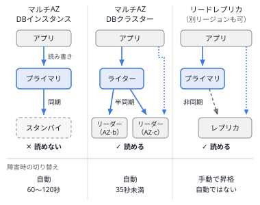
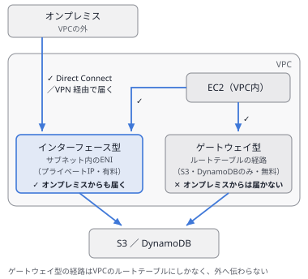
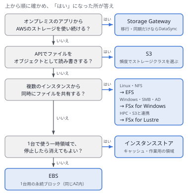
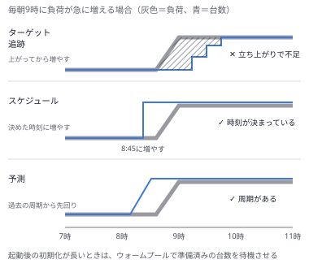
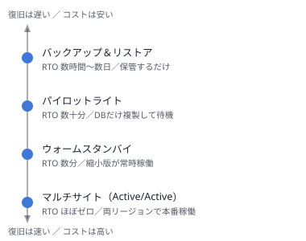
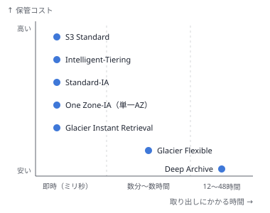

# 問題セット39 ｜ 実戦演習⑭（本番に近い設問と、ひっかけの選択肢・15問）

> 全15問・目安30分。各問の「解答と解説」を開くと正解が表示されます。
> 本試験の問題は含みません。出題形式に沿ったオリジナル問題です。
>
> 第1分野5問／第2分野4問／第3分野3問／第4分野3問を分野を伏せて並べ、複数選択を2問含めています。
> セット38と同じ形式で、1問はポリシーのJSONを読む問題です。
> 解説の【　】は、その選択肢のひっかけの種類（**偽機能・一語違い・過剰構成・条件の取り違え・守る範囲の違い**）を示します。

---

### Q1 ｜ シングルAZのデータベースのAZ障害 ｜ ★★

ある企業は、AWS上で会員サイトを運用しています。データ層はRDS for MySQLのシングルAZのDBインスタンスで、データは500 GBです。AZの障害が起きた場合でも、確定した書き込みを失わずに数分以内に復旧する必要があります。費用は必要以上にかけたくないと考えています。これらの要件を満たすソリューションはどれでしょうか。

- **A.** 別のAZにリードレプリカを作成する。障害時は、リードレプリカを手動で昇格させる。
- **B.** DBインスタンスをマルチAZ配置に変更する。障害時は、別のAZのスタンバイへ自動で切り替わる。
- **C.** 別のリージョンにリードレプリカを作成する。障害時は、リードレプリカを手動で昇格させる。
- **D.** Aurora MySQLに移行し、Aurora Global Databaseで別のリージョンにも複製する。

<details>
<summary>解答と解説</summary>

**正解：B**

**分野**：2.2 高可用性・耐障害性

**決め手**：マルチAZ配置では、別のAZのスタンバイへ**同期で**複製し、障害時は自動でフェイルオーバーします。確定した書き込みは失われず、通常は数分以内（60〜120秒程度）に再開できます。

**キーワード**：AZの障害・データを失わない・自動で切り替え → RDSのマルチAZ配置



**他の選択肢を外す理由**
- **A**：【条件の取り違え】リードレプリカへの複製は非同期のため、直前の書き込みを失うことがあります。昇格も手作業です。
- **C**：【守る範囲の違い】リージョンの障害への備えで、AZの障害には過剰です。非同期の複製のため、直前の書き込みも失うことがあります。
- **D**：【過剰構成】移行の手間とリージョンをまたぐ複製の費用がかかり、AZの障害への備えとしては必要以上です。

**参照**：[第4章 4.1 Amazon RDS](../docs/04-database.md)

</details>

---

### Q2 ｜ NAT Gatewayをなくしてもシークレットを取得する ｜ ★★★

ある企業は、AWS上で給与計算システムを運用しています。VPCのプライベートサブネットで動くLambda関数が、同じVPCのRDSに接続し、その認証情報を1時間に約1,000回、Secrets Managerから取得しています。セキュリティの方針で、VPCからインターネットへの経路（NAT Gateway）をなくす必要があります。最もセキュリティが高い構成で、関数のコードは変えずに取得を続けたいと考えています。これらの要件を満たすソリューションはどれでしょうか。

- **A.** Secrets ManagerのゲートウェイVPCエンドポイントを作成し、プライベートサブネットのルートテーブルに関連付ける。
- **B.** Secrets ManagerのインターフェースVPCエンドポイントを作成し、プライベートDNSを無効にする。
- **C.** Lambda関数をVPCの外に出し、インターネット経由でSecrets ManagerとRDSに接続する。
- **D.** Secrets ManagerのインターフェースVPCエンドポイントを作成し、プライベートDNSを有効にする。

<details>
<summary>解答と解説</summary>

**正解：D**

**分野**：1.2 安全なワークロードとアプリケーション

**決め手**：インターフェース型のVPCエンドポイントを作り、**プライベートDNSを有効にする**と、Secrets Managerの通常のエンドポイント名が、VPCの中のエンドポイントのプライベートIPアドレスに解決されます。コードを変えずに、インターネットを通らずに取得できます。

**キーワード**：S3・DynamoDB以外のサービス → インターフェース型エンドポイント＋プライベートDNS



**他の選択肢を外す理由**
- **A**：【偽機能】ゲートウェイ型のエンドポイントがあるのはS3とDynamoDBだけです。
- **B**：【一語違い】プライベートDNSを無効にすると、SDKの既定のエンドポイント名はパブリックのアドレスに解決されたままで、コードを変えないとエンドポイントに届きません。
- **C**：【条件の取り違え】RDSをインターネットに公開することになり、セキュリティの要件に反します。

**参照**：[第3章 3.3 VPCの外部接続](../docs/03-network.md)

</details>

---

### Q3 ｜ 何日後に移せばよいか分からない ｜ ★★

ある企業は、AWS上で写真の共有サービスを運用しています。S3 Standardに800 TBの写真があり、多くの写真は投稿から一定の日数がたつとほとんど見られなくなります。ライフサイクルルールでStandard-IAへ移したいのですが、何日後に移せばよいかが分かりません。最小限の労力で、移す日数を決める根拠を得る必要があります。これらの要件を満たすソリューションはどれでしょうか。

- **A.** バケットにS3のストレージクラス分析を設定し、30日以上アクセスの傾向を観察する。
- **B.** バケットのS3インベントリを有効にし、オブジェクトの一覧から作成日ごとの件数を数える。
- **C.** バケットのサーバーアクセスログを有効にし、Athenaで投稿日ごとのアクセスを集計する。
- **D.** CloudWatchでS3のリクエストメトリクスを有効にし、投稿日ごとのアクセスを確認する。

<details>
<summary>解答と解説</summary>

**正解：A**

**分野**：4.1 ストレージのコスト

**決め手**：S3の**ストレージクラス分析**は、オブジェクトの経過日数ごとのアクセスを観察し、StandardからStandard-IAへ移す時期の目安を示します。30日以上観察した結果を、ライフサイクルルールの日数の根拠にできます。

**キーワード**：移す日数の根拠 → S3のストレージクラス分析

**他の選択肢を外す理由**
- **B**：【条件の取り違え】インベントリはオブジェクトの一覧で、アクセスの記録は含まれません。
- **C**：【過剰構成】分析はできますが、ログの保存と集計の仕組みを自分で作ることになり、手間がかかります。
- **D**：【偽機能】リクエストメトリクスはリクエストの数や遅延の値で、オブジェクトの経過日数ごとのアクセスは分かりません。

**参照**：[第14章 14.2 ストレージのコスト最適化](../docs/14-cost.md)

</details>

---

### Q4 ｜ HTTPSと書き込み先を絞るバケットポリシー ｜ ★★★

あなたはソリューションアーキテクトとして、アプリケーションのログを保存するS3バケット logs の設定を担当しています。バケットとアプリケーションのIAMロール app は、同じアカウント（111122223333）にあり、ロール app にはIAMポリシーを付けていません。最もセキュリティが高い設定にするため、通信をHTTPSに限り、アプリケーションには logs/app/ 以下への書き込みだけを許可する次のバケットポリシーを付けました。

```json
{
  "Version": "2012-10-17",
  "Statement": [
    {
      "Sid": "DenyHTTP",
      "Effect": "Deny",
      "Principal": "*",
      "Action": "s3:*",
      "Resource": ["arn:aws:s3:::logs", "arn:aws:s3:::logs/*"],
      "Condition": { "Bool": { "aws:SecureTransport": "false" } }
    },
    {
      "Sid": "AllowAppPut",
      "Effect": "Allow",
      "Principal": { "AWS": "arn:aws:iam::111122223333:role/app" },
      "Action": "s3:PutObject",
      "Resource": "arn:aws:s3:::logs/app/*"
    }
  ]
}
```

この設定内容として正しいものを選択してください。

- **A.** ロール app は、HTTPで logs/app/ 以下にオブジェクトを書き込める。
- **B.** ロール app は、HTTPSで logs/ の直下にオブジェクトを書き込める。
- **C.** ロール app は、HTTPSで logs/app/ 以下にオブジェクトを書き込める。
- **D.** ロール app は、HTTPSで logs/app/ 以下のオブジェクトを読み取れる。

<details>
<summary>解答と解説</summary>

**正解：C**

**分野**：1.3 データセキュリティ管理

**決め手**：同じアカウントのロールには、バケットポリシーの許可だけでアクセスを与えられます。2つ目の文は **`logs/app/*` への `s3:PutObject` だけ**を許可し、1つ目の文はHTTPのリクエストをすべて拒否します。両方を満たすのは、HTTPSで `logs/app/` 以下へ書き込む操作だけです。

**キーワード**：SecureTransportのDeny＝HTTPを拒否／ActionとResourceの範囲を読む

**他の選択肢を外す理由**
- **A**：【一語違い】1つ目の文で、`aws:SecureTransport` が `false`（HTTP）のリクエストはすべて明示的に拒否されます。
- **B**：【条件の取り違え】許可のResourceは `logs/app/*` だけです。ロールにIAMポリシーもないため、ほかの場所には書き込めません。
- **D**：【条件の取り違え】許可しているActionは `s3:PutObject` だけで、読み取り（`s3:GetObject`）は許可されていません。

**参照**：[第11章 11.2 データ保護](../docs/11-secure.md) ／ [第5章 5.1 AWS IAM](../docs/05-security.md)

</details>

---

### Q5 ｜ 数百台から同時に読む解析データ ｜ ★★

ある企業は、AWS上でゲノム解析の基盤を運用しています。S3に保存した300 TBのデータを数百台のEC2から同時に読み、全体で毎秒数百GBのスループットが必要です。解析の結果はS3へ戻します。パフォーマンスを下げずに、S3とのデータのやり取りの手間も減らす必要があります。これらの要件を満たすソリューションはどれでしょうか。

- **A.** FSx for Windows File Serverのファイルシステムを作成してS3バケットとリンクし、EC2からマウントして読み書きする。
- **B.** FSx for Lustreのファイルシステムを作成してS3バケットとリンクし、EC2からマウントして読み書きする。
- **C.** EFSのファイルシステムを作成してS3のデータをすべてコピーし、EC2からマウントして読み書きする。
- **D.** 各EC2のEBSボリュームにS3のデータをコピーし、それぞれのインスタンスの中で読み書きする。

<details>
<summary>解答と解説</summary>

**正解：B**

**分野**：3.1 高性能なストレージ

**決め手**：FSx for Lustreは、HPCや機械学習向けの**並列ファイルシステム**で、数百GB/秒のスループットを出せます。**S3バケットとリンク**すると、S3のデータをファイルとして読み、結果をS3へ書き戻せます。

**キーワード**：HPC・S3と連携・数百GB/秒 → FSx for Lustre



**他の選択肢を外す理由**
- **A**：【一語違い】FSx for Windows File ServerはWindowsのSMBのファイル共有で、S3とリンクして並列に高速で読む用途のものではありません。
- **C**：【条件の取り違え】共有はできますが、数百GB/秒のスループットには向かず、S3とのコピーも自分で行う必要があります。
- **D**：【過剰構成】300 TBを数百台に配るコピーと容量の費用がかかり、結果をまとめる手間も増えます。

**参照**：[第2章 2.4 Amazon FSx](../docs/02-storage.md)

</details>

---

### Q6 ｜ 始業前に増やし、後で減らせるようにする ｜ ★★

ある企業は、AWS上で社内の勤怠システムを運用しています。Auto Scalingグループ（最小2台・最大20台）にターゲット追跡スケーリングを設定しています。しかし、毎朝9時の始業時に打刻が集中し、台数が増える前に応答が遅くなるという問題が発生しています。8時50分に10台にしておき、その後は負荷に応じて減らせるようにする必要があります。最小限の労力で実現したいと考えています。これらの要件を満たすソリューションはどれでしょうか。

- **A.** 毎日8時50分に、希望キャパシティを10にするスケジュールされたアクションを作成する。
- **B.** 毎日8時50分に、最小キャパシティを10にするスケジュールされたアクションを作成する。
- **C.** 毎日8時50分に、最大キャパシティを10にするスケジュールされたアクションを作成する。
- **D.** Step Functionsのワークフローを毎日8時50分に起動し、Auto Scalingグループの台数を10に変更する。

<details>
<summary>解答と解説</summary>

**正解：A**

**分野**：2.1 スケーラブルで疎結合な設計

**決め手**：スケジュールされたアクションで**希望キャパシティ**を10にすると、その時刻に台数が10台に増えます。最小キャパシティは2台のままなので、その後はターゲット追跡スケーリングが負荷に応じて台数を減らせます。

**キーワード**：定時に増やして後で減らせる＝希望キャパシティ／最小キャパシティを上げると減らせない



**他の選択肢を外す理由**
- **B**：【一語違い】最小を10にすると、次のアクションで戻すまで10台より減らず、負荷に応じて減らせません。
- **C**：【一語違い】最大を10にしても台数は増えず、負荷が高いときに10台を超えて増やすこともできなくなります。
- **D**：【過剰構成】単純な定時の変更のために、ワークフローを作って保守することになります。

**参照**：[第1章 1.2 Amazon EC2 Auto Scaling](../docs/01-compute.md)

</details>

---

### Q7 ｜ 本社と暗号化した接続を1週間で作る ｜ ★★

ある企業は、AWS上で在庫管理システムを運用しています。VPCのプライベートサブネットのEC2から、本社のデータベース（10.20.0.0/16）へ接続する必要があります。本社にはIPsecに対応したルーターがあり、1週間以内に、インターネットを経由した暗号化された接続を作りたいと考えています。最小限の労力で実現したいと考えています。これらの要件を満たすソリューションはどれでしょうか。（2つ選択）

- **A.** 本社のルーターのパブリックIPアドレスを指定して、ルーターを表す仮想プライベートゲートウェイを作成する。
- **B.** カスタマーゲートウェイを作成してVPCにアタッチし、Site-to-Site VPN接続を作成する。
- **C.** 本社のルーターのパブリックIPアドレスを指定して、ルーターを表すカスタマーゲートウェイを作成する。
- **D.** Direct Connectの専用接続を申し込み、本社のルーターに接続する。
- **E.** 仮想プライベートゲートウェイを作成してVPCにアタッチし、Site-to-Site VPN接続を作成する。

<details>
<summary>解答と解説</summary>

**正解：C・E**

**分野**：1.2 安全なワークロードとアプリケーション

**決め手**：Site-to-Site VPNは、オンプレミス側の機器を表す**カスタマーゲートウェイ**と、VPCにアタッチするAWS側の終端の**仮想プライベートゲートウェイ**の間に、IPsecのトンネルを作ります。VPCのルートテーブルでは、本社のCIDRへの経路を仮想プライベートゲートウェイに向けます（ルートの伝播で自動で追加できます）。

**キーワード**：オンプレミス側＝カスタマーゲートウェイ／VPC側＝仮想プライベートゲートウェイ

**他の選択肢を外す理由**
- **A**：【一語違い】本社の機器を表すのはカスタマーゲートウェイです。仮想プライベートゲートウェイはAWS側の終端です。
- **B**：【一語違い】VPCにアタッチするのは仮想プライベートゲートウェイ（またはTransit Gateway）です。
- **D**：【条件の取り違え】開通までに数週間以上かかることが多く、1週間以内の要件に合いません。標準では暗号化もされません。

**参照**：[第3章 3.3 VPCの外部接続](../docs/03-network.md)

</details>

---

### Q8 ｜ 終了した後も残るボリューム ｜ ★★

ある企業は、AWS上でバッチ処理を運用しています。毎日200台のEC2を起動テンプレートから起動し、ブロックデバイスマッピングで指定したデータ用のEBSボリュームで処理して、終わるとインスタンスを終了します。しかし、終了したインスタンスのデータ用のボリュームが削除されずに残り、料金が増え続けるという問題が発生しています。最小限の労力で解決したいと考えています。これらの要件を満たすソリューションはどれでしょうか。

- **A.** 起動テンプレートの詳細設定で、インスタンスの終了保護を有効にし、誤った終了の操作を防ぐ。
- **B.** EBSの自動削除ポリシーを有効にし、アタッチされていないボリュームを毎日削除する。
- **C.** 起動テンプレートのブロックデバイスマッピングで、ルートボリュームのDeleteOnTerminationを有効にする。
- **D.** 起動テンプレートのブロックデバイスマッピングで、データ用のボリュームのDeleteOnTerminationを有効にする。

<details>
<summary>解答と解説</summary>

**正解：D**

**分野**：4.1 ストレージのコスト

**決め手**：EBSボリュームがインスタンスの終了時に削除されるかは、ボリュームごとの**DeleteOnTermination**で決まります。起動テンプレートのブロックデバイスマッピングで、データ用のボリュームに有効を指定すれば、終了と同時に削除されます。

**キーワード**：終了時にボリュームを消す → DeleteOnTermination（終了保護とは別）

**他の選択肢を外す理由**
- **A**：【条件の取り違え】終了保護は誤った終了の操作を防ぐ設定で、ボリュームの削除とは関係ありません。バッチの後の終了もできなくなります。
- **B**：【偽機能】EBSに、アタッチされていないボリュームを自動で削除するポリシーの機能はありません。
- **C**：【一語違い】ルートボリュームは既定で削除されます。残っているのはデータ用のボリュームです。

**参照**：[第1章 1.1 Amazon EC2](../docs/01-compute.md)

</details>

---

### Q9 ｜ オンプレミスのサーバーをAWSで復旧する ｜ ★★

あなたはソリューションアーキテクトとして、オンプレミスで動く30台の業務サーバーの災害対策を担当しています。復旧先はAWSとし、失うデータは数秒分までに抑え、障害時は数十分以内に業務を再開する必要があります。ふだんの復旧先の費用を抑えた、最もコスト効率の良い方法にしたいと考えています。これらの要件を満たすソリューションはどれでしょうか。

- **A.** AWS Backupで、サーバーのバックアップを毎日AWSへ保存する。障害時は、バックアップからEC2を作成する。
- **B.** AWS Application Migration Serviceで、すべてのサーバーをAWSへ移行し、オンプレミスと同時に動かし続ける。
- **C.** AWS Elastic Disaster Recoveryで、サーバーのディスクを継続的にAWSへ複製する。障害時は、複製からEC2を起動する。
- **D.** AWS DataSyncで、サーバーのディスクをブロック単位でS3へ継続的に複製する。障害時は、S3からEC2を起動する。

<details>
<summary>解答と解説</summary>

**正解：C**

**分野**：2.2 高可用性・耐障害性

**決め手**：Elastic Disaster Recoveryは、サーバーのディスクを**ブロック単位で継続的に**AWSの低コストなステージング領域へ複製します。RPOは秒単位で、障害時は複製からEC2を起動するため、RTOは通常数分〜20分程度です。ふだんはステージング領域の小さな費用だけで済みます。

**キーワード**：オンプレミスのサーバー・RPO秒・RTO分 → Elastic Disaster Recovery



**他の選択肢を外す理由**
- **A**：【条件の取り違え】最大1日分のデータを失い、復元にも時間がかかるため、数秒と数十分の要件を満たしません。
- **B**：【過剰構成】移行のためのサービスで、両方の環境を常に動かすと費用が大きくなります。
- **D**：【偽機能】DataSyncはファイルやオブジェクトを転送するサービスで、ディスクをブロック単位で複製してサーバーを起動する機能はありません。

**参照**：[第12章 12.5 高可用性と耐障害性](../docs/12-resilient.md)

</details>

---

### Q10 ｜ 今のADのアカウントでWorkSpacesを使う ｜ ★★

あなたはソリューションアーキテクトとして、Amazon WorkSpacesの導入を担当しています。社員2,000人のアカウントはオンプレミスのActive Directoryで管理しており、AWSとはDirect Connectでつながっています。社員が今のADのユーザー名とパスワードでサインインできる必要があります。ディレクトリの情報はAWS側に置きたくありません。最小限の労力で実現したいと考えています。これらの要件を満たすソリューションはどれでしょうか。

- **A.** AD Connectorを作成してオンプレミスのADへ認証を中継させ、WorkSpacesのディレクトリに指定する。
- **B.** Simple ADを作成してオンプレミスのADと信頼関係を結び、WorkSpacesのディレクトリに指定する。
- **C.** AWS Managed Microsoft ADを作成してオンプレミスのADと信頼関係を結び、WorkSpacesのディレクトリに指定する。
- **D.** Cognitoユーザープールを作成してオンプレミスのADとSAMLで連携し、WorkSpacesの認証に指定する。

<details>
<summary>解答と解説</summary>

**正解：A**

**分野**：1.1 安全なアクセス

**決め手**：AD Connectorは、AWS側にディレクトリの情報を持たず、**オンプレミスのADへ認証の要求を中継する**プロキシです。社員は今のアカウントのままWorkSpacesにサインインでき、ユーザーの管理もオンプレミスのADで続けられます。

**キーワード**：オンプレミスのADをそのまま使う・AWS側に置かない → AD Connector

**他の選択肢を外す理由**
- **B**：【偽機能】Simple ADは、オンプレミスのADと信頼関係を結べません。
- **C**：【過剰構成】AWS側にドメインコントローラーを持つことになり、構築・費用ともに必要以上です。ディレクトリをAWS側に置かない要件にも合いません。
- **D**：【条件の取り違え】Cognitoはアプリケーションの利用者の認証のためのサービスで、WorkSpacesのディレクトリには使いません。

**参照**：[第5章 5.3 AWS Directory Service](../docs/05-security.md)

</details>

---

### Q11 ｜ プロセスごとの使用状況を1秒単位で見る ｜ ★★

ある企業は、AWS上で受注システムを運用しています。データ層はRDS for PostgreSQLです。しかし、ときどきCPU使用率が急に上がり、CloudWatchの1分ごとのメトリクスでは原因が分からないという問題が発生しています。DBインスタンスのOSで動くプロセスごとのCPUとメモリの使用状況を、1秒単位で確認する必要があります。最小限の労力で実現したいと考えています。これらの要件を満たすソリューションはどれでしょうか。

- **A.** CloudWatchの詳細モニタリングを有効にして間隔を1秒にし、OSのメトリクスとプロセスの一覧を確認する。
- **B.** RDSの拡張モニタリングを有効にして間隔を1秒にし、OSのメトリクスとプロセスの一覧を確認する。
- **C.** Performance Insightsを有効にし、待機イベントとSQLごとのデータベースの負荷を確認する。
- **D.** DBインスタンスにSSHで接続し、topコマンドでOSのプロセスごとの使用状況を確認する。

<details>
<summary>解答と解説</summary>

**正解：B**

**分野**：3.3 高性能なデータベース

**決め手**：RDSの**拡張モニタリング**は、DBインスタンスのOSのメトリクスを**最短1秒の間隔**で集め、プロセスやスレッドごとのCPUとメモリの使用率も確認できます。値はCloudWatch Logsにも送られます。

**キーワード**：RDSのOSのプロセス・1秒単位 → 拡張モニタリング／SQLの負荷 → Performance Insights

**他の選択肢を外す理由**
- **A**：【偽機能】詳細モニタリングはEC2のメトリクスを1分間隔にする機能で、RDSのOSのプロセスの一覧は見られません。
- **C**：【条件の取り違え】SQLや待機イベントごとの負荷を見る機能で、OSのプロセスごとのCPUとメモリは分かりません。
- **D**：【偽機能】RDSはマネージドサービスで、DBインスタンスのOSにはログインできません。

**参照**：[第4章 4.1 Amazon RDS](../docs/04-database.md)

</details>

---

### Q12 ｜ 全アカウントに同じ監視の設定を作る ｜ ★★

ある企業は、AWS上で40のアカウントをAWS Organizationsで運用しています。すべてのアカウントの2つのリージョンに、同じ監視用のCloudWatchアラームとSNSトピックを作る必要があります。アカウントは今後も増え、新しいアカウントにも自動で同じ設定を作りたいと考えています。運用上のオーバーヘッドを最小限に抑えつつ実現したいと考えています。これらの要件を満たすソリューションはどれでしょうか。

- **A.** セルフマネージドのアクセス許可でStackSetsを作成し、デプロイ先のアカウントIDを1つずつ指定する。
- **B.** サービスマネージドのアクセス許可でStackSetsを作成し、アカウントが増えるたびに update-stack-set を実行する。
- **C.** サービスマネージドのアクセス許可でStackSetsを作成し、組織のOUを対象に自動デプロイを有効にする。
- **D.** 各アカウントでCloudFormationのスタックを作成し、新しいアカウントには担当者が手作業で作成する。

<details>
<summary>解答と解説</summary>

**正解：C**

**分野**：2.1 スケーラブルで疎結合な設計

**決め手**：StackSetsを**サービスマネージドのアクセス許可**で作ると、Organizationsと連携し、OUを対象に複数のアカウントとリージョンへ同じスタックを作れます。**自動デプロイ**を有効にすれば、OUに追加されたアカウントにも自動でスタックが作られます。

**キーワード**：組織の全アカウントに同じ設定・新しいアカウントにも → StackSets（サービスマネージド＋自動デプロイ）

**他の選択肢を外す理由**
- **A**：【一語違い】アカウントが増えるたびに、デプロイ先の追加とIAMロールの準備が必要です。
- **B**：【一語違い】自動デプロイを使えば不要な手作業です。アカウントの追加を毎回実行する運用になります。
- **D**：【過剰構成】40のアカウントと2つのリージョンで80のスタックを管理し、追加のたびに作業が発生します。

**参照**：[第8章 8.3 AWS CloudFormation](../docs/08-management.md)

</details>

---

### Q13 ｜ 例外の削除を特定のロールだけに許す ｜ ★★★

ある企業は、AWS上で契約書の保管システムを運用しています。契約書はS3に保存し、作成から5年間は、通常の利用者が削除も上書きもできないようにする必要があります。ただし、法務部の特定のロールだけは、誤って保存した書類を例外として削除できるようにしたいと考えています。最小限の労力で実現したいと考えています。これらの要件を満たすソリューションはどれでしょうか。

- **A.** オブジェクトロックをコンプライアンスモードで保持期間5年に設定し、法務部のロールにだけ保持を解除する権限を付ける。
- **B.** バージョニングとMFA削除を有効にし、法務部のロールにだけMFAのデバイスを割り当てて削除させる。
- **C.** S3 Glacier Deep Archiveに移し、ボールトロックで5年間の削除を禁止して、法務部のロールだけを例外にする。
- **D.** オブジェクトロックをガバナンスモードで保持期間5年に設定し、法務部のロールにだけ保持を解除する権限を付ける。

<details>
<summary>解答と解説</summary>

**正解：D**

**分野**：1.3 データセキュリティ管理

**決め手**：オブジェクトロックの**ガバナンスモード**では、通常の利用者は保持期間中に削除や上書きができず、**`s3:BypassGovernanceRetention` の権限を持つ主体だけ**が例外として保持を解除できます。法務部のロールにだけこの権限を付ければ要件を満たします。

**キーワード**：例外を認める＝ガバナンスモード／誰も解除できない＝コンプライアンスモード

**他の選択肢を外す理由**
- **A**：【一語違い】コンプライアンスモードでは、ルートユーザーを含めて誰も保持を解除できず、例外の削除ができません。
- **B**：【条件の取り違え】MFA削除を使えるのはルートユーザーだけで、ロールには使えません。通常の利用者の上書きも防げません。
- **C**：【偽機能】ボールトロックはS3 Glacierのボールトの機能で、S3のストレージクラスに設定するものではありません。

**参照**：[第2章 2.1 Amazon S3](../docs/02-storage.md)

</details>

---

### Q14 ｜ ランキングと自動の切り替え ｜ ★★

ある企業は、AWS上でオンラインゲームを運用しています。プレイヤーのセッションとランキングをElastiCacheに置く計画です。ランキングはスコアの順に並べて上位100人をすぐに取り出し、ノードの障害時は別のAZのレプリカへ自動で切り替える必要があります。パフォーマンスを下げずに実現したいと考えています。これらの要件を満たすソリューションはどれでしょうか。

- **A.** ElastiCache（Memcached）でマルチAZと自動フェイルオーバーを有効にし、ランキングはソート済みセットで管理する。
- **B.** ElastiCache（Redis OSS）でノードを1つだけ作成し、ランキングはソート済みセットで管理する。
- **C.** ElastiCache（Redis OSS）でマルチAZと自動フェイルオーバーを有効にし、ランキングはソート済みセットで管理する。
- **D.** DynamoDBのリードレプリカを別のAZに作成し、ランキングはスコアの順のScanで取り出す。

<details>
<summary>解答と解説</summary>

**正解：C**

**分野**：3.3 高性能なデータベース

**決め手**：ElastiCache（Redis OSS・Valkey）は、**ソート済みセット**でスコアの順の並びをメモリ上で保ち、上位の取り出しをすぐに行えます。**レプリカとマルチAZの自動フェイルオーバー**にも対応しており、ノードの障害時は別のAZのレプリカが昇格します。

**キーワード**：ランキング・レプリカ・自動フェイルオーバー → Redis OSS（Valkey）／Memcachedはどれもない

**他の選択肢を外す理由**
- **A**：【一語違い】Memcachedには、レプリカと自動フェイルオーバーの機能も、ソート済みセットもありません。
- **B**：【条件の取り違え】レプリカがないため、ノードの障害時に別のAZへ切り替えられません。
- **D**：【偽機能】DynamoDBにリードレプリカの機能はありません。Scanはテーブル全体を読むため遅くもなります。

**参照**：[第4章 4.4 Amazon ElastiCache](../docs/04-database.md)

</details>

---

### Q15 ｜ 2種類のデータの保存先 ｜ ★★

ある企業は、AWS上で病院向けの画像の保管サービスを運用しています。保存するデータは2種類あります。(1)診療で四半期に1回ほど参照し、参照時はミリ秒で表示する必要がある画像。(2)法令で10年間保管し、監査のときだけ参照する記録で、取り出しに48時間かかってもよいもの。最もコスト効率の良い保存先を選ぶ必要があります。これらの要件を満たすソリューションはどれでしょうか。（2つ選択）

- **A.** (1)の画像を、S3 Glacier Instant Retrievalに保存する。
- **B.** (1)の画像を、S3 Glacier Flexible Retrievalに保存する。
- **C.** (2)の記録を、S3 Glacier Instant Retrievalに保存する。
- **D.** (2)の記録を、S3 Glacier Deep Archiveに保存する。
- **E.** (2)の記録を、S3のスナップショットとしてGlacierに保存する。

<details>
<summary>解答と解説</summary>

**正解：A・D**

**分野**：4.1 ストレージのコスト

**決め手**：四半期に1回ほどの参照でミリ秒の取り出しが必要なデータは**Glacier Instant Retrieval**、長期に保管して取り出しを待てるデータは最も安い**Glacier Deep Archive**（標準の取り出しで12時間以内、大容量で48時間以内）に置きます。

**キーワード**：ミリ秒・四半期に1回＝Glacier Instant Retrieval／長期保管・待てる＝Deep Archive



**他の選択肢を外す理由**
- **B**：【条件の取り違え】取り出しに数分から数時間かかり、ミリ秒で表示する要件を満たしません。
- **C**：【過剰構成】ミリ秒で取り出す必要はなく、Deep Archiveより保管の料金が高くなります。
- **E**：【偽機能】S3にスナップショットの機能はありません。

**参照**：[第2章 2.1 Amazon S3](../docs/02-storage.md)

</details>
