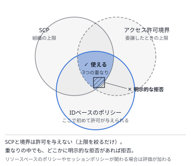

# 問題セット40 ｜ 第1分野 ポリシーの読解①（IDベースのポリシー・SCP・アクセス許可境界・12問）

> 全12問・目安20分。各問の「解答と解説」を開くと正解が表示されます。
> 本試験の問題は含みません。出題形式に沿ったオリジナル問題です。
>
> すべての問題で、ポリシーのJSONを読んで正しい内容を選びます。読み方は[第5章 5.1の「ポリシーのJSONを読む5つの手順」](../docs/05-security.md)にまとめています。
> ワイルドカード、Deny、NotAction、条件（AND・OR・IfExists）、CIDR、S3のARN、ポリシー変数、アクセス許可の境界、SCP、PassRole、タグ（ABAC）を扱います。

---

### Q1 ｜ ワイルドカードの削除の拒否 ｜ ★★

次のIAMポリシーを、運用担当者のIAMグループに付けています。ほかのポリシーは付いていません。

```json
{
  "Version": "2012-10-17",
  "Statement": [
    {
      "Effect": "Allow",
      "Action": "s3:*",
      "Resource": "*"
    },
    {
      "Effect": "Deny",
      "Action": ["s3:Delete*", "s3:PutBucketPolicy"],
      "Resource": "*"
    }
  ]
}
```

この設定内容として正しいものを選択してください。

- **A.** すべてのバケットで、オブジェクトを削除できない。
- **B.** オブジェクトの削除は拒否されるが、バケットそのものは削除できる。
- **C.** S3に対するすべての操作が許可されている。
- **D.** バケットポリシーの変更は、そのバケットを作ったユーザーに限りできる。

<details>
<summary>解答と解説</summary>

**正解：A**

**分野**：1.1 安全なアクセス

**決め手**：手順1：Denyの文から読みます。手順2：`s3:Delete*` は**名前がDeleteで始まるすべての操作**で、`DeleteObject`・`DeleteBucket`・`DeleteObjectVersion` などが含まれます。Resourceは `*` なので、どのバケットでも拒否されます。Denyは1つ目の文の許可より優先されます。

**キーワード**：ワイルドカードは操作の名前に当てはめる／Denyは許可より優先

**他の選択肢を外す理由**
- **B**：`s3:DeleteBucket` も `s3:Delete*` に当てはまるため、バケットの削除も拒否されます。
- **C**：1つ目の文で許可していても、2つ目の文のDenyに当たる操作は拒否されます。
- **D**：`s3:PutBucketPolicy` はDenyの対象で、作ったユーザーかどうかに関係なく拒否されます。

**参照**：[第5章 5.1 AWS IAM（ポリシーのJSONを読む5つの手順）](../docs/05-security.md)

</details>

---

### Q2 ｜ 名前の途中のワイルドカード ｜ ★★★

次のIAMポリシーを、開発者のIAMグループに付けています。ほかのポリシーは付いていません。

```json
{
  "Version": "2012-10-17",
  "Statement": [
    {
      "Effect": "Allow",
      "Action": "ec2:*",
      "Resource": "*"
    },
    {
      "Effect": "Deny",
      "Action": "ec2:*Snapshot*",
      "Resource": "*"
    }
  ]
}
```

この設定内容として正しいものを選択してください。

- **A.** スナップショットの作成はできないが、一覧の表示はできる。
- **B.** インスタンスの起動と終了もできない。
- **C.** EBSのスナップショットに関する操作は、一覧の表示も含めてできない。
- **D.** 自分が作ったスナップショットに限り、削除できる。

<details>
<summary>解答と解説</summary>

**正解：C**

**分野**：1.1 安全なアクセス

**決め手**：`ec2:*Snapshot*` は、**名前のどこかにSnapshotを含むすべての操作**です。`CreateSnapshot`・`DeleteSnapshot`・`CopySnapshot`・`DescribeSnapshots` などが当てはまります。Actionが決めるのは操作の種類だけで、「どのスナップショットか」はResource（ここでは `*` ＝すべて）で決まります。

**キーワード**：`*Snapshot*` ＝名前にSnapshotを含むすべての操作（Describeも含む）

**他の選択肢を外す理由**
- **A**：一覧を表示する `ec2:DescribeSnapshots` も、名前にSnapshotを含むため拒否されます。
- **B**：`RunInstances` や `TerminateInstances` は名前にSnapshotを含まないため、1つ目の文で許可されます。
- **D**：Resourceが `*` なので、誰が作ったスナップショットでも削除（`DeleteSnapshot`）は拒否されます。

**参照**：[第5章 5.1 AWS IAM（ポリシーのJSONを読む5つの手順）](../docs/05-security.md)

</details>

---

### Q3 ｜ Allow と NotAction ｜ ★★★

次のIAMポリシーを、開発者のIAMグループに付けています。

```json
{
  "Version": "2012-10-17",
  "Statement": [
    {
      "Effect": "Allow",
      "NotAction": ["iam:*", "organizations:*"],
      "Resource": "*"
    }
  ]
}
```

この設定内容として正しいものを選択してください。

- **A.** IAMとOrganizationsの操作は、明示的に拒否されている。
- **B.** IAMとOrganizations以外のすべての操作が許可されている。
- **C.** このポリシーだけが付いたユーザーは、すべての操作ができる。
- **D.** 別のポリシーでIAMの操作を許可しても、IAMの操作はできない。

<details>
<summary>解答と解説</summary>

**正解：B**

**分野**：1.1 安全なアクセス

**決め手**：`NotAction` は「**書かれた操作以外のすべて**」です。EffectがAllowなので、IAMとOrganizations以外の操作をすべて許可します。書かれた操作は「許可されていない（暗黙の拒否）」だけで、明示的なDenyとは違い、別のポリシーの許可で使えるようになります。

**キーワード**：Allow＋NotAction＝それ以外を許可（書かれた操作を拒否するのではない）

**他の選択肢を外す理由**
- **A**：Allow＋NotActionは「書かれた操作以外を許可」で、書かれた操作を明示的に拒否してはいません。許可されていないだけです。
- **C**：IAMとOrganizationsの操作は、このポリシーでは許可されていません。
- **D**：明示的なDenyではないため、別のポリシーでIAMの操作を許可すれば使えます。

**参照**：[第5章 5.1 AWS IAM（ポリシーのJSONを読む5つの手順）](../docs/05-security.md)

</details>

---

### Q4 ｜ MFAがないときの拒否 ｜ ★★★

次のIAMポリシーを、運用担当者のIAMグループに付けています。ほかのポリシーは付いていません。

```json
{
  "Version": "2012-10-17",
  "Statement": [
    {
      "Effect": "Allow",
      "Action": "ec2:*",
      "Resource": "*"
    },
    {
      "Effect": "Allow",
      "Action": [
        "iam:CreateVirtualMFADevice",
        "iam:EnableMFADevice",
        "iam:ListMFADevices",
        "sts:GetSessionToken"
      ],
      "Resource": "*"
    },
    {
      "Effect": "Deny",
      "NotAction": [
        "iam:CreateVirtualMFADevice",
        "iam:EnableMFADevice",
        "iam:ListMFADevices",
        "sts:GetSessionToken"
      ],
      "Resource": "*",
      "Condition": {
        "BoolIfExists": { "aws:MultiFactorAuthPresent": "false" }
      }
    }
  ]
}
```

この設定内容として正しいものを選択してください。

- **A.** MFAで認証していないときも、EC2の操作はできる。
- **B.** MFAで認証していれば、AWSのすべての操作ができる。
- **C.** 長期のアクセスキーで呼び出すと、条件のキーがないためEC2の操作ができる。
- **D.** MFAで認証していないときは、MFAの登録などの4つの操作だけができる。

<details>
<summary>解答と解説</summary>

**正解：D**

**分野**：1.1 安全なアクセス

**決め手**：3つ目の文は、Deny＋NotActionで「**4つの操作以外をすべて拒否**」します。条件は `BoolIfExists` で、MFAで認証していないとき（`false`）と、**キーそのものがないとき（長期のアクセスキー）**に当てはまります。MFAを登録するための4つの操作は2つ目の文で許可されているため、MFAなしでもMFAの登録だけはでき、それ以外は何もできない、定番の形です。

**キーワード**：Deny＋NotAction＋BoolIfExists（MFAなし）＝MFAを登録する操作以外を拒否

**他の選択肢を外す理由**
- **A**：MFAがないときは3つ目の文のDenyに当たり、EC2の操作も拒否されます。
- **B**：Denyは当たらなくなりますが、許可されているのはEC2の操作と、MFAの登録などの4つの操作だけです。
- **C**：`BoolIfExists` は、キーがないときは条件に当てはまるとみなします。アクセスキーでの呼び出しも拒否されます。

**参照**：[第5章 5.1 AWS IAM（ポリシーのJSONを読む5つの手順）](../docs/05-security.md)

</details>

---

### Q5 ｜ 条件のANDとOR ｜ ★★★

次のIAMポリシーを、運用担当者のIAMグループに付けています。ほかのポリシーは付いていません。

```json
{
  "Version": "2012-10-17",
  "Statement": [
    {
      "Effect": "Allow",
      "Action": ["ec2:StartInstances", "ec2:StopInstances"],
      "Resource": "*",
      "Condition": {
        "StringEquals": {
          "aws:RequestedRegion": ["ap-northeast-1", "ap-northeast-3"]
        },
        "Bool": { "aws:MultiFactorAuthPresent": "true" }
      }
    }
  ]
}
```

この設定内容として正しいものを選択してください。

- **A.** 大阪リージョンのインスタンスは、MFAで認証していれば起動できる。
- **B.** 東京リージョンのインスタンスは、MFAで認証していなくても起動できる。
- **C.** 東京と大阪の両方のリージョンを同時に指定しないと、起動できない。
- **D.** MFAで認証していれば、どのリージョンのインスタンスも起動できる。

<details>
<summary>解答と解説</summary>

**正解：A**

**分野**：1.1 安全なアクセス

**決め手**：Conditionの中の**別々の条件キーはAND**、**1つのキーに並べた値はOR**です。このポリシーは「（東京 **または** 大阪）**かつ** MFAで認証している」ときだけ、インスタンスの起動と停止を許可します。

**キーワード**：条件キーの間はAND・値の間はOR

**他の選択肢を外す理由**
- **B**：条件キーが2つあるため、リージョンとMFAの**両方**を満たす必要があります。
- **C**：1つのキーに並べた値はORです。東京か大阪のどちらかであれば満たします。
- **D**：リージョンの条件も満たす必要があり、東京と大阪以外では起動できません。

**参照**：[第5章 5.1 AWS IAM（ポリシーのJSONを読む5つの手順）](../docs/05-security.md)

</details>

---

### Q6 ｜ CIDRで送信元を絞る ｜ ★★

次のIAMポリシーを、社員のIAMグループに付けています。社員はインターネット経由でS3にアクセスします。ほかのポリシーは付いていません。

```json
{
  "Version": "2012-10-17",
  "Statement": [
    {
      "Effect": "Allow",
      "Action": "s3:GetObject",
      "Resource": "arn:aws:s3:::reports/*",
      "Condition": {
        "IpAddress": {
          "aws:SourceIp": ["192.0.2.0/24", "203.0.113.10/32"]
        }
      }
    }
  ]
}
```

この設定内容として正しいものを選択してください。

- **A.** 203.0.113.11 から、reports バケットのオブジェクトを読み取れる。
- **B.** 2つの範囲の両方に当てはまる送信元からでないと、読み取れない。
- **C.** 192.0.2.200 から、reports バケットのオブジェクトを読み取れる。
- **D.** 192.0.2.200 から、reports バケットのオブジェクトの一覧を表示できる。

<details>
<summary>解答と解説</summary>

**正解：C**

**分野**：1.1 安全なアクセス

**決め手**：`192.0.2.0/24` は先頭24ビットが同じ **192.0.2.0〜192.0.2.255** の256個のアドレス、`/32` はそのアドレス1つだけです。192.0.2.200は1つ目の範囲に入るため、オブジェクトを読み取れます。並べた2つの範囲はORで評価されます。

**キーワード**：/24＝末尾の1つの数字が0〜255／/32＝1つのアドレス／値の並びはOR

**他の選択肢を外す理由**
- **A**：`203.0.113.10/32` は203.0.113.10の1つのアドレスだけを表します。.11は含まれません。
- **B**：1つのキーに並べた値はORで、どちらかの範囲に当たれば満たします。
- **D**：許可しているのは `s3:GetObject` だけで、一覧の表示（`s3:ListBucket`）は許可されていません。

**参照**：[第5章 5.1 AWS IAM（ポリシーのJSONを読む5つの手順）](../docs/05-security.md)

</details>

---

### Q7 ｜ 一覧の表示ができない ｜ ★★★

次のIAMポリシーを、分析担当者のIAMグループに付けています。ほかのポリシーは付いていません。

```json
{
  "Version": "2012-10-17",
  "Statement": [
    {
      "Effect": "Allow",
      "Action": ["s3:ListBucket", "s3:GetObject"],
      "Resource": "arn:aws:s3:::sales-data/*"
    }
  ]
}
```

この設定内容として正しいものを選択してください。

- **A.** sales-data バケットのオブジェクトの一覧を表示できる。
- **B.** sales-data バケットのオブジェクトは、読み取りも一覧の表示もできない。
- **C.** すべてのバケットのオブジェクトを読み取れる。
- **D.** sales-data バケットのオブジェクトを読み取れるが、一覧は表示できない。

<details>
<summary>解答と解説</summary>

**正解：D**

**分野**：1.1 安全なアクセス

**決め手**：S3では、**バケット**（`arn:aws:s3:::sales-data`）と**オブジェクト**（`arn:aws:s3:::sales-data/*`）が別のリソースです。`s3:ListBucket` はバケットに、`s3:GetObject` はオブジェクトに対して評価されます。Resourceが `/*` だけなので、一覧の表示は許可されません。一覧も許可するには、Resourceにバケットのアドレスも加えます。

**キーワード**：ListBucket＝バケットのARN／GetObject・PutObject＝オブジェクトのARN（/*）

**他の選択肢を外す理由**
- **A**：`s3:ListBucket` はバケットのARN（`arn:aws:s3:::sales-data`）に対する操作で、`/*` のARNでは許可されません。
- **B**：`s3:GetObject` はオブジェクトのARN（`/*`）に対する操作なので、読み取りはできます。
- **C**：Resourceは sales-data バケットのオブジェクトだけです。

**参照**：[第5章 5.1 AWS IAM（ポリシーのJSONを読む5つの手順）](../docs/05-security.md) ／ [第2章 2.1 Amazon S3](../docs/02-storage.md)

</details>

---

### Q8 ｜ 自分のフォルダーだけを使わせる ｜ ★★★

次のIAMポリシーを、社員のIAMグループに付けています。IAMユーザー sato がこのグループに所属しています。ほかのポリシーは付いていません。

```json
{
  "Version": "2012-10-17",
  "Statement": [
    {
      "Effect": "Allow",
      "Action": "s3:ListBucket",
      "Resource": "arn:aws:s3:::home-bucket",
      "Condition": {
        "StringLike": { "s3:prefix": ["home/${aws:username}/*"] }
      }
    },
    {
      "Effect": "Allow",
      "Action": ["s3:GetObject", "s3:PutObject"],
      "Resource": "arn:aws:s3:::home-bucket/home/${aws:username}/*"
    }
  ]
}
```

この設定内容として正しいものを選択してください。

- **A.** sato は、home/tanaka/ 以下のオブジェクトを読み取れる。
- **B.** sato は、home/sato/ 以下のオブジェクトを読み書きできる。
- **C.** sato は、バケットのすべてのプレフィックスの一覧を表示できる。
- **D.** `${aws:username}` は、ポリシーを作った管理者の名前に置き換わる。

<details>
<summary>解答と解説</summary>

**正解：B**

**分野**：1.1 安全なアクセス

**決め手**：`${aws:username}` は**ポリシー変数**で、評価のときにリクエストしたIAMユーザーの名前に置き換わります。1つのポリシーで、社員ごとに自分のフォルダー（home/ユーザー名/）だけを一覧・読み書きさせられます。一覧はバケットのARNに `s3:prefix` の条件を付け、読み書きはオブジェクトのARNで絞ります。

**キーワード**：${aws:username}＝リクエストしたユーザーの名前／一覧は s3:prefix で絞る

**他の選択肢を外す理由**
- **A**：`${aws:username}` はリクエストしたユーザーの名前（sato）に置き換わるため、home/tanaka/ は対象外です。
- **C**：一覧の表示は、`s3:prefix` が home/sato/ で始まる場合に限られます。
- **D**：ポリシー変数は、**リクエストした主体**の値に置き換わります。

**参照**：[第5章 5.1 AWS IAM（ポリシーのJSONを読む5つの手順）](../docs/05-security.md)

</details>

---

### Q9 ｜ アクセス許可境界との重なり ｜ ★★★

開発者のIAMロールに、アクセス許可の境界として1つ目のポリシーを、IDベースのポリシーとして2つ目のポリシーを付けています。ほかのポリシーは付いていません。

**アクセス許可の境界**

```json
{
  "Version": "2012-10-17",
  "Statement": [
    {
      "Effect": "Allow",
      "Action": ["s3:*", "cloudwatch:*"],
      "Resource": "*"
    }
  ]
}
```

**IDベースのポリシー**

```json
{
  "Version": "2012-10-17",
  "Statement": [
    {
      "Effect": "Allow",
      "Action": ["ec2:*", "s3:GetObject"],
      "Resource": "*"
    }
  ]
}
```

この設定内容として正しいものを選択してください。

- **A.** EC2のインスタンスの起動や終了ができる。
- **B.** CloudWatchのメトリクスやアラームを操作できる。
- **C.** S3のオブジェクトを読み取れるが、書き込みはできない。
- **D.** S3のオブジェクトの書き込みや削除も含め、すべての操作ができる。

<details>
<summary>解答と解説</summary>

**正解：C**

**分野**：1.1 安全なアクセス

**決め手**：実際に使えるのは、**アクセス許可の境界とIDベースのポリシーの両方が許可する操作**だけです。両方に含まれるのは `s3:GetObject` だけなので、オブジェクトの読み取りだけができます。

**キーワード**：使える権限＝境界 ∩ IDベースのポリシー（境界は許可を与えない）



**他の選択肢を外す理由**
- **A**：IDベースのポリシーで許可していても、アクセス許可の境界に含まれないため使えません。
- **B**：境界は上限を決めるだけで、許可を与えません。IDベースのポリシーで許可されていません。
- **D**：IDベースのポリシーで許可しているのは `s3:GetObject` だけです。

**参照**：[第5章 5.1 AWS IAM（ポリシーのJSONを読む5つの手順）](../docs/05-security.md)

</details>

---

### Q10 ｜ 許可リスト型のSCP ｜ ★★★

AWS Organizationsで、開発用のOUに付いていたFullAWSAccessのSCPを外し、次のSCPだけを付けました。ルートとアカウントにはFullAWSAccessが付いています。OUのメンバーアカウントのIAMユーザーには、AdministratorAccessを付けています。

```json
{
  "Version": "2012-10-17",
  "Statement": [
    {
      "Effect": "Allow",
      "Action": ["ec2:*", "s3:*", "cloudwatch:*"],
      "Resource": "*"
    }
  ]
}
```

この設定内容として正しいものを選択してください。

- **A.** メンバーアカウントのIAMユーザーは、EC2・S3・CloudWatchの操作だけができる。
- **B.** メンバーアカウントのルートユーザーは、すべての操作ができる。
- **C.** IAMポリシーが付いていないユーザーも、SCPの許可でEC2の操作ができる。
- **D.** 管理アカウントのIAMユーザーも、EC2・S3・CloudWatchの操作だけに制限される。

<details>
<summary>解答と解説</summary>

**正解：A**

**分野**：1.1 安全なアクセス

**決め手**：SCPは、ルート・OU・アカウントの**すべての階層で許可されている操作**だけを使わせます。OUではEC2・S3・CloudWatchだけを許可しているため、AdministratorAccessを持つユーザーでも、使えるのはこの3つの操作だけです。SCPはメンバーアカウントのルートユーザーにも適用され、管理アカウントには適用されません。

**キーワード**：SCP＝上限（すべての階層で許可された操作だけ）・許可は与えない


**他の選択肢を外す理由**
- **B**：SCPは、メンバーアカウントのルートユーザーにも適用されます。
- **C**：SCPは上限を決めるだけで、許可を与えません。IAMポリシーの許可が必要です。
- **D**：SCPは管理アカウントには適用されません。

**参照**：[第5章 5.1 AWS IAM（ポリシーのJSONを読む5つの手順）](../docs/05-security.md) ／ [第8章 8.5 AWS Organizations](../docs/08-management.md)

</details>

---

### Q11 ｜ 渡せるロールを1つに絞る ｜ ★★

次のIAMポリシーを、開発者のIAMグループに付けています。ほかのポリシーは付いていません。

```json
{
  "Version": "2012-10-17",
  "Statement": [
    {
      "Effect": "Allow",
      "Action": "ec2:RunInstances",
      "Resource": "*"
    },
    {
      "Effect": "Allow",
      "Action": "iam:PassRole",
      "Resource": "arn:aws:iam::111122223333:role/app-ec2-role"
    }
  ]
}
```

この設定内容として正しいものを選択してください。

- **A.** admin-role を付けて、EC2のインスタンスを起動できる。
- **B.** ロールを付けずに、EC2のインスタンスを起動することはできない。
- **C.** app-ec2-role に付いているポリシーを変更できる。
- **D.** app-ec2-role を付けて、EC2のインスタンスを起動できる。

<details>
<summary>解答と解説</summary>

**正解：D**

**分野**：1.1 安全なアクセス

**決め手**：インスタンスにロールを付けて起動するには、`ec2:RunInstances` に加えて、そのロールを**サービスに渡す `iam:PassRole`** の許可が必要です。Resourceで渡せるロールを絞っているため、開発者は強い権限のロールを付けたインスタンスを作れません。

**キーワード**：iam:PassRole のResource＝渡せるロール

**他の選択肢を外す理由**
- **A**：`iam:PassRole` を許可しているのは app-ec2-role だけです。ほかのロールは渡せません。
- **B**：ロールを付けない起動には `iam:PassRole` は不要で、`ec2:RunInstances` の許可だけで起動できます。
- **C**：`iam:PassRole` はロールをサービスに渡す権限で、ロールの権限を変更する権限ではありません。

**参照**：[第5章 5.1 AWS IAM（ポリシーのJSONを読む5つの手順）](../docs/05-security.md)

</details>

---

### Q12 ｜ タグで操作できるインスタンスを分ける ｜ ★★★

次のIAMポリシーを、開発者のIAMロールに付けています。ロールには `Project=alpha` のタグが付いています。ほかのポリシーは付いていません。（2つ選択）

```json
{
  "Version": "2012-10-17",
  "Statement": [
    {
      "Effect": "Allow",
      "Action": ["ec2:StartInstances", "ec2:StopInstances"],
      "Resource": "*",
      "Condition": {
        "StringEquals": {
          "ec2:ResourceTag/Project": "${aws:PrincipalTag/Project}"
        }
      }
    },
    {
      "Effect": "Allow",
      "Action": "ec2:DescribeInstances",
      "Resource": "*"
    }
  ]
}
```

この設定内容として正しいものを2つ選択してください。

- **A.** `Project=beta` のタグが付いたインスタンスを停止できる。
- **B.** `Project=alpha` のタグが付いたインスタンスを停止できる。
- **C.** Projectのタグが付いていないインスタンスを起動できる。
- **D.** `Project=alpha` のタグが付いたインスタンスを終了できる。
- **E.** すべてのインスタンスの一覧を表示できる。

<details>
<summary>解答と解説</summary>

**正解：B・E**

**分野**：1.1 安全なアクセス

**決め手**：`${aws:PrincipalTag/Project}` は**ロールのタグの値（alpha）**に置き換わり、インスタンスのタグ `ec2:ResourceTag/Project` と一致するときだけ起動と停止を許可します（ABAC）。一覧の表示は2つ目の文で、条件なしに許可されています。

**キーワード**：ABAC＝リソースのタグと主体のタグが一致するときだけ許可

**他の選択肢を外す理由**
- **A**：インスタンスのタグ（beta）が、ロールのタグ（alpha）と一致しません。
- **C**：タグがないインスタンスは条件を満たさないため、起動も停止もできません。
- **D**：許可しているのは起動と停止だけで、終了（`TerminateInstances`）は許可されていません。

**参照**：[第5章 5.1 AWS IAM（ポリシーのJSONを読む5つの手順）](../docs/05-security.md)

</details>
