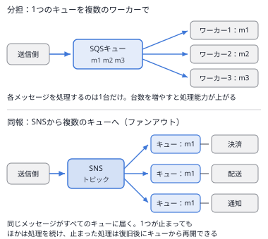

# 問題セット41 ｜ 第1分野 ポリシーの読解②（バケットポリシー・キーポリシー・信頼ポリシー・12問）

> 全12問・目安20分。各問の「解答と解説」を開くと正解が表示されます。
> 本試験の問題は含みません。出題形式に沿ったオリジナル問題です。
>
> すべての問題で、リソースに付けるポリシー（S3のバケットポリシー、KMSのキーポリシー、IAMロールの信頼ポリシー、SQSのアクセスポリシー、Lambdaのリソースベースのポリシー）を読んで正しい内容を選びます。
> Principal、同じアカウントと別のアカウントの評価の違い、ブロックパブリックアクセス、否定の演算子、VPCエンドポイント、組織のID、`kms:ViaService`、外部ID、`aws:SourceArn` を扱います。読み方は[第5章 5.1の「ポリシーのJSONを読む5つの手順」](../docs/05-security.md)にまとめています。

---

### Q1 ｜ 公開のバケットポリシーとブロックパブリックアクセス ｜ ★★★

Webサイトの画像を置くバケット site-assets に、次のバケットポリシーを付けました。その後、このバケットのブロックパブリックアクセスの4つの設定をすべて有効にしました。

```json
{
  "Version": "2012-10-17",
  "Statement": [
    {
      "Effect": "Allow",
      "Principal": "*",
      "Action": "s3:GetObject",
      "Resource": "arn:aws:s3:::site-assets/*"
    }
  ]
}
```

この設定内容として正しいものを選択してください。

- **A.** インターネットの誰でも、オブジェクトを読み取れる。
- **B.** 匿名のアクセスは拒否され、同じアカウントの許可された利用者は読み取れる。
- **C.** ブロックパブリックアクセスを有効にすると、バケットポリシーは自動で削除される。
- **D.** 同じアカウントの利用者も含めて、誰もオブジェクトを読み取れない。

<details>
<summary>解答と解説</summary>

**正解：B**

**分野**：1.3 データセキュリティ管理

**決め手**：`"Principal": "*"` は**誰でも（匿名を含む）**という意味で、このポリシーは公開のポリシーです。ブロックパブリックアクセスの **RestrictPublicBuckets** が有効だと、公開のポリシーを持つバケットへのアクセスは、AWSのサービスと**同じアカウントの許可された利用者**だけに制限されます。ポリシーそのものは削除されません。

**キーワード**：Principal "*"＝公開／ブロックパブリックアクセスはポリシーより優先して公開を止める

**他の選択肢を外す理由**
- **A**：ブロックパブリックアクセスの「公開のバケットポリシーによるアクセスを制限する」設定が、公開のポリシーによるアクセスを止めます。
- **C**：ポリシーは残ったままで、公開のポリシーによるアクセスが制限されるだけです。
- **D**：制限されるのは公開のアクセスと別のアカウントからのアクセスで、同じアカウントの許可された利用者やAWSのサービスは使えます。

**参照**：[第2章 2.1 Amazon S3](../docs/02-storage.md) ／ [第5章 5.1 AWS IAM（ポリシーのJSONを読む5つの手順）](../docs/05-security.md)

</details>

---

### Q2 ｜ 暗号化の方式を指定しないアップロード ｜ ★★★

バケット records の既定の暗号化はSSE-KMSにしています。さらに、次のバケットポリシーを付けました。アプリケーションのIAMロールには、このバケットへの `s3:PutObject` と `s3:GetObject` を許可しています。

```json
{
  "Version": "2012-10-17",
  "Statement": [
    {
      "Effect": "Deny",
      "Principal": "*",
      "Action": "s3:PutObject",
      "Resource": "arn:aws:s3:::records/*",
      "Condition": {
        "StringNotEquals": { "s3:x-amz-server-side-encryption": "aws:kms" }
      }
    }
  ]
}
```

この設定内容として正しいものを選択してください。

- **A.** 暗号化の方式を指定しないアップロードは、既定の暗号化が使われて成功する。
- **B.** 暗号化の方式に AES256 を指定したアップロードは成功する。
- **C.** オブジェクトの読み取りも、暗号化の方式を指定しないと拒否される。
- **D.** 暗号化の方式に aws:kms を指定したアップロードだけが成功する。

<details>
<summary>解答と解説</summary>

**正解：D**

**分野**：1.3 データセキュリティ管理

**決め手**：Denyの条件は「アップロードで指定した暗号化の方式が aws:kms **ではない**」です。`StringNotEquals` のような**否定の演算子は、リクエストにそのキー（ヘッダー）がないときも当てはまる**ため、方式を指定しないアップロードは、バケットの既定の暗号化がSSE-KMSでも拒否されます。

**キーワード**：否定の演算子はキーがないときも当てはまる／Denyの対象のActionを確かめる

**他の選択肢を外す理由**
- **A**：リクエストに暗号化のヘッダーがないと、否定の演算子 `StringNotEquals` は当てはまり、Denyで拒否されます。
- **B**：値が aws:kms と違うため、Denyで拒否されます。
- **C**：Denyの対象は `s3:PutObject` だけで、読み取りには影響しません。

**参照**：[第5章 5.1 AWS IAM（ポリシーのJSONを読む5つの手順）](../docs/05-security.md) ／ [第11章 11.2 データ保護](../docs/11-secure.md)

</details>

---

### Q3 ｜ VPCエンドポイント以外からの拒否 ｜ ★★

バケット internal-docs に、次のバケットポリシーを付けました。ほかのバケットポリシーの文はありません。

```json
{
  "Version": "2012-10-17",
  "Statement": [
    {
      "Effect": "Deny",
      "Principal": "*",
      "Action": "s3:*",
      "Resource": [
        "arn:aws:s3:::internal-docs",
        "arn:aws:s3:::internal-docs/*"
      ],
      "Condition": {
        "StringNotEquals": { "aws:SourceVpce": "vpce-0a1b2c3d" }
      }
    }
  ]
}
```

この設定内容として正しいものを選択してください。

- **A.** vpce-0a1b2c3d を通るリクエストは、IAMポリシーで許可されていれば成功する。
- **B.** vpce-0a1b2c3d を通るリクエストは、IAMポリシーで許可されていなくても成功する。
- **C.** 管理者は、マネジメントコンソールからオブジェクトを読み取れる。
- **D.** 同じVPCの別のエンドポイントを通るリクエストも成功する。

<details>
<summary>解答と解説</summary>

**正解：A**

**分野**：1.2 安全なワークロードとアプリケーション

**決め手**：このポリシーは「vpce-0a1b2c3d を通らないリクエストをすべて拒否」するだけで、**何も許可していません**。エンドポイントを通るリクエストはDenyに当たらず、IAMポリシーの許可があれば成功します。ほかの経路（コンソールやインターネット）からは、管理者でも拒否されます。

**キーワード**：Denyだけのポリシーは許可を与えない／aws:SourceVpce＝通ったエンドポイント


**他の選択肢を外す理由**
- **B**：このバケットポリシーにはAllowがありません。IAMポリシーなどでの許可が必要です。
- **C**：コンソールからのリクエストはこのエンドポイントを通らないため、Denyで拒否されます。
- **D**：条件はエンドポイントのID単位で、ほかのエンドポイントを通るリクエストは拒否されます。

**参照**：[第5章 5.1 AWS IAM（ポリシーのJSONを読む5つの手順）](../docs/05-security.md) ／ [第11章 11.5 設計ケーススタディ](../docs/11-secure.md)

</details>

---

### Q4 ｜ 組織内のアカウントに読ませる ｜ ★★

アカウントA（111122223333）のバケット shared-data に、次のバケットポリシーを付けました。o-abc123 は、アカウントAが属する組織のIDです。

```json
{
  "Version": "2012-10-17",
  "Statement": [
    {
      "Effect": "Allow",
      "Principal": "*",
      "Action": "s3:GetObject",
      "Resource": "arn:aws:s3:::shared-data/*",
      "Condition": {
        "StringEquals": { "aws:PrincipalOrgID": "o-abc123" }
      }
    }
  ]
}
```

この設定内容として正しいものを選択してください。

- **A.** 組織内の別のアカウントのロールは、自分のアカウントでIAMポリシーを付けていなくても読み取れる。
- **B.** 組織外のアカウントのロールも、自分のアカウントのIAMポリシーで許可すれば読み取れる。
- **C.** 組織内の別のアカウントのロールは、自分のアカウントのIAMポリシーでも許可されていれば読み取れる。
- **D.** 匿名のユーザーも、組織のネットワークから接続すれば読み取れる。

<details>
<summary>解答と解説</summary>

**正解：C**

**分野**：1.1 安全なアクセス

**決め手**：`Principal: "*"` に `aws:PrincipalOrgID` の条件を付けると、「**組織 o-abc123 に属する主体**」だけを許可するポリシーになります。今後追加されるアカウントも自動で対象になります。ただし**別のアカウントからのアクセス**なので、呼び出す側のアカウントのIAMポリシーでも許可されている必要があります。

**キーワード**：aws:PrincipalOrgID＝組織内の主体だけ／別のアカウントからは両方の許可が必要

**他の選択肢を外す理由**
- **A**：別のアカウントからのアクセスには、バケットポリシーと、呼び出す側のIAMポリシーの両方の許可が必要です。
- **B**：組織外の主体は `aws:PrincipalOrgID` が一致しないため、バケットポリシーで許可されません。
- **D**：匿名のリクエストには組織のIDがなく、条件を満たしません。ネットワークの場所も関係ありません。

**参照**：[第5章 5.1 AWS IAM（ポリシーのJSONを読む5つの手順）](../docs/05-security.md)

</details>

---

### Q5 ｜ アカウントを指定したバケットポリシー ｜ ★★★

アカウントA（111122223333）のバケット partner-reports に、次のバケットポリシーを付けました。222233334444 は取引先のアカウントBです。

```json
{
  "Version": "2012-10-17",
  "Statement": [
    {
      "Effect": "Allow",
      "Principal": { "AWS": "arn:aws:iam::222233334444:root" },
      "Action": "s3:GetObject",
      "Resource": "arn:aws:s3:::partner-reports/*"
    }
  ]
}
```

この設定内容として正しいものを選択してください。

- **A.** アカウントBのルートユーザーだけが、オブジェクトを読み取れる。
- **B.** アカウントBの主体は、アカウントBのIAMポリシーでも許可されていれば読み取れる。
- **C.** アカウントBのすべてのIAMユーザーとロールが、IAMポリシーなしで読み取れる。
- **D.** アカウントBの利用者は、オブジェクトを書き込むこともできる。

<details>
<summary>解答と解説</summary>

**正解：B**

**分野**：1.1 安全なアクセス

**決め手**：Principalの `arn:aws:iam::222233334444:root` は、**アカウントB全体**に権限を渡すという意味です。アカウントBの中で誰に使わせるかは、アカウントBの管理者がIAMポリシーで決めます。別のアカウントからのアクセスなので、バケットポリシーとアカウントBのIAMポリシーの**両方の許可**がそろって初めて読み取れます。

**キーワード**：:root のPrincipal＝アカウント全体／別のアカウントからは両方の許可が必要

**他の選択肢を外す理由**
- **A**：`arn:aws:iam::アカウントID:root` は**アカウント全体**を表し、ルートユーザーだけを指すものではありません。
- **C**：別のアカウントからのアクセスには、アカウントBの管理者がIAMポリシーで許可を委ねる必要があります。
- **D**：許可しているのは `s3:GetObject` だけです。

**参照**：[第5章 5.1 AWS IAM（ポリシーのJSONを読む5つの手順）](../docs/05-security.md)

</details>

---

### Q6 ｜ IDベースのDenyとバケットポリシーのAllow ｜ ★★★

同じアカウント（111122223333）の中で、バケット project-files に1つ目のバケットポリシーを付け、IAMユーザー dev に2つ目のIAMポリシーだけを付けています。

**バケットポリシー（project-files）**

```json
{
  "Version": "2012-10-17",
  "Statement": [
    {
      "Effect": "Allow",
      "Principal": { "AWS": "arn:aws:iam::111122223333:user/dev" },
      "Action": "s3:*",
      "Resource": [
        "arn:aws:s3:::project-files",
        "arn:aws:s3:::project-files/*"
      ]
    }
  ]
}
```

**IAMユーザー dev のポリシー**

```json
{
  "Version": "2012-10-17",
  "Statement": [
    {
      "Effect": "Deny",
      "Action": "s3:DeleteObject",
      "Resource": "*"
    }
  ]
}
```

この設定内容として正しいものを選択してください。

- **A.** dev は、project-files のオブジェクトを読み取れる。
- **B.** dev は、project-files のオブジェクトを削除できる。
- **C.** dev はIAMポリシーにAllowがないため、project-files に対して何もできない。
- **D.** バケットポリシーのAllowが優先されるため、削除を含むすべての操作ができる。

<details>
<summary>解答と解説</summary>

**正解：A**

**分野**：1.1 安全なアクセス

**決め手**：同じアカウントの中では、**IDベースのポリシーとバケットポリシーのどちらかで許可されていれば**操作できます。dev はバケットポリシーで `s3:*` を許可されているため、読み取りなどはできます。ただし削除は、IAMポリシーの**明示的なDeny**が優先されて拒否されます。

**キーワード**：同じアカウント＝どちらかの許可で足りる／明示的なDenyはどこにあっても優先

**他の選択肢を外す理由**
- **B**：IAMポリシーの明示的なDenyが、バケットポリシーの許可より優先されます。
- **C**：同じアカウントの中では、バケットポリシーの許可だけで操作できます。
- **D**：どのポリシーのAllowよりも、明示的なDenyが優先されます。

**参照**：[第5章 5.1 AWS IAM（ポリシーのJSONを読む5つの手順）](../docs/05-security.md)

</details>

---

### Q7 ｜ キーポリシーのアカウントの文 ｜ ★★★

アカウント111122223333のKMSのカスタマー管理キーに、次のキーポリシーを付けています。

```json
{
  "Version": "2012-10-17",
  "Statement": [
    {
      "Sid": "EnableIAMPolicies",
      "Effect": "Allow",
      "Principal": { "AWS": "arn:aws:iam::111122223333:root" },
      "Action": "kms:*",
      "Resource": "*"
    },
    {
      "Sid": "AllowAppUse",
      "Effect": "Allow",
      "Principal": { "AWS": "arn:aws:iam::111122223333:role/app" },
      "Action": ["kms:Decrypt", "kms:GenerateDataKey"],
      "Resource": "*"
    }
  ]
}
```

この設定内容として正しいものを選択してください。

- **A.** このアカウントのルートユーザーだけが、キーを管理できる。
- **B.** role/app は、IAMポリシーがなくても `kms:Encrypt` を使える。
- **C.** 別のアカウントのロールも、自分のアカウントのIAMポリシーで許可すればキーを使える。
- **D.** このアカウントのIAMユーザーやロールは、IAMポリシーで許可されればキーを使える。

<details>
<summary>解答と解説</summary>

**正解：D**

**分野**：1.3 データセキュリティ管理

**決め手**：KMSでは**キーポリシーが権限の起点**です。1つ目の文（アカウント `:root` に `kms:*`）があることで、このアカウントの中では**IAMポリシーでもキーの権限を与えられる**ようになります。2つ目の文は、role/app にIAMポリシーなしで復号とデータキーの生成を許可しています。

**キーワード**：キーポリシーのアカウント（:root）の文＝IAMポリシーを有効にする


**他の選択肢を外す理由**
- **A**：`:root` は**アカウント全体**を表し、IAMポリシーでキーの権限を与えられるようにする文です。
- **B**：キーポリシーで role/app に許可しているのは `kms:Decrypt` と `kms:GenerateDataKey` だけです。
- **C**：キーポリシーで別のアカウントを許可していないため、使えません。

**参照**：[第5章 5.1 AWS IAM（ポリシーのJSONを読む5つの手順）](../docs/05-security.md) ／ [第5章 5.8 AWS KMS](../docs/05-security.md)

</details>

---

### Q8 ｜ S3経由だけで復号させる ｜ ★★★

KMSのキーポリシーに、次の文を加えました。role/app には、KMSに関するIAMポリシーは付いていません。S3に関する権限は付いています。

```json
{
  "Effect": "Allow",
  "Principal": { "AWS": "arn:aws:iam::111122223333:role/app" },
  "Action": "kms:Decrypt",
  "Resource": "*",
  "Condition": {
    "StringEquals": { "kms:ViaService": "s3.ap-northeast-1.amazonaws.com" }
  }
}
```

この設定内容として正しいものを選択してください。

- **A.** role/app は、KMSのDecryptのAPIを直接呼び出して、手元のデータを復号できる。
- **B.** role/app は、大阪リージョンのS3からオブジェクトを読み取るときにも復号できる。
- **C.** role/app は、東京リージョンのS3からSSE-KMSのオブジェクトを読むときに復号できる。
- **D.** role/app は、DynamoDBのテーブルの暗号化を経由しても復号できる。

<details>
<summary>解答と解説</summary>

**正解：C**

**分野**：1.3 データセキュリティ管理

**決め手**：`kms:ViaService` は、**キーを使う要求をKMSへ送ったAWSのサービス**を表す条件キーです。値が東京リージョンのS3なので、role/app はS3のSSE-KMSのオブジェクトを読み取るときだけキーで復号でき、KMSのAPIを直接呼んで復号することはできません。

**キーワード**：kms:ViaService＝どのサービス経由ならキーを使えるか

**他の選択肢を外す理由**
- **A**：直接の呼び出しは、S3を経由していないため条件を満たしません。
- **B**：条件の値は東京リージョンのS3（s3.ap-northeast-1）だけです。
- **D**：`kms:ViaService` がS3以外のサービスになるため、条件を満たしません。

**参照**：[第5章 5.1 AWS IAM（ポリシーのJSONを読む5つの手順）](../docs/05-security.md) ／ [第5章 5.8 AWS KMS](../docs/05-security.md)

</details>

---

### Q9 ｜ EC2が引き受けるロールの信頼ポリシー ｜ ★★

IAMロール app-ec2-role に、次の信頼ポリシーを付けています。アクセス許可のポリシーとして、S3の読み取りを許可するポリシーも付けています。

```json
{
  "Version": "2012-10-17",
  "Statement": [
    {
      "Effect": "Allow",
      "Principal": { "Service": "ec2.amazonaws.com" },
      "Action": "sts:AssumeRole"
    }
  ]
}
```

この設定内容として正しいものを選択してください。

- **A.** このロールは、Lambda関数の実行ロールとしても使える。
- **B.** このロールは、インスタンスプロファイルを通してEC2のインスタンスで使える。
- **C.** このポリシーによって、ロールでS3の読み取りができるようになる。
- **D.** このアカウントのIAMユーザーは、誰でもこのロールを引き受けられる。

<details>
<summary>解答と解説</summary>

**正解：B**

**分野**：1.1 安全なアクセス

**決め手**：信頼ポリシーは、**ロールを引き受けられる主体**を決めます。Principalが `ec2.amazonaws.com` なので、EC2のサービスがロールを引き受け、インスタンスのアプリケーションに一時的な認証情報を渡せます。ロールで**何ができるか**は、別に付けたアクセス許可のポリシーで決まります。

**キーワード**：信頼ポリシー＝誰が引き受けられるか／アクセス許可のポリシー＝何ができるか

**他の選択肢を外す理由**
- **A**：信頼しているのはEC2のサービスだけです。Lambdaで使うには `lambda.amazonaws.com` を信頼する必要があります。
- **C**：信頼ポリシーは**誰がロールを引き受けられるか**を決めるもので、できる操作はアクセス許可のポリシーで決まります。
- **D**：Principalにはユーザーやアカウントが含まれていないため、IAMユーザーは引き受けられません。

**参照**：[第5章 5.1 AWS IAM（ポリシーのJSONを読む5つの手順）](../docs/05-security.md)

</details>

---

### Q10 ｜ 外部IDを条件にした信頼ポリシー ｜ ★★

監視サービスの会社（アカウント999988887777）に使わせるIAMロールに、次の信頼ポリシーを付けています。

```json
{
  "Version": "2012-10-17",
  "Statement": [
    {
      "Effect": "Allow",
      "Principal": { "AWS": "arn:aws:iam::999988887777:root" },
      "Action": "sts:AssumeRole",
      "Condition": {
        "StringEquals": { "sts:ExternalId": "Partner-7f3a" }
      }
    }
  ]
}
```

この設定内容として正しいものを選択してください。

- **A.** 999988887777の主体は、外部IDを指定しなくても、IAMポリシーで許可されていれば引き受けられる。
- **B.** 外部IDを知っていれば、どのアカウントの主体でも引き受けられる。
- **C.** 外部IDは、ロールで操作できるリソースを Partner-7f3a に絞る。
- **D.** 999988887777の主体は、IAMポリシーで許可され、外部IDが一致すれば引き受けられる。

<details>
<summary>解答と解説</summary>

**正解：D**

**分野**：1.1 安全なアクセス

**決め手**：Principalで監視会社の**アカウント全体**を信頼し、`sts:ExternalId` が一致するときだけ引き受けを許可しています。監視会社の側では、IAMポリシーで `sts:AssumeRole` を許可された主体が、外部IDを付けて引き受けます。外部IDは、別の顧客になりすまして使われること（混乱した代理問題）を防ぎます。

**キーワード**：sts:ExternalId＝第三者に引き受けさせるときのなりすまし対策

**他の選択肢を外す理由**
- **A**：条件で外部IDの一致を求めているため、指定しないと引き受けられません。
- **B**：Principalで信頼しているのは999988887777のアカウントだけです。
- **C**：外部IDは引き受けるときの確認に使う値で、操作できるリソースとは関係ありません。

**参照**：[第5章 5.1 AWS IAM（ポリシーのJSONを読む5つの手順）](../docs/05-security.md)

</details>

---

### Q11 ｜ SNSからだけ受け付けるキュー ｜ ★★

SQSのキュー order-queue に、次のアクセスポリシーを付けています。

```json
{
  "Version": "2012-10-17",
  "Statement": [
    {
      "Effect": "Allow",
      "Principal": { "Service": "sns.amazonaws.com" },
      "Action": "sqs:SendMessage",
      "Resource": "arn:aws:sqs:ap-northeast-1:111122223333:order-queue",
      "Condition": {
        "ArnEquals": {
          "aws:SourceArn": "arn:aws:sns:ap-northeast-1:111122223333:orders"
        }
      }
    }
  ]
}
```

この設定内容として正しいものを選択してください。

- **A.** orders トピックに発行したメッセージだけを、SNSがキューへ送れる。
- **B.** アカウントのどのSNSトピックからでも、キューへ送れる。
- **C.** orders トピックは、キューからメッセージを受信して削除できる。
- **D.** アカウントのIAMユーザーは、このポリシーだけでキューへ送れる。

<details>
<summary>解答と解説</summary>

**正解：A**

**分野**：1.2 安全なワークロードとアプリケーション

**決め手**：Principalが `sns.amazonaws.com`、条件の `aws:SourceArn` が orders トピックのARNなので、「**orders トピックのためにSNSが送るメッセージ**」だけを受け付けます。`aws:SourceArn` を付けないと、同じSNSのサービスを通じて、ほかのトピックからも送れてしまいます。

**キーワード**：サービスのPrincipal＋aws:SourceArn＝どのリソースのための呼び出しかを絞る



**他の選択肢を外す理由**
- **B**：`aws:SourceArn` を orders トピックに限っているため、ほかのトピックからは送れません。
- **C**：許可しているのは `sqs:SendMessage` だけです。
- **D**：Principalは SNS のサービスで、IAMユーザーは含まれていません。

**参照**：[第5章 5.1 AWS IAM（ポリシーのJSONを読む5つの手順）](../docs/05-security.md) ／ [第6章 6.2 Amazon SNS](../docs/06-integration.md)

</details>

---

### Q12 ｜ S3から呼ばれる関数のリソースベースのポリシー ｜ ★★★

Lambda関数 thumbnail に、次のリソースベースのポリシーを付けています。（2つ選択）

```json
{
  "Version": "2012-10-17",
  "Statement": [
    {
      "Effect": "Allow",
      "Principal": { "Service": "s3.amazonaws.com" },
      "Action": "lambda:InvokeFunction",
      "Resource": "arn:aws:lambda:ap-northeast-1:111122223333:function:thumbnail",
      "Condition": {
        "StringEquals": { "AWS:SourceAccount": "111122223333" },
        "ArnLike": { "AWS:SourceArn": "arn:aws:s3:::uploads" }
      }
    }
  ]
}
```

この設定内容として正しいものを2つ選択してください。

- **A.** このアカウントのどのバケットのイベント通知からでも、関数を呼び出せる。
- **B.** このポリシーにより、関数はS3のオブジェクトを読み取れる。
- **C.** uploads バケットのイベント通知から、関数を呼び出せる。
- **D.** このアカウントのIAMユーザーは、このポリシーで関数を呼び出せる。
- **E.** 別のアカウントが持つ uploads という名前のバケットからは、関数を呼び出せない。

<details>
<summary>解答と解説</summary>

**正解：C・E**

**分野**：1.2 安全なワークロードとアプリケーション

**決め手**：関数のリソースベースのポリシーは、**誰がこの関数を呼び出せるか**を決めます。S3のサービスに、uploads バケット（`AWS:SourceArn`）かつこのアカウント（`AWS:SourceAccount`）からの呼び出しだけを許可しています。バケットの名前は削除後に別のアカウントが使えることがあるため、`SourceAccount` も付けて、別のアカウントの同じ名前のバケットからの呼び出しを防ぎます。

**キーワード**：リソースベースのポリシー＝呼び出せる相手／実行ロール＝関数ができること

**他の選択肢を外す理由**
- **A**：`AWS:SourceArn` を uploads バケットに限っています。
- **B**：関数がS3を読み取れるかは、関数の**実行ロール**で決まります。このポリシーは、関数を**呼び出せる相手**を決めるものです。
- **D**：Principalは S3 のサービスで、IAMユーザーは含まれていません。

**参照**：[第5章 5.1 AWS IAM（ポリシーのJSONを読む5つの手順）](../docs/05-security.md) ／ [第1章 1.6 AWS Lambda](../docs/01-compute.md)

</details>
